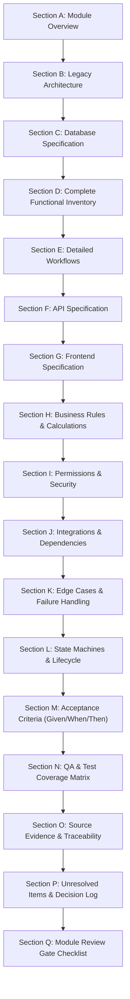

# DEZOLVER — FUNCTIONAL SPECIFICATION AUTHORING STANDARD

**Standard Identifier:** `DEZ-STD-FS-001`  
**Version:** `1.0.0`  
**Status:** `ACTIVE / MANDATORY`  
**Effective Date:** November 2026  
**Scope:** Universal across all 18 Modules of the Dezolver Platform Reconstruction  
**Audience:** Principal Architects, Backend Engineers, Frontend Engineers, Database Engineers, QA Architects, Security Officers  

---

## 1. PURPOSE & PRINCIPLES

### 1.1 Purpose
This standard governs the authoring, forensic verification, and maintenance of all Functional Specifications for the Dezolver platform. Its purpose is to establish an unyielding, function-level, source-grounded specification format so that any developer, architect, or auditor who has never seen the legacy codebase can understand its exact runtime behavior, database mutations, mathematical formulas, network protocols, API contracts, user interfaces, failure modes, and security controls.

### 1.2 Core Principles

1. **Source Code is the Exclusive Authority:**  
   Every factual assertion in a specification must be extracted directly from verified application source code (`src/`), database schemas (`prisma/`), client applications (`frontend/src/`), worker consumers, or configuration files. Conceptual architecture documents, legacy readmes, pitch decks, and previous AI-generated audits must never be cited as proof of implemented functionality.
2. **Complete Execution Path Tracing:**  
   No feature or function may be documented in isolation. Every functional item must trace the complete end-to-end execution path:  
   $$\text{User Action} \longrightarrow \text{UI Event} \longrightarrow \text{API Client} \longrightarrow \text{HTTP Route/Controller} \longrightarrow \text{Guards/Middleware} \longrightarrow \text{Service Logic} \longrightarrow \text{DB Read/Write} \longrightarrow \text{External Systems} \longrightarrow \text{HTTP Response} \longrightarrow \text{Frontend State/UI Mutation}$$
3. **Strict Function-Level Granularity:**  
   High-level summaries and hand-waving descriptions are strictly prohibited. Specifications must break modules down to individual functions, methods, API endpoints, database fields, and UI components.
4. **Zero Tolerance for Invention:**  
   Never invent formulas, scoring algorithms, validation rules, default values, or business logic. If a mechanism is missing or incomplete in code, document it precisely as missing or incomplete.
5. **Rigorous Classification of Truth:**  
   Legacy implementation facts, target requirements, product decisions, and technical recommendations must never be conflated. Every item must carry a strict status classification.

---

## 2. STATUS CLASSIFICATION TAXONOMY

Every entity, function, API endpoint, workflow, business rule, and UI view documented within a module must be tagged with exactly one of the eight standardized status classifications defined below:

| Status Label | Badge Markdown | Definition & Application Rule | Evidence Requirement |
|---|---|---|---|
| **CONFIRMED LEGACY IMPLEMENTATION** | `` | The functionality is completely implemented, wired end-to-end, and actively executable in the legacy source code. | Exact file paths, class/method names, and line number ranges for both backend and frontend. |
| **PARTIALLY IMPLEMENTED** | `` | Code exists in some layers (e.g., database schema exists and API controller exists, but service returns mock data, or backend exists but frontend has no UI connection). | Precise gap identification detailing which layers exist and which are stubbed, commented out, or missing. |
| **NOT IMPLEMENTED** | `` | Functionality described in business flows or conceptual docs has 0 code footprints (no database tables, no backend routes, no frontend components). | Exhaustive negative proof: grep/AST audit results showing 0 occurrences across backend and frontend. |
| **UNVERIFIABLE** | `` | The feature relies on external third-party infrastructure, proprietary binaries, or unseeded runtime environments that cannot be verified statically. | Detailed explanation of external dependency blocks and exact boundaries of static verification. |
| **CONFLICTING IMPLEMENTATION** | `` | Two or more parts of the codebase implement incompatible behaviors (e.g., frontend expects PascalCase JSON but backend emits camelCase; or Prisma model defines nullable while controller enforces non-null). | Side-by-side code citations detailing the incompatible components and their runtime impacts. |
| **TARGET REQUIREMENT — APPROVED** | `` | A required feature that was missing or broken in legacy code, but has been officially approved by product leadership for inclusion in the target architecture. | Reference to formal product approval, user story ID, or approved specification decision log entry. |
| **PRODUCT DECISION — OPEN** | `` | An ambiguous business workflow, missing edge-case rule, or unresolved policy question requiring explicit resolution by product stakeholders. | Clear statement of options, business trade-offs, impact on existing data, and pending decision owner. |
| **TECHNICAL RECOMMENDATION** | `` | An architectural, performance, security, or maintainability improvement proposed by engineering, but not yet formally scheduled as a requirement. | Rationale, risk analysis, migration complexity, and architectural justification. |

---

## 3. MANDATORY MODULE SPECIFICATION STRUCTURE (SECTIONS A — Q)

Every Module Specification document must contain the following seventeen sections (A through Q) in the exact order specified. If a section is conditional (e.g., Section L when a module has no state machines), it must explicitly state `"N/A — [Reason]"` accompanied by technical justification, rather than being omitted.



---

### SECTION A: MODULE OVERVIEW
*Status:* **MANDATORY**

#### A.1 Purpose & Objectives
- Precise statement of the module's business domain and operational purpose.
- Core business problems solved by this module.
- High-level business metrics and goals supported (e.g., student grading accuracy, exam integrity, tenant isolation).

#### A.2 Scope & Boundaries
- **In-Scope:** Explicit enumeration of capabilities owned directly by this module.
- **Out-of-Scope:** Explicit enumeration of capabilities delegated to adjacent modules (e.g., "Module 6 handles sandbox code execution; test case grading and verdict aggregation are delegated to Module 7").

#### A.3 Actors & Personas
- Detailed inventory of human personas interacting with the module (e.g., Platform Super Admin, Tenant Admin, College Dean, Department HOD, Course Faculty, Lab Assistant, Student, Unauthenticated Candidate).
- Machine actors (e.g., BullMQ Worker Daemon, Judge0 Callback Webhook, Razorpay Webhook Dispatcher).

#### A.4 Dependencies & Cross-Module Relationships
- Upstream modules providing data to this module.
- Downstream modules consuming data produced by this module.
- Cross-cutting shared infrastructure (Redis, Database Connection Pools, S3 buckets, Socket.IO gateways).

#### A.5 Domain Terminology & Glossary
- Strict definitions of domain-specific concepts, acronyms, and identifiers (e.g., "Verdict", "Submission", "Cohort", "Slice", "Penalty Time", "Dunning", "Seat Allocation").

---

### SECTION B: LEGACY IMPLEMENTATION ARCHITECTURE
*Status:* **MANDATORY**

#### B.1 Architectural Overview Diagram
A comprehensive Mermaid diagram showing the interaction between Frontend Components, API Controllers, Guards, Services, BullMQ Queues, Worker Processors, Database Schemas, and External Systems.

#### B.2 Backend Architecture
- NestJS Module class: `[ModuleName]Module` (`src/[module]/[module].module.ts`).
- Controllers and Providers registered in the module container.
- Background worker consumers (`src/worker/` or `src/[module]/processors/`).
- Shared interceptors, filters, pipes, and middlewares applied.

#### B.3 Frontend Architecture
- React route definitions and route guards (`frontend/src/routes/`).
- Page components (`frontend/src/pages/`).
- Subcomponents and UI views (`frontend/src/components/`).
- State management stores (Zustand: `frontend/src/store/`, React Query hooks: `frontend/src/hooks/`).
- HTTP client service layer (`frontend/src/services/` or `frontend/src/lib/api.ts`).

#### B.4 Database Models & Schema Boundaries
- Prisma schema files containing relevant entities (`prisma/[module]/schema.prisma`).
- Cross-schema foreign keys or logical relations (since Dezolver v2 employs an 11-schema partitioned PostgreSQL database).
- External integrations (e.g., Judge0 CE API, Razorpay Payment Gateway, AWS S3 / CloudFront, AWS X-Ray).

---

### SECTION C: DATABASE SPECIFICATION
*Status:* **MANDATORY**

Every table and entity managed or accessed by the module must be fully documented down to individual columns.

#### C.1 Entity Definition Table
For every entity, provide the complete physical schema mapping:

| Column Name | Data Type | Nullable | Default | PK | FK Constraint | Unique | Index | Description & Runtime Usage |
|---|---|---|---|---|---|---|---|---|
| `id` | `VARCHAR(36)` | `NO` | `gen_random_uuid()` | `YES` | — | `YES` | `PRIMARY` | Unique entity identifier (UUIDv4). |
| `tenant_id` | `VARCHAR(36)` | `NO` | — | `NO` | `Tenant(id) ON DELETE CASCADE` | `NO` | `idx_[entity]_tenant` | Tenant isolation boundary. |
| `created_at` | `TIMESTAMP(3)`| `NO` | `CURRENT_TIMESTAMP` | `NO` | — | `NO` | — | UTC creation timestamp. |
| `updated_at` | `TIMESTAMP(3)`| `NO` | — | `NO` | — | `NO` | — | Auto-updated modification timestamp. |

#### C.2 Constraints, Relationships & Cascade Behaviors
- **Foreign Key Constraints:** Exact parent-child relationship definitions with `ON DELETE` (`CASCADE`, `RESTRICT`, `SET NULL`) and `ON UPDATE` behaviors.
- **Unique Constraints:** Composite unique indexes (e.g., `@@unique([tenant_id, slug])` or `@@unique([student_id, assessment_id, attempt_number])`).
- **Indexes:** B-tree, Hash, or GIN indexes configured for query performance.

#### C.3 Soft-Delete & Data Retention Mechanics
- Presence or absence of `deleted_at` or `is_deleted` flags.
- Filtering mechanics in queries (Prisma client extensions, Prisma middleware, or manual `WHERE deleted_at IS NULL`).
- Archival and hard-delete purge policies.

---

### SECTION D: COMPLETE FUNCTIONAL INVENTORY
*Status:* **MANDATORY**

Every distinct functional capability within the module must be cataloged with an assigned unique identifier (`FN-[MODULE]-[NUMBER]`, e.g., `FN-AUTH-001`, `FN-EVAL-004`).

#### D.1 Function Specification Template
Each functional inventory item must adhere strictly to the following 17-point specification:

```markdown
#### FN-[MOD]-[XXX]: [Descriptive Function Name]
- **Status:** [One of the 8 status labels with badge]
- **1. Trigger:** [What event or call triggers execution? e.g., HTTP POST request, BullMQ job dequeue, UI button click, Cron schedule]
- **2. Actor:** [Which persona or process initiates this? e.g., Student, SuperAdmin, WorkerDaemon]
- **3. Preconditions:** [What prerequisite state must exist before execution can begin? e.g., User must be authenticated, Assessment must be in 'live' status, Seat count must be > 0]
- **4. Input Fields & Payload:** [Detailed table of parameters: Query, Path, Body, Headers]
- **5. Input Validation Rules:** [Class-validator DTO rules, Zod schemas, regex patterns, size limits]
- **6. Execution & Processing Logic:** [Step-by-step description of internal logic, algorithms, branching conditions, loops]
- **7. Business Rules Enforced:** [Explicit cross-references to Section H rules]
- **8. Database Operations:** [Exact Prisma operations: reads, creates, updates, deletes, transaction blocks]
- **9. External Service Calls:** [Calls to external APIs, Judge0, Redis, Razorpay, S3]
- **10. Authorization & Security Checks:** [Guards executed, roles required, tenant boundary checks]
- **11. Success Response & Payload:** [HTTP status code, JSON response schema, return types]
- **12. Failure Responses & Error Codes:** [Every error condition, HTTP status, error code string, user-facing error message]
- **13. Side Effects & Emitted Events:** [BullMQ jobs enqueued, Outbox events inserted, WebSocket notifications broadcast]
- **14. Postconditions & State Changes:** [Final database state, session mutations, cache updates]
- **15. Related Functions:** [Upstream callers and downstream callee functions]
- **16. Source Code Evidence:** [Exact file path, class name, method name, line numbers]
- **17. Edge Cases Handled:** [Specific edge cases resolved by this function implementation]
```

---

### SECTION E: DETAILED WORKFLOWS
*Status:* **MANDATORY**

End-to-end workflows must trace how functions in Section D interact with frontend users and backend infrastructure.

#### E.1 Sequence Diagrams
Provide standard `mermaid` sequence diagrams for all primary, secondary, and failure workflows.

#### E.2 Step-by-Step Execution Trace
For each workflow:
1. **User Action:** Human triggers an event on a specific UI element (e.g., clicks "Submit Code" button in `CodeEditorPanel.tsx`).
2. **Frontend Event & Client Validation:** React hook validates local state, formats payload, and sets UI loading state.
3. **HTTP Dispatch:** Axios API client adds Bearer token in `Authorization` header and dispatches POST request.
4. **Network & Ingress:** CloudFront / WAF / NestJS Global Guards evaluate IP, rate limits, and CORS.
5. **Authentication & Guard Pipeline:** `JwtAuthGuard` verifies RS256 signature; `PermissionsGuard` checks permission claims; `FeatureFlagGuard` checks tenant feature activation.
6. **Controller Layer:** Controller extracts validated DTO via NestJS `ValidationPipe`.
7. **Service Layer Processing:** Service executes core business logic within an explicit database transaction (`$transaction`).
8. **Asynchronous Dispatch:** Service inserts outbox event and enqueues BullMQ background job in Redis.
9. **Database Mutation:** Changes committed to PostgreSQL.
10. **Response Serialization:** HTTP 200/201 response emitted with JSON DTO.
11. **Client State & UI Mutation:** React Query invalidates cached queries, updates UI state, and stops loading spinner.

---

### SECTION F: API SPECIFICATION
*Status:* **MANDATORY**

Every HTTP endpoint exposed by the module must be documented exhaustively.

#### F.1 Endpoint Inventory Table
| Method | Route | Controller | Guard(s) | Required Permission | Rate Limit | Status |
|---|---|---|---|---|---|---|
| `POST` | `/api/v1/auth/login` | `AuthController.login` | `LocalAuthGuard` | `Public` | 10 req/min | `CONFIRMED` |
| `GET` | `/api/v1/courses/:id`| `CoursesController.findById` | `JwtAuthGuard` | `read:course` | 100 req/min | `CONFIRMED` |

#### F.2 Endpoint Deep-Dive Specification
For each endpoint:
- **HTTP Method & Path:** e.g., `POST /api/v1/assessments/:id/submit`
- **Controller & Method:** `AssessmentController.submitCode` (`src/assessment/assessment.controller.ts:145-182`)
- **Headers Required:** `Authorization: Bearer <JWT>`, `Content-Type: application/json`, `X-Tenant-Id: <UUID>`
- **Path Parameters:**
  - `id` (`string`, UUIDv4, Required): Assessment identifier.
- **Query Parameters:** (Name, Type, Required/Optional, Default, Description)
- **Request Body Schema (JSON):**
  ```json
  {
    "problemId": "uuid-string",
    "languageId": 71,
    "sourceCode": "string (base64 encoded or plain text)"
  }
  ```
- **Validation DTO Class:** `SubmitCodeDto` (`src/assessment/dto/submit-code.dto.ts:12-45`)
- **Success Response (HTTP 200/201/202):**
  - Status Code: `202 Accepted`
  - Body:
    ```json
    {
      "success": true,
      "submissionId": "uuid-string",
      "status": "QUEUED",
      "pollUrl": "/api/v1/submissions/uuid-string/status"
    }
    ```
- **Error Responses Table:**
  | Status Code | Error Code String | Trigger Condition | Response Body Payload |
  |---|---|---|---|
  | `400 Bad Request` | `INVALID_PAYLOAD` | DTO validation failure | `{"statusCode": 400, "message": ["sourceCode must not be empty"]}` |
  | `401 Unauthorized` | `TOKEN_EXPIRED` | Expired RS256 access token | `{"statusCode": 401, "message": "jwt expired"}` |
  | `403 Forbidden` | `INSUFFICIENT_PERMISSIONS` | Caller lacks required permission | `{"statusCode": 403, "message": "Forbidden resource"}` |
  | `404 Not Found` | `ASSESSMENT_NOT_FOUND` | Assessment ID does not exist | `{"statusCode": 404, "message": "Assessment not found"}` |
  | `429 Too Many Requests` | `RATE_LIMIT_EXCEEDED` | Exceeded limit | `{"statusCode": 429, "message": "ThrottlerException: Too Many Requests"}` |

---

### SECTION G: FRONTEND SPECIFICATION
*Status:* **MANDATORY**

#### G.1 Page & Route Inventory
| Route Path | Page Component | Guard / Access Level | State Management | Layout Container | Status |
|---|---|---|---|---|---|
| `/admin/users` | `UserManagementPage.tsx` | `RoleGuard(['admin'])` | TanStack Query (`useUsers`) | `AdminDashboardLayout` | `CONFIRMED` |
| `/assessment/:id` | `AssessmentExamView.tsx` | `StudentAuthGuard` | Zustand (`useExamStore`) | `ExamFullscreenLayout` | `CONFIRMED` |

#### G.2 Component Breakdown & Visual Hierarchy
- Master layout components, sidebars, header navigation bars, modal dialogs, drawers, and form cards.
- Monaco Editor configurations (supported syntax highlighters, read-only modes, theme toggles, snippet injections).

#### G.3 State Management & Data Fetching
- **Server Cache (TanStack Query):** Query keys (e.g., `['assessments', id]`), stale time, cache time, retry policies, manual cache invalidation triggers.
- **Client Store (Zustand):** State slices, action creators, persistence engines (`localStorage` sync for auth tokens and timer countdowns).

#### G.4 UI State Transitions & UX Handling
- **Loading State:** Skeleton loaders, circular spinners, disabled button states.
- **Empty State:** Visual graphics, placeholder text, "Create New" call-to-action buttons.
- **Error State:** In-line form validation warnings, toast notifications (e.g., React Hot Toast / Sonner), modal error alerts.
- **Permission-Dependent UI Visibility:** Elements conditionally rendered or disabled based on RBAC claims.

---

### SECTION H: BUSINESS RULES AND CALCULATIONS
*Status:* **MANDATORY**

Document all domain logic, scoring rules, mathematical formulas, constraints, and operational policies enforced by code.

#### H.1 Mathematical Formulas & Algorithms
Provide exact mathematical representations formatted in KaTeX.  
*Example:* Contest Penalty Time Calculation:
$$\text{Penalty Time} = \sum_{p \in \text{Solved Problems}} \left( T_{\text{solve}}(p) + 20 \times W(p) \right)$$
where $T_{\text{solve}}(p)$ is the elapsed time in minutes from contest start to the first accepted submission of problem $p$, and $W(p)$ is the count of rejected submissions for problem $p$ prior to the accepted submission.

#### H.2 Validation Rules & Boundary Conditions
- Min/Max lengths, numeric bounds, allowed character sets, file size ceilings.
- Quotas: Maximum students per section, maximum concurrent exam submissions, maximum execution timeouts.

#### H.3 Default Configurations & Fallbacks
- Default timeout values, default memory limits (e.g., 512 MB), default grading weights.

> [!CAUTION]
> Never invent rules or formulas. If an algorithm is missing, stubbed, or hardcoded in the codebase, document the exact code behavior and mark the missing logic as `PRODUCT DECISION — OPEN`.

---

### SECTION I: PERMISSIONS AND SECURITY
*Status:* **MANDATORY**

#### I.1 Role-Based Access Control (RBAC) Matrix
A comprehensive matrix defining permissions across all user roles:

| Permission Name | Super Admin | Tenant Admin | College Dean | Faculty | Student | Guest |
|---|:---:|:---:|:---:|:---:|:---:|:---:|
| `user:create` | ✅ | ✅ | ❌ | ❌ | ❌ | ❌ |
| `course:publish` | ✅ | ✅ | ✅ | ❌ | ❌ | ❌ |
| `submission:create` | ❌ | ❌ | ❌ | ❌ | ✅ | ❌ |

#### I.2 Multi-Tenant Isolation Enforcement
- Architectural mechanism used to guarantee tenant data isolation (e.g., PostgreSQL row-level security, Prisma query extensions injecting `WHERE tenant_id = ctx.tenantId`, or schema separation).
- Behavior when `X-Tenant-Id` header is omitted, malformed, or references an unauthorized tenant.

#### I.3 Cryptographic Standards & Token Handling
- Token signing algorithm (e.g., RS256 with 2048-bit RSA key pair).
- Token storage mechanism: Access token in memory/Zustand; refresh token in `HttpOnly`, `SameSite=Strict`, `Secure` cookie.
- Password hashing algorithm (e.g., Argon2id or bcrypt with salt rounds $\ge 12$).

#### I.4 Security Vulnerabilities & Exposure Audit
- Audit of identified security risks in legacy implementation (e.g., missing tenant filtering on endpoints, unhashed secrets, permissive CORS, rate limit bypasses).

---

### SECTION J: INTEGRATIONS AND DEPENDENCIES
*Status:* **MANDATORY**

#### J.1 Internal Subsystem Dependencies
- Cross-module communication mechanisms: Direct module imports, NestJS event emitter (`EventEmitter2`), BullMQ queues, or database outbox polling.

#### J.2 External Infrastructure Integrations
1. **Judge0 CE Sandbox Runner:**
   - Host URL, RapidAPI authorization headers vs self-hosted headers.
   - Polling interval vs webhook callback delivery.
   - Execution limits: CPU time limit, wall time limit, memory limit, stack limit.
2. **Payment Gateway (Razorpay):**
   - Order creation API, signature verification algorithm (`hmac_sha256(order_id + "|" + payment_id, secret)`), webhook idempotency handling.
3. **Storage & Content Delivery (AWS S3 / CloudFront):**
   - Bucket configuration, signed URL generation, asset upload constraints.
4. **Real-time Layer (Socket.IO + Redis Streams):**
   - WebSocket namespace, room partitioning strategy, authentication handshake.

---

### SECTION K: EDGE CASES AND FAILURE HANDLING
*Status:* **MANDATORY**

Document the exact system behavior during anomalies, hardware faults, and concurrent races.

#### K.1 Infrastructure & Network Faults
- What happens if the Judge0 cluster returns HTTP 500 or becomes unreachable?
- What happens if Redis goes down mid-submission?
- What happens if PostgreSQL connection pool runs out of connections?

#### K.2 Concurrency & Race Conditions
- Two students submitting identical solutions at the exact millisecond.
- Faculty grading a submission while a background re-evaluation is in progress.
- Concurrent enrollment exceeding course seat limit.

#### K.3 Input Anomalies & Malicious Payloads
- Infinite loop code submissions (`while(true){}`).
- Fork bombs (`:(){ :|:& };:`) or malicious syscalls.
- Massive payloads (> 50 MB source code) or non-UTF-8 binary inputs.

#### K.4 Retries, Circuit Breakers & Dead-Letter Queues (DLQ)
- BullMQ retry configuration: Backoff strategies (exponential vs fixed), max retry attempts.
- Dead-letter queue inspection and dead-letter alert routing.

---

### SECTION L: STATE MACHINES AND LIFECYCLE
*Status:* **CONDITIONAL** *(Mandatory for modules containing multi-state entities; explicitly mark "N/A" with justification if stateless)*

#### L.1 State Transition Diagram
A formal Mermaid state diagram (`stateDiagram-v2`) showing all valid states, transitions, triggers, and terminal states.

#### L.2 State Transition Matrix Table
| Current State | Event / Trigger | Guard Condition | Next State | Action / Side Effect |
|---|---|---|---|---|
| `DRAFT` | `publish()` | All required fields valid | `PUBLISHED` | Emit `CoursePublishedEvent`, notify students |
| `PUBLISHED` | `archive()` | No active cohorts enrolled | `ARCHIVED` | Make read-only, hide from search |
| `PUBLISHED` | `delete()` | — | ❌ Invalid | Reject with `409 Conflict` |

#### L.3 Terminal States & Irreversible Operations
- Rules governing terminal states from which an entity can never transition (e.g., `SUBMISSION_GRADED`, `CERTIFICATE_REVOKED`).

---

### SECTION M: ACCEPTANCE CRITERIA
*Status:* **MANDATORY**

Every function cataloged in Section D must have testable, unambiguous acceptance criteria formatted in Given/When/Then Gherkin notation.

#### M.1 Scenario Formatting Standard
```gherkin
Scenario: FN-AUTH-001-AC-01: Successful user login with valid credentials
  Given a registered user exists with email "student@dezolver.edu" and password "ValidPass123!"
    And the user account is active and verified
  When the user sends a POST request to "/api/v1/auth/login" with valid email and password
  Then the system responds with HTTP 200 OK
    And the response body contains an RS256 JWT access token with 15-minute expiration
    And an HttpOnly, Secure cookie named "refreshToken" is set with 7-day expiration
    And the user's "last_login_at" timestamp in the database is updated to the current time

Scenario: FN-AUTH-001-AC-02: Account lockout after 5 consecutive failed attempts
  Given a registered user exists with email "student@dezolver.edu"
    And the user has 4 prior consecutive failed login attempts
  When the user submits an incorrect password
  Then the system responds with HTTP 423 Locked
    And the account status transitions to "LOCKED" for 30 minutes
    And an audit log entry "AUTH_ACCOUNT_LOCKED" is recorded with the client IP
```

---

### SECTION N: QA AND TEST COVERAGE MATRIX
*Status:* **MANDATORY**

Provide an exhaustive test scenario matrix covering positive paths, negative paths, boundary values, security boundaries, and performance benchmarks.

| Test ID | Category | Scenario Description | Input Data / Setup | Expected Outcome | Verification Method | Status |
|---|---|---|---|---|---|---|
| `TC-MOD-01` | Positive Path | Standard user submission | Valid code, Python 3, correct logic | Status `ACCEPTED`, score 100% | Automated Jest / Supertest | `PASS` |
| `TC-MOD-02` | Boundary Path | Source code at max limit (64KB) | Exactly 65,536 bytes | Submits successfully | Integration Test | `PASS` |
| `TC-MOD-03` | Boundary Path | Source code exceeding limit | 65,537 bytes | HTTP 400 `PAYLOAD_TOO_LARGE` | Unit Test | `PASS` |
| `TC-MOD-04` | Security | Tenant boundary bypass | Tenant A user queries Tenant B | HTTP 404 / 403 Forbidden | E2E Security Test | `PASS` |
| `TC-MOD-05` | Fault Injection | Judge0 sandbox outage | Judge0 simulated HTTP 503 | BullMQ job retries with backoff | Fault Injection Test | `PASS` |

---

### SECTION O: SOURCE EVIDENCE AND TRACEABILITY
*Status:* **MANDATORY**

Every single finding, claim, and specification item must link back to exact physical files in the repository.

#### O.1 Source File Inventory
| Layer | Relative File Path | Primary Class / Object | Lines of Interest | Description |
|---|---|---|---|---|
| Backend Controller | `src/identity/auth.controller.ts` | `AuthController` | L24–L112 | HTTP route bindings for authentication |
| Backend Service | `src/identity/auth.service.ts` | `AuthService` | L45–L210 | Core token generation and credential verification |
| Database Schema | `prisma/identity/schema.prisma` | `model User` | L15–L58 | User table schema and constraint definitions |
| Frontend Component | `frontend/src/pages/LoginPage.tsx` | `LoginPage` | L30–L125 | Login form view and submit handler |
| Frontend Service | `frontend/src/services/auth.service.ts`| `authService` | L10–L48 | Axios API client for auth endpoints |

---

### SECTION P: UNRESOLVED ITEMS AND DECISION LOG
*Status:* **MANDATORY**

A clear segregation of technical debt, missing legacy implementations, open product questions, and engineering recommendations.

#### P.1 Missing Legacy Functionality
- Capabilities mentioned in documentation or business specs that do not exist in the source code.

#### P.2 Unverifiable Behaviors
- Behaviors obscured by external systems, missing database migrations, or missing test suites.

#### P.3 Conflicting Implementations
- Inconsistencies between frontend expectations and backend outputs.

#### P.4 Product Decision Log
| Decision ID | Open Product Question | Options Considered | Business Impact | Recommended Direction | Decision Owner |
|---|---|---|---|---|---|
| `DEC-MOD-01` | Should late submissions be permitted in assessments with a grading penalty? | A) Hard cutoff (0 points)<br>B) 10% penalty per hour | Impacts student stress vs academic rigor | Option B with configurable ceiling | Academic Committee |

#### P.5 Technical Debt & Architectural Recommendations
- Prioritized list of refactoring tasks, security mitigations, and performance optimizations.

---

### SECTION Q: MODULE REVIEW GATE CHECKLIST
*Status:* **MANDATORY**

Before a module specification is deemed complete and submitted for user sign-off, the author must verify and sign off on all 16 completion criteria:

```markdown
### Module Completion Sign-Off Checklist
- [ ] 1. All relevant legacy source files were inspected directly (no doc assumptions).
- [ ] 2. All relevant functions were identified, numbered, and traced end-to-end.
- [ ] 3. All API endpoints were cataloged with DTOs, parameters, and error codes.
- [ ] 4. All database entities, columns, constraints, and indexes were documented.
- [ ] 5. All frontend pages, components, states, and user interactions were traced.
- [ ] 6. All mathematical formulas and scoring calculations were verified from code.
- [ ] 7. All permissions, RBAC claims, and tenant isolation checks were inspected.
- [ ] 8. All cross-module dependencies and external integrations were verified.
- [ ] 9. All edge cases, failure modes, and recovery behaviors were documented.
- [ ] 10. Every function has testable Given/When/Then Acceptance Criteria.
- [ ] 11. An exhaustive QA scenario matrix (Positive, Boundary, Security, Fault) is included.
- [ ] 12. Every assertion includes exact file path, class/method, and line number citations.
- [ ] 13. All unverified assumptions have been eliminated or marked UNVERIFIABLE.
- [ ] 14. Product decisions, open questions, and technical recommendations are segregated.
- [ ] 15. The specification strictly conforms to SECTIONS A through Q of this Standard.
- [ ] 16. Git status verified: Zero modifications made to application source code or schemas.
```

---

## 4. DOCUMENTATION REPOSITORY LAYOUT

All reconstructed Functional Specifications must reside in a dedicated, permanent directory structure under `docs/functional-spec/`:

```
docs/functional-spec/
├── FUNCTIONAL-SPECIFICATION-STANDARD.md    # Master Authoring Standard (This Document)
├── INDEX.md                                # Master Platform Reconstruction Index
├── module-01-auth/
│   ├── README.md                           # Executive Summary & Navigation
│   └── SPECIFICATION.md                    # Exhaustive Specification (Sections A - Q)
├── module-02-org/
│   ├── README.md
│   └── SPECIFICATION.md
├── module-03-billing/
│   ├── README.md
│   └── SPECIFICATION.md
├── module-04-courses/
│   ├── README.md
│   └── SPECIFICATION.md
├── module-05-problems/
│   ├── README.md
│   └── SPECIFICATION.md
├── module-06-submission/
│   ├── README.md
│   └── SPECIFICATION.md
├── module-07-evaluation/
│   ├── README.md
│   └── SPECIFICATION.md
├── module-08-labs/
│   ├── README.md
│   └── SPECIFICATION.md
├── module-09-assessments/
│   ├── README.md
│   └── SPECIFICATION.md
├── module-10-groups/
│   ├── README.md
│   └── SPECIFICATION.md
├── module-11-contests/
│   ├── README.md
│   ├── 11.1-participation.md
│   ├── 11.2-submission.md
│   ├── 11.3-scoring.md
│   ├── 11.4-penalties.md
│   ├── 11.5-ranking.md
│   ├── 11.6-tiebreaking.md
│   └── SPECIFICATION.md
├── module-12-certificates/
│   ├── README.md
│   └── SPECIFICATION.md
├── module-13-notifications/
│   ├── README.md
│   └── SPECIFICATION.md
├── module-14-tickets/
│   ├── README.md
│   └── SPECIFICATION.md
├── module-15-audit/
│   ├── README.md
│   └── SPECIFICATION.md
├── module-16-analytics/
│   ├── README.md
│   └── SPECIFICATION.md
├── module-17-state-machines/
│   ├── README.md
│   └── SPECIFICATION.md
└── module-18-edge-cases/
    ├── README.md
    └── SPECIFICATION.md
```

---

## 5. MANDATORY SEQUENTIAL EXECUTION & PERMISSION GATE PROTOCOL

### 5.1 One-Module-At-A-Time Rule
Work must proceed strictly one module at a time in exact numerical order (Module 1 through Module 18). Batching modules, running modules in parallel, or jumping ahead to future modules is strictly forbidden.

### 5.2 Permission Gate Protocol
Upon completing a module specification:
1. Complete the Section Q Module Review Gate Checklist.
2. Present a formal completion report to the user summarizing:
   - Module Name and Identifier.
   - Updated specification file paths.
   - Total functions, APIs, database entities, and workflows traced.
   - Summary of key legacy findings and confirmed limitations.
   - Git verification confirming zero application code modifications.
3. **STOP.**
4. Ask the user for explicit permission before opening or modifying the next module:
   > *"Module [N] — [ModuleName] is complete. May I proceed with Module [N+1] — [NextModuleName]?"*
5. Do not proceed until explicit, affirmative user authorization is received.

---

**End of Standard**  
*Maintained by Dezolver Architecture & Quality Assurance Team*
