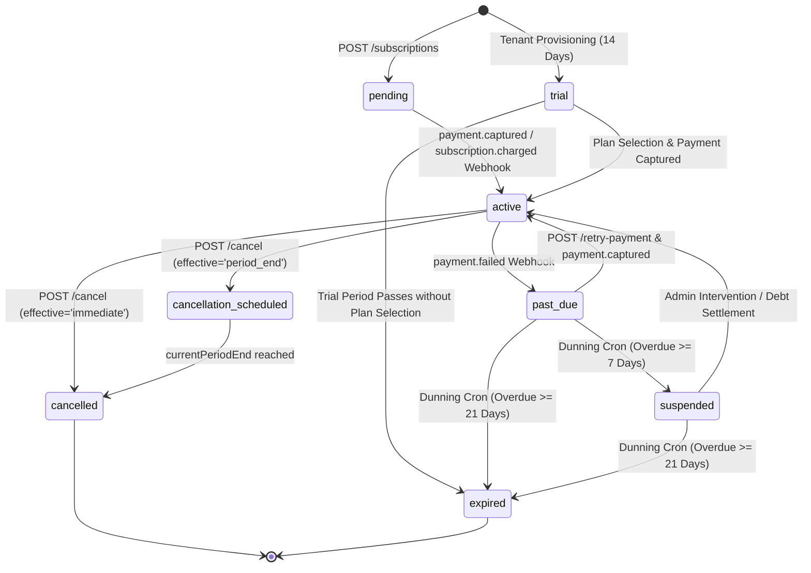
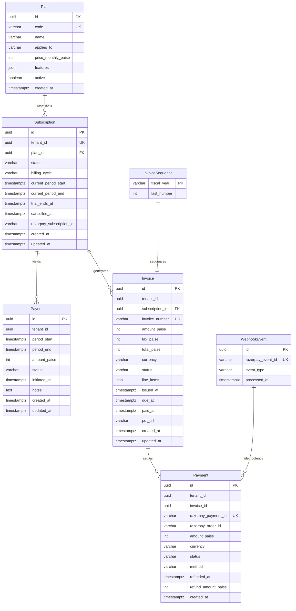
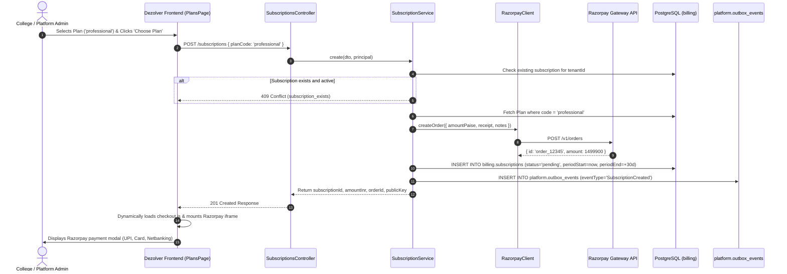
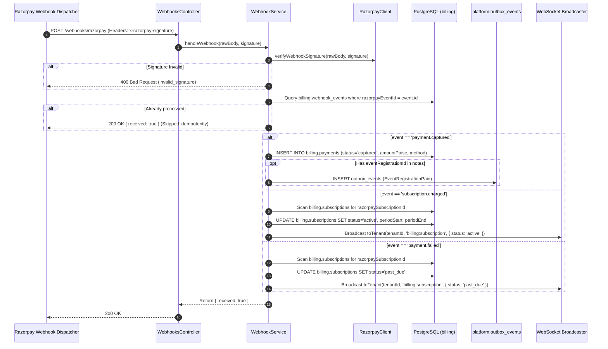
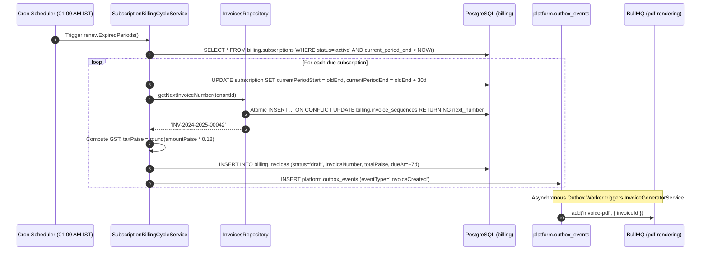
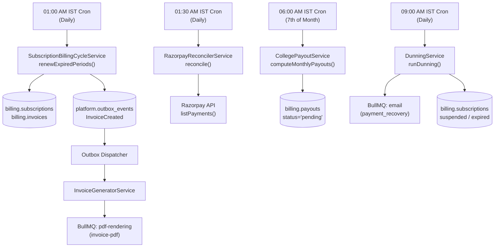

# DEZOLVER FUNCTIONAL SPECIFICATION
## Module 03 — Subscription & Seat Management

---

### DOCUMENT CONTROL
- **Document Identifier:** `DEZ-SPEC-MOD-003`
- **Module Name:** Subscription & Seat Management
- **Domain:** Commercial Billing, Tenant Entitlements, Payment Processing & Financial Settlement
- **Compliance Standard:** `FUNCTIONAL-SPECIFICATION-STANDARD.md` (`DEZ-STD-FS-001`)
- **Investigation Baseline:** Legacy Application Source Code (`src/billing/`, `prisma/billing/`, `frontend/src/pages/billing/`)
- **Status:** Complete Legacy Forensic Reconstruction
- **Last Verification Date:** November 2026

---

## SECTION A: MODULE OVERVIEW & SCOPE DEFINITION

### A.1 Domain Boundaries & Primary Responsibility
Module 3 is the commercial billing and financial monetization engine of the Dezolver platform. Its core responsibilities comprise:
1. **Plan Catalog Management:** Maintaining commercial tiers (`starter`, `professional`, `enterprise`, `unlimited`, `direct-free`), pricing structures in paise (INR), and feature entitlement metadata.
2. **Subscription Lifecycle Orchestration:** Managing the 7-state tenant subscription lifecycle (`pending`, `trial`, `active`, `past_due`, `suspended`, `expired`, `cancelled`), trial periods (14 days), billing cycles (30 days / monthly), and pro-rated upgrades.
3. **Payment Gateway Integration:** Interfacing with the Razorpay payment infrastructure via standard REST APIs for order generation, subscription creation, signature verification, payment capture, and automated refunds, with graceful fallback to a local stub client in non-production environments.
4. **GST-Compliant Invoicing:** Sequential, collision-proof allocation of financial invoice numbers (`INV-YYYY-YYYY-NNNNN`) backed by PostgreSQL atomic row-locking, computing 18% GST and emitting asynchronous PDF generation events.
5. **Dunning & Debt Recovery:** Automated daily enforcement transitions for unpaid accounts, transitioning subscriptions from `past_due` to `suspended` (7 days overdue) and `expired` (21 days overdue).
6. **Platform Commission & Payout Settlement:** Calculating 80/20 monthly revenue distributions for college tenant event/subscription proceeds and generating pending payout settlements for administrative execution.
7. **Rate Limit Tier Enforcement:** Binding subscription plans to per-tenant API rate limits enforced via Redis sliding-window counters.

### A.2 Implementation Reality vs. Architectural Fiction: The Seat Management Finding
A primary objective of this forensic investigation was to uncover how **Seat Management, User Licensing, and Seat Allocation** were implemented.

> [!CAUTION]
> **CRITICAL FORENSIC DISCOVERY — SEAT MANAGEMENT DOES NOT EXIST**
> 
> Across the entire codebase (`src/`, `prisma/`, and `frontend/src/`):
> 1. **Zero Database Entities:** There are no `Seat`, `License`, `SeatAllocation`, or `TenantQuota` tables in any Prisma schema.
> 2. **Zero Backend Enforcement:** No logic in `src/billing/`, `src/identity/`, or `src/tenancy/` inspects user counts against a subscription limit when users sign up, are invited, or are imported via CSV rosters.
> 3. **Unbounded User Ingestion:** Any tenant with an active subscription (or a 14-day trial) can create an infinite number of students and faculty members.
> 4. **Orphaned Frontend Artifacts:** The frontend repository contains an unmounted UI component ([`UsageCard.tsx`](file:///E:/Dezolver%20project/dezlovers-main/Final%20product/frontend/src/components/billing/UsageCard.tsx)) and TypeScript declarations ([`PlanFeatures`](file:///E:/Dezolver%20project/dezlovers-main/Final%20product/frontend/src/types/billing.types.ts#L6-L20)) containing `maxStudents` and `maxFaculty`, but these fields exist solely as inert JSON properties inside `Plan.features`.

### A.3 In-Scope vs. Out-of-Scope Systems
- **In-Scope (Fully Implemented in Source Code):**
  - Subscription creation, upgrades, cancellations, and payment retries via [`src/billing/services/subscription.service.ts`](file:///E:/Dezolver%20project/dezlovers-main/Final%20product/dezlovers-main(cuurent%20update)/src/billing/services/subscription.service.ts).
  - Razorpay order creation, payment capture, and refund execution via [`src/billing/integrations/razorpay.client.ts`](file:///E:/Dezolver%20project/dezlovers-main/Final%20product/dezlovers-main(cuurent%20update)/src/billing/integrations/razorpay.client.ts).
  - Webhook processing with HMAC SHA-256 signature verification via [`src/billing/services/webhook.service.ts`](file:///E:/Dezolver%20project/dezlovers-main/Final%20product/dezlovers-main(cuurent%20update)/src/billing/services/webhook.service.ts).
  - Daily dunning sweeps and subscription suspension via [`src/billing/services/dunning.service.ts`](file:///E:/Dezolver%20project/dezlovers-main/Final%20product/dezlovers-main(cuurent%20update)/src/billing/services/dunning.service.ts).
  - Daily billing cycle renewals and invoice drafting via [`src/billing/services/subscription-billing-cycle.service.ts`](file:///E:/Dezolver%20project/dezlovers-main/Final%20product/dezlovers-main(cuurent%20update)/src/billing/services/subscription-billing-cycle.service.ts).
  - Monthly college payout calculation (80% net share) via [`src/billing/services/college-payout.service.ts`](file:///E:/Dezolver%20project/dezlovers-main/Final%20product/dezlovers-main(cuurent%20update)/src/billing/services/college-payout.service.ts).
  - Daily payment reconciliation against Razorpay API via [`src/billing/services/razorpay-reconciler.service.ts`](file:///E:/Dezolver%20project/dezlovers-main/Final%20product/dezlovers-main(cuurent%20update)/src/billing/services/razorpay-reconciler.service.ts).
  - Atomic Indian fiscal year sequential numbering via [`src/billing/repositories/invoices.repository.ts`](file:///E:/Dezolver%20project/dezlovers-main/Final%20product/dezlovers-main(cuurent%20update)/src/billing/repositories/invoices.repository.ts).
  - Event registration fee order creation via [`src/billing/controllers/event-orders.controller.ts`](file:///E:/Dezolver%20project/dezlovers-main/Final%20product/dezlovers-main(cuurent%20update)/src/billing/controllers/event-orders.controller.ts).
  - Automated refunding upon event cancellation via [`src/billing/consumers/event-cancelled.consumer.ts`](file:///E:/Dezolver%20project/dezlovers-main/Final%20product/dezlovers-main(cuurent%20update)/src/billing/consumers/event-cancelled.consumer.ts).
  - Tiered rate-limiting via [`src/shared/rate-limit/per-tenant-rate-limit.guard.ts`](file:///E:/Dezolver%20project/dezlovers-main/Final%20product/dezlovers-main(cuurent%20update)/src/shared/rate-limit/per-tenant-rate-limit.guard.ts).
  - Full frontend billing suite across 8 pages and 12 UI components.
- **Out-of-Scope (Absent / Missing in Implementation):**
  - Per-seat counting, quota enforcement, or license assignment.
  - Multi-currency conversions (all amounts strictly handled in INR / paise).
  - Automated payout execution via banking APIs (payouts transition to `initiated` manually via admin controller without live bank dispatch).
  - Dynamic invoice PDF binary generation (delegated to an asynchronous queue with known payload contract bugs).

### A.4 Cross-Module Dependencies
- **Module 1 (Authentication):** Provides the authenticated `PrincipalContext` (`userId`, `tenantId`, `roles`) via JWT access tokens.
- **Module 2 (Organization & Tenancy):** Tenant creation triggers automatic 14-day trial subscription provisioning; subscription suspension triggers tenant deactivation.
- **Module 11 (Events & Competitions):** Event registration triggers order creation; event cancellation triggers mass attendee payment refunds.
- **Shared Infrastructure:** BullMQ (`email` queue, `pdf-rendering` queue), Redis (sliding-window rate limits and subscription caching), and the transactional outbox (`platform.outbox_events`).

---

## SECTION B: CORE BUSINESS RULES & DOMAIN LOGIC

### B.1 Currency & Precision Invariants
1. **Paise Storage Standard:** All monetary figures across `plans`, `subscriptions`, `invoices`, `payments`, and `payouts` are strictly represented as integers in **paise** ($1\text{ INR} = 100\text{ paise}$).
2. **Display Conversion:** Frontend components divide paise by 100 and format via `Intl.NumberFormat('en-IN', { style: 'currency', currency: 'INR' })`.
3. **Fixed Indian GST Calculation:** Invoices automatically levy 18% Goods and Services Tax on taxable amounts:
   $$\text{taxPaise} = \text{Math.round}(\text{amountPaise} \times 0.18)$$
   $$\text{totalPaise} = \text{amountPaise} + \text{taxPaise}$$
   Source: [`src/billing/services/subscription-billing-cycle.service.ts#L38-L45`](file:///E:/Dezolver project/dezlovers-main/Final product/dezlovers-main(cuurent update)/src/billing/services/subscription-billing-cycle.service.ts#L38-L45).

### B.2 Billing Cycle & Proration Rules
1. **Fixed Period Duration:** Billing periods are hardcoded to exactly **30 days** ($30 \times 24 \times 60 \times 60 \times 1000\text{ ms}$), irrespective of actual calendar month lengths (28, 29, or 31 days).
2. **Pro-Rata Upgrade Formula:** Upgrading an active subscription before its current period ends calculates the billable days remaining:
   $$\text{proratedDays} = \left\lceil \frac{\text{currentPeriodEnd} - \text{now}}{86{,}400{,}000\text{ ms}} \right\rceil$$
   $$\text{proratedPaise} = \text{Math.round}\left( \frac{\text{newPlanPriceMonthlyPaise}}{30} \times \text{proratedDays} \right)$$
   Source: [`src/billing/services/subscription.service.ts#L104-L109`](file:///E:/Dezolver project/dezlovers-main/Final product/dezlovers-main(cuurent update)/src/billing/services/subscription.service.ts#L104-L109).
3. **Immediate vs. Period-End Cancellation:**
   - `immediate`: Sets `status = 'cancelled'` and records `cancelledAt = NOW()`.
   - `period_end`: Sets `status = 'cancellation_scheduled'`, allowing platform access until `currentPeriodEnd`.
   Source: [`src/billing/services/subscription.service.ts#L136-L140`](file:///E:/Dezolver project/dezlovers-main/Final product/dezlovers-main(cuurent update)/src/billing/services/subscription.service.ts#L136-L140).

### B.3 Dunning & Debt Collection Lifecycle Rules
Unpaid subscriptions transition through rigid overdue thresholds evaluated daily at 09:00 AM IST:
- **Day 0:** Subscription enters `past_due` upon receiving a `payment.failed` webhook or an uncollected invoice due date.
- **Days 1, 3, 7, 14, 21:** Dunning notification events are scheduled for delivery.
- **Day 7 Overdue:** If `daysOverdue >= 7`, subscription status is forcibly transitioned to `suspended`.
- **Day 21 Overdue:** If `daysOverdue >= 21`, subscription status is permanently transitioned to `expired`.
Source: [`src/billing/services/dunning.service.ts#L29-L52`](file:///E:/Dezolver project/dezlovers-main/Final product/dezlovers-main(cuurent update)/src/billing/services/dunning.service.ts#L29-L52).

### B.4 College Revenue Share & Payout Rules
1. **80/20 Net Settlement:** College tenants receive 80% of their subscription value, with 20% retained by the Dezolver platform:
   $$\text{payoutPaise} = \lfloor \text{amountPaise} \times 0.8 \rfloor$$
2. **Monthly Evaluation Schedule:** Computed on the 7th of every month at 06:00 AM IST for the prior completed calendar month:
   - `periodStart`: 1st day of previous month at 00:00:00.
   - `periodEnd`: 1st day of current month at 00:00:00.
   Source: [`src/billing/services/college-payout.service.ts#L11-L33`](file:///E:/Dezolver project/dezlovers-main/Final product/dezlovers-main(cuurent update)/src/billing/services/college-payout.service.ts#L11-L33).

### B.5 Subscription State Machine



---

## SECTION C: DATABASE ENTITIES & SCHEMA MAPPING

Module 3 models reside entirely within the isolated PostgreSQL database schema `billing` defined in [`prisma/billing/schema.prisma`](file:///E:/Dezolver project/dezlovers-main/Final product/dezlovers-main(cuurent update)/prisma/billing/schema.prisma).

### C.1 Entity Relationship Diagram



### C.2 Detailed Database Column Specifications

#### 1. Table `billing.plans` (`Plan`)
- `id`: `UUID`, Primary Key, default `gen_random_uuid()`.
- `code`: `VARCHAR(64)`, Unique, Non-nullable. Commercial identifier (`starter`, `professional`, `enterprise`, `unlimited`).
- `name`: `VARCHAR(255)`, Non-nullable. Display label.
- `applies_to`: `VARCHAR(30)`, Default `'college'`. Target market (`college`, `direct`, `both`).
- `price_monthly_paise`: `INTEGER`, Default `0`. Base subscription price per 30-day billing cycle in paise.
- `features`: `JSONB`, Default `'{}'`. Inert feature flag and quota payload (e.g. `{"events_competitions": true, "maxStudents": 500}`).
- `active`: `BOOLEAN`, Default `true`. Controls availability in plan catalog queries.
- `created_at`: `TIMESTAMPTZ`, Default `NOW()`.

#### 2. Table `billing.subscriptions` (`Subscription`)
- `id`: `UUID`, Primary Key, default `gen_random_uuid()`.
- `tenant_id`: `UUID`, Unique, Non-nullable. Strict 1:1 relationship between tenant and subscription.
- `plan_id`: `UUID`, Foreign Key referencing `billing.plans(id)`.
- `status`: `VARCHAR(30)`, Default `'trial'`. Current state (`pending`, `trial`, `active`, `past_due`, `suspended`, `expired`, `cancelled`, `cancellation_scheduled`).
- `billing_cycle`: `VARCHAR(20)`, Default `'monthly'`.
- `current_period_start`: `TIMESTAMPTZ`, Non-nullable. Period start timestamp.
- `current_period_end`: `TIMESTAMPTZ`, Non-nullable. Expiration timestamp (start + 30 days).
- `trial_ends_at`: `TIMESTAMPTZ`, Nullable. Explicit trial termination deadline.
- `cancelled_at`: `TIMESTAMPTZ`, Nullable. Recorded when immediate cancellation is triggered.
- `razorpay_subscription_id`: `VARCHAR(255)`, Nullable. External Razorpay subscription reference.
- `created_at`: `TIMESTAMPTZ`, Default `NOW()`.
- `updated_at`: `TIMESTAMPTZ`, Auto-updated. Used by dunning service to evaluate overdue duration.
- *Indexes:* `@@index([status])`.

#### 3. Table `billing.invoices` (`Invoice`)
- `id`: `UUID`, Primary Key, default `gen_random_uuid()`.
- `tenant_id`: `UUID`, Non-nullable. Owning tenant.
- `subscription_id`: `UUID`, Nullable, Foreign Key referencing `billing.subscriptions(id)`.
- `invoice_number`: `VARCHAR(50)`, Unique, Non-nullable. Sequential GST identifier (`INV-YYYY-YYYY-NNNNN`).
- `amount_paise`: `INTEGER`, Non-nullable. Base amount excluding tax.
- `tax_paise`: `INTEGER`, Default `0`. Computed 18% GST in paise.
- `total_paise`: `INTEGER`, Non-nullable. Gross payable amount (`amount_paise + tax_paise`).
- `currency`: `VARCHAR(3)`, Default `'INR'`.
- `status`: `VARCHAR(20)`, Default `'draft'`. Current invoice status (`draft`, `issued`, `paid`, `void`, `uncollectible`).
- `line_items`: `JSONB`, Default `'[]'`. Array/object containing billing descriptions and period dates.
- `issued_at`: `TIMESTAMPTZ`, Non-nullable.
- `due_at`: `TIMESTAMPTZ`, Non-nullable (issuedAt + 7 days).
- `paid_at`: `TIMESTAMPTZ`, Nullable. Timestamp when settled.
- `pdf_url`: `VARCHAR(1024)`, Nullable. S3/Storage URL for pre-rendered PDF document.
- `created_at`: `TIMESTAMPTZ`, Default `NOW()`.
- `updated_at`: `TIMESTAMPTZ`, Auto-updated.
- *Indexes:* `@@index([tenant_id, status])`, `@@index([due_at])`.

#### 4. Table `billing.payments` (`Payment`)
- `id`: `UUID`, Primary Key, default `gen_random_uuid()`.
- `tenant_id`: `UUID`, Non-nullable.
- `invoice_id`: `UUID`, Nullable. Associated invoice reference.
- `razorpay_payment_id`: `VARCHAR(255)`, Unique, Non-nullable. Gateway payment reference.
- `razorpay_order_id`: `VARCHAR(255)`, Nullable. Gateway order reference.
- `amount_paise`: `INTEGER`, Non-nullable. Gross captured amount.
- `currency`: `VARCHAR(3)`, Default `'INR'`.
- `status`: `VARCHAR(30)`, Default `'captured'`. (`captured`, `refunded`, `partially_refunded`, `failed`).
- `method`: `VARCHAR(30)`, Nullable. Payment rail (`card`, `upi`, `netbanking`, `wallet`).
- `refunded_at`: `TIMESTAMPTZ`, Nullable. Timestamp of refund execution.
- `refund_amount_paise`: `INTEGER`, Nullable. Amount returned to customer.
- `created_at`: `TIMESTAMPTZ`, Default `NOW()`.
- *Indexes:* `@@index([tenant_id])`.

#### 5. Table `billing.invoice_sequences` (`InvoiceSequence`)
- `fiscal_year`: `VARCHAR(9)`, Primary Key. Indian fiscal notation (e.g. `'2024-2025'`).
- `last_number`: `INTEGER`, Default `0`. Counter tracking the highest allocated sequential number.

#### 6. Table `billing.payouts` (`Payout`)
- `id`: `UUID`, Primary Key, default `gen_random_uuid()`.
- `tenant_id`: `UUID`, Non-nullable. Beneficiary college tenant.
- `period_start`: `TIMESTAMPTZ`, Non-nullable. Beginning of accounting month.
- `period_end`: `TIMESTAMPTZ`, Non-nullable. End of accounting month.
- `amount_paise`: `INTEGER`, Non-nullable. Net 80% revenue settlement.
- `status`: `VARCHAR(20)`, Default `'pending'`. State (`pending`, `initiated`, `completed`, `failed`).
- `initiated_at`: `TIMESTAMPTZ`, Nullable. Administrative execution timestamp.
- `notes`: `TEXT`, Nullable. Settlement reference or bank transmission notes.
- `created_at`: `TIMESTAMPTZ`, Default `NOW()`.
- `updated_at`: `TIMESTAMPTZ`, Auto-updated.
- *Indexes:* `@@index([tenant_id, status])`.

#### 7. Table `billing.webhook_events` (`WebhookEvent`)
- `id`: `UUID`, Primary Key, default `gen_random_uuid()`.
- `razorpay_event_id`: `VARCHAR(255)`, Unique, Non-nullable. Gateway webhook event identifier (`evt_...`).
- `event_type`: `VARCHAR(100)`, Non-nullable.
- `processed_at`: `TIMESTAMPTZ`, Default `NOW()`.

---

## SECTION D: ROLE-BASED ACCESS CONTROL (RBAC) & TENANT BOUNDARIES

### D.1 RBAC Permission Matrix

| Endpoint | Method | Required Permission in Code | Intended Role | Implementation Reality / Vulnerability |
|---|---|---|---|---|
| `/plans` | `GET` | `@Public()` | Anonymous | Publicly accessible catalog. Correct. |
| `/subscriptions` | `GET` | `read:cohort` | `college_admin` | **VULNERABLE:** `read:cohort` is held by `student` and `faculty`. Any student can list all subscriptions. |
| `/subscriptions` | `POST` | `platform:manage_tenants` | `platform_admin` | Only `platform_admin` can create subscriptions via this API. |
| `/subscriptions/:id` | `GET` | `read:cohort` | `college_admin` | **VULNERABLE:** Any authenticated student can inspect subscription details. |
| `/subscriptions/tenant/:tenantId` | `GET` | `read:cohort` | `college_admin` | **VULNERABLE:** Any student can query active subscription metadata for any tenant. |
| `/subscriptions/:id/upgrade` | `POST` | `platform:manage_tenants` | `college_admin` | **RESTRICTED:** Requires `platform:manage_tenants`. Standard college admins cannot self-upgrade. |
| `/subscriptions/:id/cancel` | `POST` | `platform:manage_tenants` | `college_admin` | **RESTRICTED:** Requires `platform:manage_tenants`. Standard college admins cannot cancel. |
| `/subscriptions/:id/retry-payment` | `POST` | `read:cohort` | `college_admin` | **VULNERABLE:** Any authenticated student can trigger Razorpay payment retries. |
| `/invoices` | `GET` | `read:cohort` | `college_admin` | **VULNERABLE:** Scoped to `req.principal.tenantId`, but accessible to all tenant students. |
| `/invoices/:id` | `GET` | `read:cohort` | `college_admin` | **CRITICAL IDOR:** Fetches by `id` with **zero** `tenantId` verification in repository. |
| `/invoices/:id/pdf` | `GET` | `read:cohort` | `college_admin` | **CRITICAL IDOR:** 302 redirects to `pdfUrl` with **zero** tenant boundary validation. |
| `/payments` | `GET` | `read:cohort` | `college_admin` | Scoped to current tenant, but accessible by students. |
| `/payments/:id` | `GET` | `read:cohort` | `college_admin` | **CRITICAL IDOR:** Fetches by `id` with zero tenant verification. |
| `/event-registration-orders` | `POST` | `read:cohort` | `student`, `faculty` | Creates order for event registration. Correct. |
| `/admin/v1/billing/refunds` | `POST` | `manage:billing` | `platform_admin` | Accessible only via wildcard `*` by `platform_admin`. |
| `/admin/v1/billing/payouts` | `GET` | `manage:billing` | `platform_admin` | Accessible only via wildcard `*` by `platform_admin`. |
| `/admin/v1/billing/payouts/:id/initiate`| `POST` | `manage:billing` | `platform_admin` | Accessible only via wildcard `*` by `platform_admin`. |
| `/webhooks/razorpay` | `POST` | `@Public()` | Razorpay Servers | Secured via HMAC SHA-256 webhook signature. |

### D.2 Critical Tenant Isolation Analysis & IDOR Flaws
1. **Invoice IDOR Vulnerability:**
   In [`src/billing/controllers/invoices.controller.ts#L40-L42`](file:///E:/Dezolver project/dezlovers-main/Final product/dezlovers-main(cuurent update)/src/billing/controllers/invoices.controller.ts#L40-L42):
   ```typescript
   async getById(@Param('id') id: string) {
     return this.invoicesRepo.findById(id);
   }
   ```
   The underlying query [`prisma.billing.invoice.findUnique({ where: { id } })`](file:///E:/Dezolver project/dezlovers-main/Final product/dezlovers-main(cuurent update)/src/billing/repositories/invoices.repository.ts#L9) performs **no check** against `req.principal.tenantId`. Any authenticated user across any tenant can view invoices or download PDF receipts belonging to any other college if they obtain or guess the UUID.
2. **Payment IDOR Vulnerability:**
   Identical vulnerability in [`src/billing/controllers/payments.controller.ts#L37-L39`](file:///E:/Dezolver project/dezlovers-main/Final product/dezlovers-main(cuurent update)/src/billing/controllers/payments.controller.ts#L37-L39):
   ```typescript
   async getById(@Param('id') id: string) {
     return this.paymentsRepo.findById(id);
   }
   ```
   Direct query by primary key UUID leaks transaction IDs, amounts, and Razorpay references cross-tenant.

---

## SECTION E: END-TO-END FUNCTIONAL WORKFLOWS

### E.1 Workflow 1: Tenant Subscription Provisioning & Razorpay Order Checkout



### E.2 Workflow 2: Asynchronous Webhook Payment Processing & Subscription Activation



### E.3 Workflow 3: Daily Automated Subscription Renewal & Invoicing Cycle



---

## SECTION F: COMPREHENSIVE API SPECIFICATIONS

### F.1 Plans Endpoints

#### `GET /plans`
- **Method / Path:** `GET /plans`
- **Controller:** [`src/billing/controllers/plans.controller.ts#L11-L17`](file:///E:/Dezolver project/dezlovers-main/Final product/dezlovers-main(cuurent update)/src/billing/controllers/plans.controller.ts#L11-L17)
- **Authentication:** None (`@Public()`)
- **Query Parameters:**
  - `appliesTo` (optional, string): Filters by target entity (`college`, `direct`, `both`).
- **Success Response (200 OK):**
  ```json
  [
    {
      "id": "e4b6c8d2-1111-4000-8000-000000000001",
      "code": "starter",
      "name": "Starter",
      "appliesTo": "college",
      "priceMonthlyPaise": 499900,
      "features": {
        "events": false,
        "assessments": true,
        "certificates": false,
        "analytics": false,
        "maxStudents": 200
      },
      "active": true,
      "createdAt": "2026-01-01T00:00:00.000Z"
    }
  ]
  ```

---

### F.2 Subscriptions Endpoints

#### `GET /subscriptions`
- **Method / Path:** `GET /subscriptions`
- **Controller:** [`src/billing/controllers/subscriptions.controller.ts#L29-L36`](file:///E:/Dezolver project/dezlovers-main/Final product/dezlovers-main(cuurent update)/src/billing/controllers/subscriptions.controller.ts#L29-L36)
- **Auth:** Bearer JWT | **Permission:** `read:cohort`
- **Success Response (200 OK):** Array of all subscription records including associated plans.

#### `POST /subscriptions`
- **Method / Path:** `POST /subscriptions`
- **Controller:** [`src/billing/controllers/subscriptions.controller.ts#L38-L49`](file:///E:/Dezolver project/dezlovers-main/Final product/dezlovers-main(cuurent update)/src/billing/controllers/subscriptions.controller.ts#L38-L49)
- **Auth:** Bearer JWT | **Permission:** `platform:manage_tenants`
- **Request Body (`CreateSubscriptionDto`):**
  ```json
  {
    "planCode": "professional",
    "tenantId": "c5a7d9e1-2222-4000-8000-000000000002"
  }
  ```
- **Success Response (201 Created):**
  ```json
  {
    "subscriptionId": "f7a8b9c0-3333-4000-8000-000000000003",
    "status": "pending",
    "amountInr": 14999,
    "billingCycle": "monthly",
    "razorpay": {
      "orderId": "order_NX8abc123DEF",
      "publicKey": "rzp_test_1DP5mmOlF5G5ag",
      "checkoutUrl": null
    }
  }
  ```
- **Error Responses:**
  - `400 Bad Request`: Validation failure.
  - `404 Not Found`: Plan code does not exist (`plan_not_found`).
  - `409 Conflict`: Subscription already exists and is not expired/cancelled (`subscription_exists`).

#### `GET /subscriptions/:id`
- **Method / Path:** `GET /subscriptions/:id`
- **Controller:** [`src/billing/controllers/subscriptions.controller.ts#L51-L60`](file:///E:/Dezolver project/dezlovers-main/Final product/dezlovers-main(cuurent update)/src/billing/controllers/subscriptions.controller.ts#L51-L60)
- **Auth:** Bearer JWT | **Permission:** `read:cohort`
- **Success Response (200 OK):** Subscription object with populated `plan`.

#### `GET /subscriptions/tenant/:tenantId`
- **Method / Path:** `GET /subscriptions/tenant/:tenantId`
- **Controller:** [`src/billing/controllers/subscriptions.controller.ts#L62-L71`](file:///E:/Dezolver project/dezlovers-main/Final product/dezlovers-main(cuurent update)/src/billing/controllers/subscriptions.controller.ts#L62-L71)
- **Auth:** Bearer JWT | **Permission:** `read:cohort`
- **Success Response (200 OK):** Active subscription entity for requested tenant.

#### `POST /subscriptions/:id/upgrade`
- **Method / Path:** `POST /subscriptions/:id/upgrade`
- **Controller:** [`src/billing/controllers/subscriptions.controller.ts#L73-L89`](file:///E:/Dezolver project/dezlovers-main/Final product/dezlovers-main(cuurent update)/src/billing/controllers/subscriptions.controller.ts#L73-L89)
- **Auth:** Bearer JWT | **Permission:** `platform:manage_tenants`
- **Request Body (`UpgradeSubscriptionDto`):**
  ```json
  {
    "planCode": "enterprise"
  }
  ```
- **Success Response (200 OK):**
  ```json
  {
    "subscriptionId": "f7a8b9c0-3333-4000-8000-000000000003",
    "razorpay": {
      "orderId": "order_UPG789xyz",
      "publicKey": "rzp_test_1DP5mmOlF5G5ag",
      "amountInr": 18500
    }
  }
  ```

#### `POST /subscriptions/:id/cancel`
- **Method / Path:** `POST /subscriptions/:id/cancel`
- **Controller:** [`src/billing/controllers/subscriptions.controller.ts#L91-L107`](file:///E:/Dezolver project/dezlovers-main/Final product/dezlovers-main(cuurent update)/src/billing/controllers/subscriptions.controller.ts#L91-L107)
- **Auth:** Bearer JWT | **Permission:** `platform:manage_tenants`
- **Request Body (`CancelSubscriptionDto`):**
  ```json
  {
    "effective": "immediate"
  }
  ```
  *(Values: `'immediate'` | `'period_end'`)*
- **Success Response (200 OK):**
  ```json
  {
    "subscriptionId": "f7a8b9c0-3333-4000-8000-000000000003",
    "status": "cancelled"
  }
  ```
- **Error Responses:**
  - `400 Bad Request`: Subscription already cancelled (`already_cancelled`).

#### `POST /subscriptions/:id/retry-payment`
- **Method / Path:** `POST /subscriptions/:id/retry-payment`
- **Controller:** [`src/billing/controllers/subscriptions.controller.ts#L109-L120`](file:///E:/Dezolver project/dezlovers-main/Final product/dezlovers-main(cuurent update)/src/billing/controllers/subscriptions.controller.ts#L109-L120)
- **Auth:** Bearer JWT | **Permission:** `read:cohort`
- **Success Response (200 OK):** Creates new Razorpay order for plan amount.
- **Error Responses:**
  - `400 Bad Request`: Subscription is not in `past_due` status (`not_past_due`).

---

### F.3 Invoices Endpoints

#### `GET /invoices`
- **Method / Path:** `GET /invoices`
- **Controller:** [`src/billing/controllers/invoices.controller.ts#L15-L31`](file:///E:/Dezolver project/dezlovers-main/Final product/dezlovers-main(cuurent update)/src/billing/controllers/invoices.controller.ts#L15-L31)
- **Auth:** Bearer JWT | **Permission:** `read:cohort`
- **Query Parameters:** `limit` (int, default 20), `cursor` (UUID string).
- **Success Response (200 OK):**
  ```json
  [
    {
      "id": "a1b2c3d4-4444-4000-8000-000000000004",
      "tenantId": "c5a7d9e1-2222-4000-8000-000000000002",
      "invoiceNumber": "INV-2024-2025-00001",
      "amountPaise": 1499900,
      "taxPaise": 269982,
      "totalPaise": 1769882,
      "currency": "INR",
      "status": "paid",
      "issuedAt": "2026-01-01T00:00:00.000Z",
      "dueAt": "2026-01-08T00:00:00.000Z",
      "paidAt": "2026-01-02T10:15:00.000Z",
      "pdfUrl": "https://s3.ap-south-1.amazonaws.com/dezolver-invoices/INV-2024-2025-00001.pdf"
    }
  ]
  ```

#### `GET /invoices/:id`
- **Method / Path:** `GET /invoices/:id`
- **Controller:** [`src/billing/controllers/invoices.controller.ts#L33-L42`](file:///E:/Dezolver project/dezlovers-main/Final product/dezlovers-main(cuurent update)/src/billing/controllers/invoices.controller.ts#L33-L42)
- **Auth:** Bearer JWT | **Permission:** `read:cohort`
- **Success Response (200 OK):** Invoice detail entity.

#### `GET /invoices/:id/pdf`
- **Method / Path:** `GET /invoices/:id/pdf`
- **Controller:** [`src/billing/controllers/invoices.controller.ts#L44-L56`](file:///E:/Dezolver project/dezlovers-main/Final product/dezlovers-main(cuurent update)/src/billing/controllers/invoices.controller.ts#L44-L56)
- **Auth:** Bearer JWT | **Permission:** `read:cohort`
- **Success Response:** `302 Found` redirecting to `pdfUrl`.
- **Error Response (404 Not Found):** `{ "code": "pdf_not_ready" }`.

---

### F.4 Payments & Event Orders Endpoints

#### `GET /payments`
- **Method / Path:** `GET /payments`
- **Controller:** [`src/billing/controllers/payments.controller.ts#L14-L29`](file:///E:/Dezolver project/dezlovers-main/Final product/dezlovers-main(cuurent update)/src/billing/controllers/payments.controller.ts#L14-L29)
- **Auth:** Bearer JWT | **Permission:** `read:cohort`
- **Success Response (200 OK):** Paginated payments list for `req.principal.tenantId`.

#### `POST /event-registration-orders`
- **Method / Path:** `POST /event-registration-orders`
- **Controller:** [`src/billing/controllers/event-orders.controller.ts#L26-L42`](file:///E:/Dezolver project/dezlovers-main/Final product/dezlovers-main(cuurent update)/src/billing/controllers/event-orders.controller.ts#L26-L42)
- **Auth:** Bearer JWT | **Permission:** `read:cohort`
- **Request Body:** `{ "eventId": "evt_999", "amountPaise": 50000 }`
- **Success Response (201 Created):** `{ "orderId": "order_EVT123", "amount": 50000, "currency": "INR", "eventId": "evt_999" }`.

---

### F.5 Admin Billing & Webhook Endpoints

#### `POST /admin/v1/billing/refunds`
- **Method / Path:** `POST /admin/v1/billing/refunds`
- **Controller:** [`src/billing/controllers/admin-billing.controller.ts#L21-L47`](file:///E:/Dezolver project/dezlovers-main/Final product/dezlovers-main(cuurent update)/src/billing/controllers/admin-billing.controller.ts#L21-L47)
- **Auth:** Bearer JWT | **Permission:** `manage:billing`
- **Request Body (`IssueRefundDto`):** `{ "paymentId": "uuid", "reason": "Accidental double charge", "amountPaise": 50000 }`.
- **Success Response (200 OK):** `{ "paymentId": "uuid", "refundId": "rfnd_888", "status": "refunded" }`.

#### `GET /admin/v1/billing/payouts`
- **Method / Path:** `GET /admin/v1/billing/payouts`
- **Controller:** [`src/billing/controllers/admin-billing.controller.ts#L49-L57`](file:///E:/Dezolver project/dezlovers-main/Final product/dezlovers-main(cuurent update)/src/billing/controllers/admin-billing.controller.ts#L49-L57)
- **Auth:** Bearer JWT | **Permission:** `manage:billing`
- **Success Response (200 OK):** Array of all historical payout settlements.

#### `POST /admin/v1/billing/payouts/:id/initiate`
- **Method / Path:** `POST /admin/v1/billing/payouts/:id/initiate`
- **Controller:** [`src/billing/controllers/admin-billing.controller.ts#L59-L75`](file:///E:/Dezolver project/dezlovers-main/Final product/dezlovers-main(cuurent update)/src/billing/controllers/admin-billing.controller.ts#L59-L75)
- **Auth:** Bearer JWT | **Permission:** `manage:billing`
- **Request Body (`InitiatePayoutDto`):** `{ "bankAccountEmail": "accounts@college.edu", "notes": "NEFT ref 99881122" }`.
- **Success Response (200 OK):** Updated payout record with `status: "initiated"`.

#### `POST /webhooks/razorpay`
- **Method / Path:** `POST /webhooks/razorpay`
- **Controller:** [`src/billing/controllers/webhooks.controller.ts#L12-L25`](file:///E:/Dezolver project/dezlovers-main/Final product/dezlovers-main(cuurent update)/src/billing/controllers/webhooks.controller.ts#L12-L25)
- **Authentication:** Public with HMAC SHA-256 header validation (`x-razorpay-signature`).
- **Success Response (200 OK):** `{ "received": true }`.

---

## SECTION G: FRONTEND IMPLEMENTATION & USER INTERFACE

### G.1 Billing Pages Matrix

| Route | Page Component | File Path | Functional Capabilities |
|---|---|---|---|
| `/billing` | `BillingDashboardPage` | [`frontend/src/pages/billing/BillingDashboardPage.tsx`](file:///E:/Dezolver project/dezlovers-main/Final product/frontend/src/pages/billing/BillingDashboardPage.tsx) | Current plan summary, renewal countdown, past-due alert banner, retry action button, recent invoices table (last 5). |
| `/billing/plans` | `PlansPage` | [`frontend/src/pages/billing/PlansPage.tsx`](file:///E:/Dezolver project/dezlovers-main/Final product/frontend/src/pages/billing/PlansPage.tsx) | Plan catalog display, Monthly vs. Annual toggle (17% savings indicator), card vs. comparison table view, checkout dialog trigger. |
| `/billing/subscription/:id`| `SubscriptionPage` | [`frontend/src/pages/billing/SubscriptionPage.tsx`](file:///E:/Dezolver project/dezlovers-main/Final product/frontend/src/pages/billing/SubscriptionPage.tsx) | Subscription detail, payment rail disclaimer, immediate vs period-end cancellation modal. |
| `/billing/invoices` | `InvoicesPage` | [`frontend/src/pages/billing/InvoicesPage.tsx`](file:///E:/Dezolver project/dezlovers-main/Final product/frontend/src/pages/billing/InvoicesPage.tsx) | Infinite-scroll paginated invoice table with status badges (`Draft`, `Paid`, `Uncollectible`). |
| `/billing/invoices/:id` | `InvoiceDetailPage` | [`frontend/src/pages/billing/InvoiceDetailPage.tsx`](file:///E:/Dezolver project/dezlovers-main/Final product/frontend/src/pages/billing/InvoiceDetailPage.tsx) | Line item breakdown, 18% GST tax display, one-click PDF download via blob stream. |
| `/billing/payments` | `PaymentsPage` | [`frontend/src/pages/billing/PaymentsPage.tsx`](file:///E:/Dezolver project/dezlovers-main/Final product/frontend/src/pages/billing/PaymentsPage.tsx) | Historical payments ledger, payment methods, transaction status badges. |
| `/billing/payments/:id` | `PaymentDetailPage` | [`frontend/src/pages/billing/PaymentDetailPage.tsx`](file:///E:/Dezolver project/dezlovers-main/Final product/frontend/src/pages/billing/PaymentDetailPage.tsx) | Gateway identifiers, captured timestamps, direct navigation to associated invoice. |
| `/admin/v1/billing` | `AdminBillingPage` | [`frontend/src/pages/billing/AdminBillingPage.tsx`](file:///E:/Dezolver project/dezlovers-main/Final product/frontend/src/pages/billing/AdminBillingPage.tsx) | Platform admin tabs: College monthly payouts table + captured payment refund modal. |

### G.2 Razorpay Standard Checkout Integration
Frontend modal integration is encapsulated in [`frontend/src/components/billing/RazorpayCheckout.tsx`](file:///E:/Dezolver project/dezlovers-main/Final product/frontend/src/components/billing/RazorpayCheckout.tsx):
- Dynamically loads `https://checkout.razorpay.com/v1/checkout.js` into the DOM.
- Initializes `window.Razorpay` with `key_id`, `order_id`, `amount`, and user prefill coordinates (`prefillName`, `prefillEmail`).
- Zero sensitive PCI payment card data touches Dezolver client or backend servers; checkout is handled in Razorpay's sandboxed iframe.

### G.3 Inert Feature Gating Implementation
- [`frontend/src/components/guards/FeatureGate.tsx`](file:///E:/Dezolver project/dezlovers-main/Final product/frontend/src/components/guards/FeatureGate.tsx) defines a React wrapper to conditionalize children based on `PLAN_FEATURES[planCode][feature]`.
- **Forensic Status:** This component is completely unused across the application. Feature restrictions are never mounted on routes or navigational items.

---

## SECTION H: BACKGROUND JOBS, QUEUES & SCHEDULED TASKS

Module 3 runs 4 scheduled cron tasks and interacts with 2 BullMQ queues:



### H.1 Cron Schedules & Execution Logic

| Service | Cron Expression | Timezone | Functional Responsibility |
|---|---|---|---|
| `SubscriptionBillingCycleService` | `0 1 * * *` | `Asia/Kolkata` | Finds active subscriptions where `currentPeriodEnd < NOW()`. Rolls periods forward by 30 days, generates draft invoices with GST, and emits `InvoiceCreated`. |
| `RazorpayReconcilerService` | `30 1 * * *` | `Asia/Kolkata` | Fetches captured payments from Razorpay API for past 7 days (`from = now - 7d`, `count = 100`). Compares amount and presence against `billing.payments`; logs discrepancies. |
| `CollegePayoutService` | `0 6 7 * *` | `Asia/Kolkata` | Finds all active college subscriptions on the 7th of each month. Computes 80% net payout for prior calendar month; creates pending `billing.payouts` records. |
| `DunningService` | `0 9 * * *` | `Asia/Kolkata` | Iterates `past_due` subscriptions. Evaluates `daysOverdue`. Transitions to `suspended` (>= 7 days) and `expired` (>= 21 days). Enqueues recovery emails on days 1, 3, 7, 14, 21. |

### H.2 BullMQ Queues & Consumers
1. **Queue `email`:**
   - Producer: `DunningService` ([`src/billing/services/dunning.service.ts#L45-L50`](file:///E:/Dezolver project/dezlovers-main/Final product/dezlovers-main(cuurent update)/src/billing/services/dunning.service.ts#L45-L50)).
   - Job Name: `'send'`.
   - **Legacy Bug:** Passes `to: sub.tenantId` instead of an email address.
2. **Queue `pdf-rendering`:**
   - Producer: `InvoiceGeneratorService` ([`src/billing/services/invoice-generator.service.ts#L25`](file:///E:/Dezolver project/dezlovers-main/Final product/dezlovers-main(cuurent update)/src/billing/services/invoice-generator.service.ts#L25)).
   - Job Name: `'invoice-pdf'`.
   - Options: `{ attempts: 3, backoff: { type: 'exponential', delay: 5000 } }`.
   - **Legacy Bug:** Scheduled with `{ invoiceId: undefined }` due to payload contract mismatch.

---

## SECTION I: REAL-TIME & EVENT-DRIVEN ARCHITECTURE

### I.1 Transactional Outbox Events Emitted

| Event Type | Aggregate Type | Aggregate ID | Emitted By | Payload |
|---|---|---|---|---|
| `SubscriptionCreated` | `Subscription` | `subscription.id` | `SubscriptionService.create` | `{ subscriptionId, planCode }` |
| `SubscriptionCancelled` | `Subscription` | `subscription.id` | `SubscriptionService.cancel` | `{ subscriptionId, effective, actorUserId }` |
| `InvoiceCreated` | `Invoice` | `invoiceNumber` | `SubscriptionBillingCycleService` | `{ invoiceNumber, tenantId }` |
| `EventRegistrationPaid`| `Registration` | `registrationId` | `WebhookService.handlePaymentCaptured` | `{ registrationId, razorpayPaymentId }` |

### I.2 Events Consumed
1. **`EventCancelled`:**
   - Consumer: `EventCancelledConsumer` (`billing.refund-cancelled-event`) in [`src/billing/consumers/event-cancelled.consumer.ts`](file:///E:/Dezolver project/dezlovers-main/Final product/dezlovers-main(cuurent update)/src/billing/consumers/event-cancelled.consumer.ts).
   - Logic: Automatically initiates full Razorpay refunds for all registered attendees of the cancelled event and updates payment records to `status = 'refunded'`.
2. **`TenantStatusChanged`:**
   - Consumer: `RealtimeBillingConsumer` (`ws.tenant-billing-status`) in [`src/websocket/consumers/realtime-billing.consumer.ts`](file:///E:/Dezolver project/dezlovers-main/Final product/dezlovers-main(cuurent update)/src/websocket/consumers/realtime-billing.consumer.ts).
   - Logic: Emits `billing:subscription` updates with `{ status: newStatus }` over WebSocket to all clients in the tenant room.

---

## SECTION J: EXTERNAL INTEGRATIONS & THIRD-PARTY SERVICES

### J.1 Razorpay SDK Integration & Stub Architecture
The Razorpay gateway integration is encapsulated in [`src/billing/integrations/razorpay.client.ts`](file:///E:/Dezolver project/dezlovers-main/Final product/dezlovers-main(cuurent update)/src/billing/integrations/razorpay.client.ts):
- **Credentials:** Reads `RAZORPAY_KEY_ID`, `RAZORPAY_KEY_SECRET`, and `RAZORPAY_WEBHOOK_SECRET` via NestJS `ConfigService`.
- **Stub Mode:** When credentials are null or empty, the client logs a warning and runs in offline stub mode:
  - `createOrder`: Returns fake order `{ orderId: 'order_stub_' + timestamp, amountPaise, currency, receipt }`.
  - `createSubscription`: Returns fake `{ subscriptionId: 'sub_stub_' + timestamp, shortUrl: 'https://rzp.io/stub/...' }`.
  - `refundPayment`: Returns fake `{ refundId: 'rfnd_stub_' + timestamp }`.
  - `listPayments`: Returns `[]`.

### J.2 Webhook Signature Verification Algorithm
Webhook payloads are verified via HMAC SHA-256 in [`RazorpayClient.verifyWebhookSignature`](file:///E:/Dezolver project/dezlovers-main/Final product/dezlovers-main(cuurent update)/src/billing/integrations/razorpay.client.ts#L142-L149):
```typescript
verifyWebhookSignature(rawBody: string, signature: string): boolean {
  if (!this.webhookSecret) return true; // Bypasses validation if secret not configured
  const expected = crypto
    .createHmac('sha256', this.webhookSecret)
    .update(rawBody)
    .digest('hex');
  return crypto.timingSafeEqual(Buffer.from(expected), Buffer.from(signature));
}
```
*Vulnerability Note:* If `RAZORPAY_WEBHOOK_SECRET` is unset, verification evaluates to `true`, accepting forged webhooks.

---

## SECTION K: EDGE CASES, FAILURE MODES & SYSTEM RESILIENCE

### K.1 Razorpay API Unavailability
- During order creation: Throws uncaught exceptions, bubbling up as HTTP 500 errors to the frontend.
- During webhook delivery: Gateway retries automatically with exponential backoff over 24 hours.
- During nightly reconciliation: Caught gracefully in [`RazorpayReconcilerService.ts#L23-L26`](file:///E:/Dezolver project/dezlovers-main/Final project/dezlovers-main(cuurent update)/src/billing/services/razorpay-reconciler.service.ts#L23-L26); logs a warning and aborts the cycle without crashing the service.

### K.2 Concurrent Invoice Number Allocation
- Collisions under high concurrency are prevented by PostgreSQL row-level locks via `INSERT ... ON CONFLICT (fiscal_year) DO UPDATE SET last_number = last_number + 1 RETURNING last_number` ([`invoices.repository.ts#L45-L51`](file:///E:/Dezolver project/dezlovers-main/Final product/dezlovers-main(cuurent update)/src/billing/repositories/invoices.repository.ts#L45-L51)).

### K.3 Rate-Limit Degraded Mode
- In [`PerTenantRateLimitGuard.ts#L34`](file:///E:/Dezolver project/dezlovers-main/Final product/dezlovers-main(cuurent update)/src/shared/rate-limit/per-tenant-rate-limit.guard.ts#L34), if Redis is offline (`!this.redis.client`), rate limiting automatically fails open (`return true`), avoiding complete platform outages during cache failures.

---

## SECTION L: LEGACY BUGS, DISCREPANCIES & ARCHITECTURAL ANTI-PATTERNS

### L.1 Detailed Forensic Bug Disclosures

```
┌─────────────────────────────────────────────────────────────────────────────────────────────────┐
│                                    LEGACY DEFECT SUMMARY                                        │
├───────┬─────────────────────────────────────────────────┬─────────────────────────────┬─────────┤
│ ID    │ Defect Title                                    │ Source File Location        │ Impact  │
├───────┼─────────────────────────────────────────────────┼─────────────────────────────┼─────────┤
│ BUG-1 │ Complete Absence of Seat Quotas & Licensing     │ src/billing/, prisma/       │ CRITICAL│
│ BUG-2 │ Dunning Email Queued with Tenant UUID as Email  │ dunning.service.ts:46       │ CRITICAL│
│ BUG-3 │ Outbox Payload Mismatch for Invoice PDF Jobs    │ invoice-generator.service:20│ HIGH    │
│ BUG-4 │ In-Memory Full Table Scan in Webhook Processor  │ webhook.service.ts:109, 137 │ HIGH    │
│ BUG-5 │ Excessive Permission Exposure (read:cohort)     │ subscriptions.controller.ts │ HIGH    │
│ BUG-6 │ Invoice & Payment IDOR Cross-Tenant Leakage     │ invoices.controller.ts:41   │ HIGH    │
│ BUG-7 │ Unenforced Plan Feature Gating                  │ FeatureGate.tsx             │ MEDIUM  │
│ BUG-8 │ Hardcoded 30-Day Month Proration Drift          │ subscription.service.ts:108 │ MEDIUM  │
│ BUG-9 │ Webhook Bypass When Secret Unset                │ razorpay.client.ts:143      │ HIGH    │
└───────┴─────────────────────────────────────────────────┴─────────────────────────────┴─────────┘
```

1. **BUG-1: Non-Existent Seat Management**
   - *Description:* There is no seat limit checking when users are added or invited. Tenancy user growth is unbounded.
2. **BUG-2: Dunning Email Dispatched to Tenant UUID**
   - *Code:* In [`src/billing/services/dunning.service.ts#L46`](file:///E:/Dezolver project/dezlovers-main/Final product/dezlovers-main(cuurent update)/src/billing/services/dunning.service.ts#L46):
     ```typescript
     await this.emailQueue.add('send', {
       to: sub.tenantId, // Tenant UUID passed instead of primary administrator email!
       templateId: 'payment_recovery',
       variables: { planName: sub.plan?.name ?? 'your plan', daysOverdue },
     });
     ```
   - *Impact:* The email consumer receives a UUID instead of a valid email address; dunning emails fail delivery.
3. **BUG-3: Asynchronous Outbox Contract Mismatch in Invoice PDF Generation**
   - *Code:* [`SubscriptionBillingCycleService.ts#L58`](file:///E:/Dezolver project/dezlovers-main/Final product/dezlovers-main(cuurent update)/src/billing/services/subscription-billing-cycle.service.ts#L58) emits:
     ```typescript
     payload: { invoiceNumber, tenantId: sub.tenantId }
     ```
     Whereas [`InvoiceGeneratorService.ts#L20`](file:///E:/Dezolver project/dezlovers-main/Final product/dezlovers-main(cuurent update)/src/billing/services/invoice-generator.service.ts#L20) consumes:
     ```typescript
     const { invoiceId } = e.payload as { invoiceId: string };
     ```
   - *Impact:* `invoiceId` evaluates to `undefined`, queueing invalid jobs in `pdf-rendering` and halting automated PDF creation.
4. **BUG-4: In-Memory O(N) Table Scan in Webhook Processing**
   - *Code:* In [`src/billing/services/webhook.service.ts#L109-L111`](file:///E:/Dezolver project/dezlovers-main/Final product/dezlovers-main(cuurent update)/src/billing/services/webhook.service.ts#L109-L111):
     ```typescript
     const sub = await this.subsRepo.findAll().then(list =>
       list.find((s: any) => s.razorpaySubscriptionId === razorpaySubId),
     );
     ```
   - *Impact:* Fetches the entire database table into Node.js process memory on every webhook invocation instead of executing an indexed SQL `WHERE razorpay_subscription_id = ?` query.
5. **BUG-5: Overly Permissive `read:cohort` Decorators on Financial Endpoints**
   - *Description:* Read endpoints for subscriptions, invoices, and payments require `read:cohort`, an entitlement held by default by `student` and `faculty` roles.
6. **BUG-6: Invoice & Payment IDOR Cross-Tenant Vulnerability**
   - *Description:* Detail queries `GET /invoices/:id` and `GET /payments/:id` query strictly by UUID without filtering by the authenticated user's `tenantId`.

---

## SECTION M: DISCREPANCY RECONCILIATION: IMPLEMENTED VS. NON-IMPLEMENTED VS. INTENDED

| Capability | Intended / Conceptual Expectation | Actual Legacy Implementation Status | Recommended Remediation |
|---|---|---|---|
| **Subscription Lifecycle** | Multi-tier monthly/annual subscriptions with trial. | **CONFIRMED IMPLEMENTED** (`prisma/billing/schema.prisma`). | Fix proration drift to use exact calendar days. |
| **Seat Quota Enforcement** | Restrict student/faculty counts based on plan. | **NOT IMPLEMENTED** (0 database or backend occurrences). | Create `billing.seat_allocations` table & enforce in `users.service.ts`. |
| **Razorpay Integration** | Order & webhook payment lifecycle. | **CONFIRMED IMPLEMENTED** with fallback stub client. | Add live webhook secret validation requirement. |
| **Sequential Invoicing** | GST-compliant fiscal-year sequential numbering. | **CONFIRMED IMPLEMENTED** via PostgreSQL sequences. | Fix outbox payload contract bug for PDF generation. |
| **Dunning & Collections** | Suspend overdue accounts after 7 days; expire at 21. | **CONFIRMED IMPLEMENTED** in `DunningService`. | Resolve tenant admin email lookup bug. |
| **College Revenue Sharing**| 80/20 monthly payout settlement. | **CONFIRMED IMPLEMENTED** in `CollegePayoutService`. | Make platform commission configurable per tenant. |
| **Rate Limit Tiers** | Tiered API throughput by plan. | **CONFIRMED IMPLEMENTED** via Redis sliding window. | Retain implementation. |
| **Invoice / Payment RBAC** | College administrator visibility only. | **CONFLICTING / VULNERABLE** (`read:cohort` + IDOR). | Restrict to `read:billing` and enforce tenant scoping. |

---

## SECTION N: COMPLETE FUNCTIONAL INVENTORY & VERIFICATION TRACEABILITY

### N.1 Backend Implementation Inventory

| Function / Component ID | File Location | Class / Function Name | Functional Classification | Status |
|---|---|---|---|---|
| `FN-BIL-001` | `src/billing/controllers/plans.controller.ts:15` | `PlansController.list` | Plan Catalog Retrieval | CONFIRMED LEGACY IMPLEMENTATION |
| `FN-BIL-002` | `src/billing/controllers/subscriptions.controller.ts:34` | `SubscriptionsController.findAll` | Subscription Listing | CONFIRMED LEGACY IMPLEMENTATION |
| `FN-BIL-003` | `src/billing/controllers/subscriptions.controller.ts:47` | `SubscriptionsController.create` | Subscription Creation | CONFIRMED LEGACY IMPLEMENTATION |
| `FN-BIL-004` | `src/billing/controllers/subscriptions.controller.ts:58` | `SubscriptionsController.getById` | Subscription Detail Query | CONFIRMED LEGACY IMPLEMENTATION |
| `FN-BIL-005` | `src/billing/controllers/subscriptions.controller.ts:69` | `SubscriptionsController.getByTenantId` | Tenant Subscription Query | CONFIRMED LEGACY IMPLEMENTATION |
| `FN-BIL-006` | `src/billing/controllers/subscriptions.controller.ts:83` | `SubscriptionsController.upgrade` | Pro-Rata Plan Upgrade | CONFIRMED LEGACY IMPLEMENTATION |
| `FN-BIL-007` | `src/billing/controllers/subscriptions.controller.ts:101`| `SubscriptionsController.cancel` | Subscription Cancellation | CONFIRMED LEGACY IMPLEMENTATION |
| `FN-BIL-008` | `src/billing/controllers/subscriptions.controller.ts:118`| `SubscriptionsController.retryPayment`| Payment Retry Trigger | CONFIRMED LEGACY IMPLEMENTATION |
| `FN-BIL-009` | `src/billing/controllers/invoices.controller.ts:21` | `InvoicesController.list` | Tenant Invoices Retrieval | CONFIRMED LEGACY IMPLEMENTATION |
| `FN-BIL-010` | `src/billing/controllers/invoices.controller.ts:40` | `InvoicesController.getById` | Invoice Detail Retrieval | VULNERABLE (IDOR) |
| `FN-BIL-011` | `src/billing/controllers/invoices.controller.ts:50` | `InvoicesController.downloadPdf` | Invoice PDF Download | VULNERABLE (IDOR) |
| `FN-BIL-012` | `src/billing/controllers/payments.controller.ts:19` | `PaymentsController.list` | Tenant Payments Query | CONFIRMED LEGACY IMPLEMENTATION |
| `FN-BIL-013` | `src/billing/controllers/payments.controller.ts:37` | `PaymentsController.getById` | Payment Detail Query | VULNERABLE (IDOR) |
| `FN-BIL-014` | `src/billing/controllers/event-orders.controller.ts:34` | `EventOrdersController.create` | Event Order Provisioning | CONFIRMED LEGACY IMPLEMENTATION |
| `FN-BIL-015` | `src/billing/controllers/admin-billing.controller.ts:31`| `AdminBillingController.issueRefund` | Refund Execution | CONFIRMED LEGACY IMPLEMENTATION |
| `FN-BIL-016` | `src/billing/controllers/admin-billing.controller.ts:55`| `AdminBillingController.listPayouts` | Payout Listing | CONFIRMED LEGACY IMPLEMENTATION |
| `FN-BIL-017` | `src/billing/controllers/admin-billing.controller.ts:68`| `AdminBillingController.initiatePayout` | Payout Initiation | CONFIRMED LEGACY IMPLEMENTATION |
| `FN-BIL-018` | `src/billing/controllers/webhooks.controller.ts:16` | `WebhooksController.razorpay` | Webhook Receiver | CONFIRMED LEGACY IMPLEMENTATION |
| `FN-BIL-019` | `src/billing/services/subscription.service.ts:27` | `SubscriptionService.create` | Subscription Order Logic | CONFIRMED LEGACY IMPLEMENTATION |
| `FN-BIL-020` | `src/billing/services/subscription.service.ts:96` | `SubscriptionService.upgrade` | Pro-Rata Math Logic | CONFIRMED LEGACY IMPLEMENTATION |
| `FN-BIL-021` | `src/billing/services/subscription.service.ts:128`| `SubscriptionService.cancel` | Cancellation Logic | CONFIRMED LEGACY IMPLEMENTATION |
| `FN-BIL-022` | `src/billing/services/webhook.service.ts:20` | `WebhookService.handleWebhook` | Webhook Dispatcher | CONFIRMED LEGACY IMPLEMENTATION |
| `FN-BIL-023` | `src/billing/services/dunning.service.ts:21` | `DunningService.runDunning` | Overdue Debt Sweep | DEFECTIVE (UUID Email Bug) |
| `FN-BIL-024` | `src/billing/services/subscription-billing-cycle.service.ts:21` | `SubscriptionBillingCycleService.renewExpiredPeriods` | Renewal & Invoicing Cron | CONFIRMED LEGACY IMPLEMENTATION |
| `FN-BIL-025` | `src/billing/services/invoice-generator.service.ts:17`| `InvoiceGeneratorService.constructor` | Asynchronous PDF Consumer | DEFECTIVE (Payload Contract) |
| `FN-BIL-026` | `src/billing/services/razorpay-reconciler.service.ts:16`| `RazorpayReconcilerService.reconcile` | Payment Reconciliation | CONFIRMED LEGACY IMPLEMENTATION |
| `FN-BIL-027` | `src/billing/services/college-payout.service.ts:12` | `CollegePayoutService.computeMonthlyPayouts` | Revenue Share Settlement | CONFIRMED LEGACY IMPLEMENTATION |
| `FN-BIL-028` | `src/billing/repositories/invoices.repository.ts:41` | `InvoicesRepository.getNextInvoiceNumber` | Atomic GST Sequence | CONFIRMED LEGACY IMPLEMENTATION |
| `FN-BIL-029` | `src/billing/integrations/razorpay.client.ts:59` | `RazorpayClient.createOrder` | Gateway Order Dispatch | CONFIRMED LEGACY IMPLEMENTATION |
| `FN-BIL-030` | `src/billing/consumers/event-cancelled.consumer.ts:17`| `EventCancelledConsumer.handle` | Refund Upon Event Cancel | CONFIRMED LEGACY IMPLEMENTATION |
| `FN-BIL-031` | `src/shared/rate-limit/per-tenant-rate-limit.guard.ts:29`| `PerTenantRateLimitGuard.canActivate` | Tier Throughput Guard | CONFIRMED LEGACY IMPLEMENTATION |

### N.2 Frontend Implementation Inventory

| Component / Hook Name | File Location | Functional Role | Status |
|---|---|---|---|
| `BillingDashboardPage` | `frontend/src/pages/billing/BillingDashboardPage.tsx` | Overview Dashboard | CONFIRMED IMPLEMENTED |
| `PlansPage` | `frontend/src/pages/billing/PlansPage.tsx` | Plan Catalog & Cycle Toggle | CONFIRMED IMPLEMENTED |
| `SubscriptionPage` | `frontend/src/pages/billing/SubscriptionPage.tsx` | Subscription Details & Cancel | CONFIRMED IMPLEMENTED |
| `InvoicesPage` | `frontend/src/pages/billing/InvoicesPage.tsx` | Infinite Invoice Ledger | CONFIRMED IMPLEMENTED |
| `InvoiceDetailPage` | `frontend/src/pages/billing/InvoiceDetailPage.tsx` | Invoice Line Items & PDF | CONFIRMED IMPLEMENTED |
| `PaymentsPage` | `frontend/src/pages/billing/PaymentsPage.tsx` | Payment Transactions | CONFIRMED IMPLEMENTED |
| `PaymentDetailPage` | `frontend/src/pages/billing/PaymentDetailPage.tsx` | Transaction Breakdown | CONFIRMED IMPLEMENTED |
| `AdminBillingPage` | `frontend/src/pages/billing/AdminBillingPage.tsx` | Admin Payouts & Refunds | CONFIRMED IMPLEMENTED |
| `RazorpayCheckout` | `frontend/src/components/billing/RazorpayCheckout.tsx` | Razorpay iframe Modal | CONFIRMED IMPLEMENTED |
| `UpgradeDialog` | `frontend/src/components/billing/UpgradeDialog.tsx` | Pro-rata Upgrade Modal | CONFIRMED IMPLEMENTED |
| `RefundDialog` | `frontend/src/components/billing/RefundDialog.tsx` | Admin Payment Refund Modal | CONFIRMED IMPLEMENTED |
| `UsageCard` | `frontend/src/components/billing/UsageCard.tsx` | Student/Faculty Quota UI | ORPHANED / UNMOUNTED |
| `FeatureGate` | `frontend/src/components/guards/FeatureGate.tsx` | Plan Feature Wrapper | ORPHANED / UNMOUNTED |

---

## SECTION O: QA TEST SCENARIOS & ACCEPTANCE CRITERIA

```gherkin
Feature: Subscription Lifecycle & Payment Settlements

  Scenario: Tenant administrator initiates new subscription checkout
    Given an authenticated user with "platform_admin" role
    And tenant "c5a7d9e1-2222-4000-8000-000000000002" with no active subscription
    When the client posts to "/subscriptions" with planCode "professional"
    Then the response status is 201 Created
    And a subscription record is created with status "pending"
    And a valid Razorpay order ID is returned
    And an outbox event "SubscriptionCreated" is emitted

  Scenario: Webhook captures successful payment and activates subscription
    Given an existing subscription with status "pending" and razorpaySubscriptionId "sub_rzp_99"
    When Razorpay dispatches webhook "subscription.charged" with valid HMAC SHA-256 header
    Then the webhook is accepted with status 200 OK
    And the subscription status is updated to "active"
    And "currentPeriodEnd" is extended by 30 days
    And a WebSocket update "billing:subscription" is broadcast to the tenant room

  Scenario: Dunning sweep suspends accounts overdue past 7 days
    Given an active subscription with status "past_due"
    And "updatedAt" was 8 days prior to current timestamp
    When the daily 09:00 AM IST dunning cron runs
    Then the subscription status is updated to "suspended"
    And a "payment_recovery" email job is submitted to BullMQ

  Scenario: Cross-tenant invoice query authorization failure (Target Fix)
    Given an authenticated student belonging to Tenant A
    When the student attempts to fetch "/invoices/{invoiceId_belonging_to_Tenant_B}"
    Then the system returns 403 Forbidden or 404 Not Found
    And zero financial metadata from Tenant B is disclosed
```

---

## SECTION P: TARGET RECOMMENDATIONS & REMEDIATIONS

1. **Implement Formal Seat Management Architecture:**
   - Create table `billing.seat_allocations` (`id`, `tenant_id`, `user_id`, `allocated_at`).
   - Add explicit columns `max_seats` and `overage_allowed` to `billing.plans`.
   - Implement an intercepting validation guard on user registration, invitation, and CSV import to block roster additions when active user count $\ge \text{max\_seats}$.
2. **Remediate Critical IDOR Vulnerabilities:**
   - Update `invoices.repository.ts` and `payments.repository.ts` to enforce tenant scoping:
     ```typescript
     async findByIdAndTenant(id: string, tenantId: string) {
       return this.prisma.billing.invoice.findFirst({ where: { id, tenantId } });
     }
     ```
3. **Correct Dunning Email Recipient Resolution:**
   - In `DunningService.ts`, resolve the primary administrative contact email from `identity.users` where `role = 'college_admin'` rather than passing `sub.tenantId`.
4. **Fix Invoice Outbox Event Payload Contract:**
   - Update `SubscriptionBillingCycleService.ts` to emit `{ invoiceId: invoice.id, invoiceNumber, tenantId }`, aligning with `InvoiceGeneratorService`.
5. **Optimize Webhook Lookup Queries:**
   - Add an indexed column and query:
     ```typescript
     this.prisma.billing.subscription.findFirst({ where: { razorpaySubscriptionId } });
     ```

---

## SECTION Q: OPEN QUESTIONS & DECISIONS NEEDED

1. **Product Policy on Seat Limits vs. Unlimited Academic Access:**
   - *Question:* Should Dezolver v2 enforce strict per-seat licensing (blocking student signup when the quota is reached), or should it allow soft limits with per-seat overage invoicing at the end of the billing period?
2. **Automated Banking Payout Integration:**
   - *Question:* Should the payout workflow integrate directly with RazorpayX or ICICI Bank Corporate APIs for automated NEFT/IMPS dispatch, or remain a manual administrative authorization workflow?
3. **Proration Policy for Leap Years and Variable Month Durations:**
   - *Question:* Should commercial billing transition from a fixed 30-day denominator to exact daily proration based on the actual calendar days in the given billing period?

