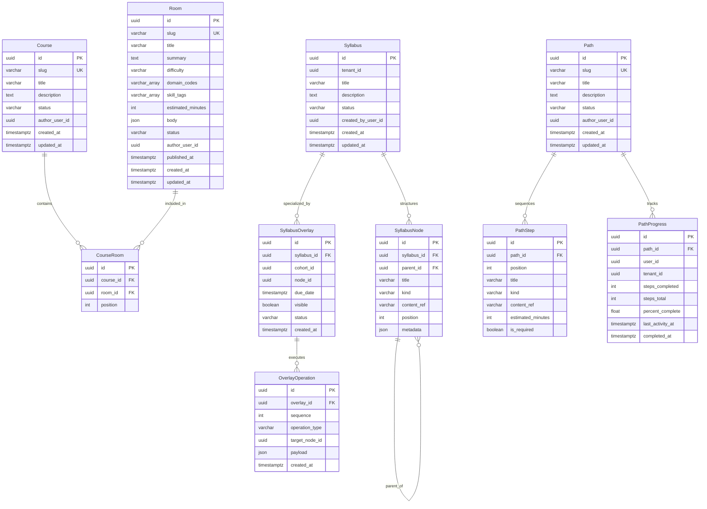
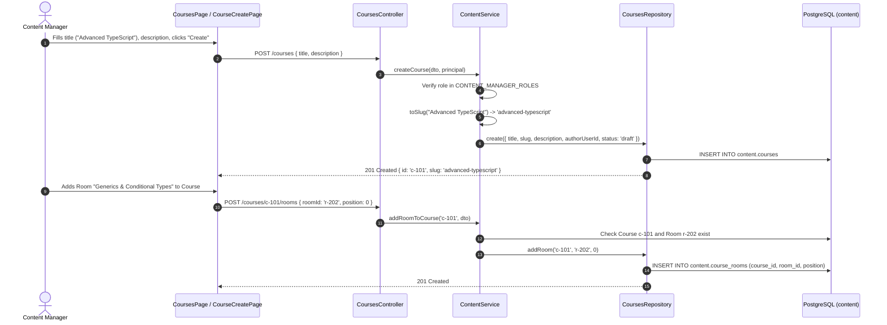
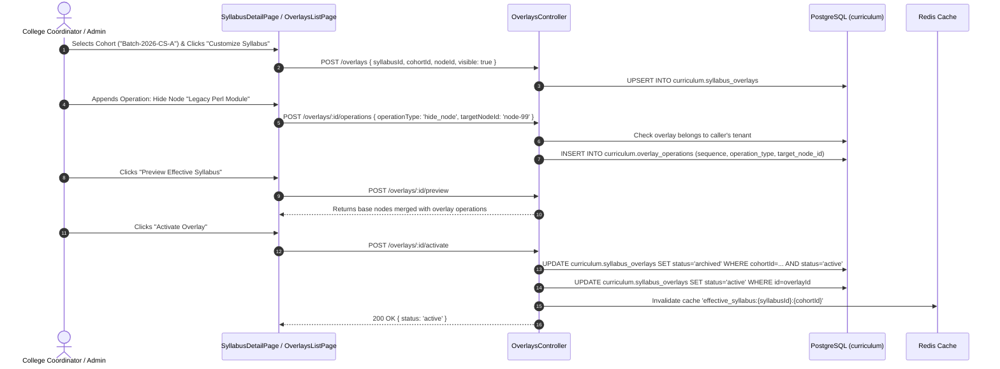
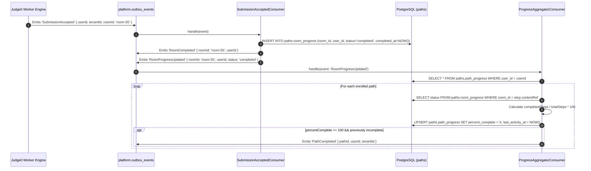
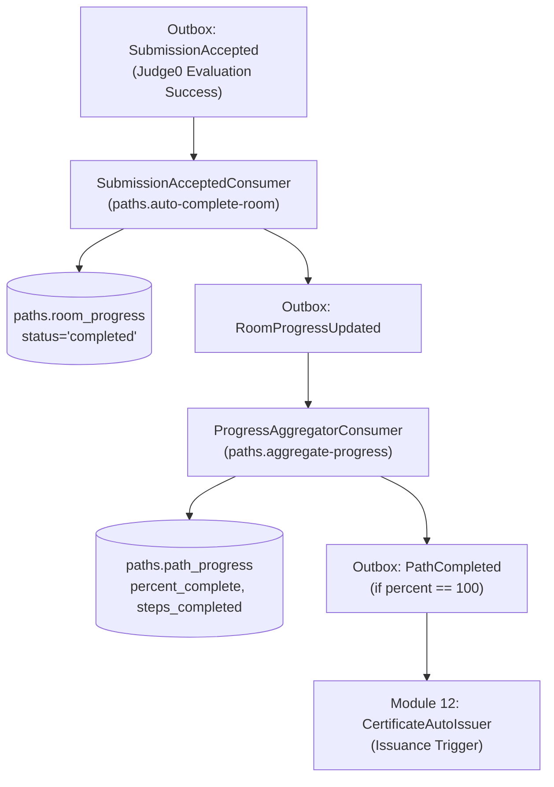

# DEZOLVER FUNCTIONAL SPECIFICATION
## Module 04 — Course & Enrollment

---

### DOCUMENT CONTROL
- **Document Identifier:** `DEZ-SPEC-MOD-004`
- **Module Name:** Course & Enrollment Management
- **Domain:** Content Architecture, Curriculum Syllabi, Cohort Differential Overlays & Learning Path Progression
- **Compliance Standard:** `FUNCTIONAL-SPECIFICATION-STANDARD.md` (`DEZ-STD-FS-001`)
- **Investigation Baseline:** Legacy Application Source Code (`src/content/`, `src/curriculum/`, `src/paths/`, `prisma/content/`, `prisma/curriculum/`, `prisma/paths/`, `frontend/src/pages/content/courses/`, `frontend/src/pages/curriculum/`, `frontend/src/pages/paths/`)
- **Status:** Complete Legacy Forensic Reconstruction
- **Last Verification Date:** November 2026

---

## SECTION A: MODULE OVERVIEW & SCOPE DEFINITION

### A.1 Domain Boundaries & Primary Responsibility
Module 4 governs educational structuring, syllabus authoring, cohort-level curriculum customization, learning path journeys, and student progress tracking within the Dezolver platform. In the legacy codebase, educational delivery does not reside in a monolithic "LMS" module; rather, it is decoupled across three specialized domains:
1. **Course & Room Content Architecture (`content` schema):** Curating modular interactive learning environments (`Room`) and grouping them into ordered, public collections (`Course`) linked through positional join entities (`CourseRoom`).
2. **Curriculum & Differential Overlay Engine (`curriculum` schema):** Authoring hierarchical syllabus trees (`Syllabus`, `SyllabusNode`) at the tenant level, providing fine-grained cohort differentiation through an operation-based overlay engine (`SyllabusOverlay`, `OverlayOperation`), and delivering high-performance, Redis-cached effective trees (`EffectiveSyllabusResolver`).
3. **Learning Paths & Progression Tracking (`paths` schema):** Defining structured, step-by-step career and skill paths (`Path`, `PathStep`), recording student enrollment and completion metrics (`PathProgress`), and dynamically updating student mastery in response to asynchronous Judge0 code evaluations.

### A.2 Implementation Reality vs. Architectural Fiction: The Course Enrollment Finding
A critical forensic mandate of this investigation was to determine how **Course Enrollment** was implemented.

> [!CAUTION]
> **CRITICAL FORENSIC DISCOVERY — DIRECT COURSE ENROLLMENT DOES NOT EXIST**
> 
> Across the entire codebase (`src/`, `prisma/`, and `frontend/src/`):
> 1. **Zero Database Tables for Course Enrollment:** There is no `CourseEnrollment`, `UserCourse`, `Enrollment`, or `StudentCourse` entity in any Prisma schema.
> 2. **Courses are Stateless Content Containers:** In [`prisma/content/schema.prisma#L80-L95`](file:///E:/Dezolver project/dezlovers-main/Final product/dezlovers-main(cuurent update)/prisma/content/schema.prisma#L80-L95), a `Course` consists solely of metadata (`slug`, `title`, `description`, `status`) and a 1:N relationship to `CourseRoom`. There are no student foreign keys, enrollment dates, or completion flags on courses.
> 3. **Enrollment is Path-Centric:** Student learning enrollment is modeled exclusively through **Learning Paths** via `PathProgress` (`paths.path_progress`). A student is considered "enrolled" when they possess a `PathProgress` record for a specific `pathId`.
> 4. **Academic Delivery is Cohort/Syllabus-Centric:** Academic institutional learning is delivered by assigning a `Syllabus` to a tenant and customizing it per `Cohort` via `SyllabusOverlay`, rather than enrolling students into individual standalone courses.

### A.3 In-Scope vs. Out-of-Scope Systems
- **In-Scope (Fully Implemented in Source Code):**
  - Course creation, slug-based public lookup, and room attachment/removal via [`src/content/controllers/courses.controller.ts`](file:///E:/Dezolver project/dezlovers-main/Final product/dezlovers-main(cuurent update)/src/content/controllers/courses.controller.ts).
  - Room lifecycle transitions (`draft` $\to$ `review` $\to$ `published` $\to$ `archived`) and version rollback via [`src/content/controllers/rooms.controller.ts`](file:///E:/Dezolver project/dezlovers-main/Final product/dezlovers-main(cuurent update)/src/content/controllers/rooms.controller.ts).
  - Hierarchical syllabus tree creation and node management (`topic`, `subtopic`, `room`, `problem`, `assessment`) via [`src/curriculum/controllers/curriculum.controller.ts`](file:///E:/Dezolver project/dezlovers-main/Final product/dezlovers-main(cuurent update)/src/curriculum/controllers/curriculum.controller.ts).
  - Differential syllabus overlays with typed operations (`hide_node`, `reorder_children`, `rename_node`, `remap_content`, `add_child_node`) and conflict detection via [`src/curriculum/controllers/overlays.controller.ts`](file:///E:/Dezolver project/dezlovers-main/Final product/dezlovers-main(cuurent update)/src/curriculum/controllers/overlays.controller.ts).
  - Redis-cached effective syllabus resolution via [`src/curriculum/services/effective-syllabus.resolver.ts`](file:///E:/Dezolver project/dezlovers-main/Final product/dezlovers-main(cuurent update)/src/curriculum/services/effective-syllabus.resolver.ts).
  - Learning path management, step sequencing, forking, and enrolled path listing via [`src/paths/controllers/paths.controller.ts`](file:///E:/Dezolver project/dezlovers-main/Final product/dezlovers-main(cuurent update)/src/paths/controllers/paths.controller.ts) and [`src/paths/controllers/me-paths.controller.ts`](file:///E:/Dezolver project/dezlovers-main/Final product/dezlovers-main(cuurent update)/src/paths/controllers/me-paths.controller.ts).
  - Asynchronous progress aggregation via [`src/paths/consumers/progress-aggregator.consumer.ts`](file:///E:/Dezolver project/dezlovers-main/Final product/dezlovers-main(cuurent update)/src/paths/consumers/progress-aggregator.consumer.ts).
  - Automated room completion upon Judge0 test case success via [`src/paths/consumers/submission-accepted.consumer.ts`](file:///E:/Dezolver project/dezlovers-main/Final product/dezlovers-main(cuurent update)/src/paths/consumers/submission-accepted.consumer.ts).
- **Out-of-Scope (Absent / Missing in Implementation):**
  - Course-level self-enrollment endpoints or student completion certificates at the course level.
  - Course prerequisites or co-requisite validation logic.
  - `Domain` database entity (queried dynamically in `SyllabusRepository` but omitted from schema).
  - `UserSyllabusAssignment` entity (queried dynamically in `SyllabusRepository` but omitted from schema; `GET /me/syllabus` always throws 404).
  - `CareerMap` entity (queried dynamically in `PathsRepository` but omitted from schema; `GET /career-maps` always returns empty array).

### A.4 Cross-Module Dependencies
- **Module 1 (Authentication):** Injects caller credentials (`userId`, `tenantId`, `roles`, `cohortId`).
- **Module 2 (Organization & Tenancy):** Provides `tenantId` for syllabus scoping and `cohortId` for syllabus overlay targeting.
- **Module 5 (Problem Management):** Problems defined in `content.problems` are referenced as syllabus leaf nodes (`kind = 'problem'`) and path steps.
- **Module 6 & 7 (Submission & Evaluation):** Judge0 evaluation success emits `SubmissionAccepted`, which triggers automatic room and path progress advancement in Module 4.
- **Module 12 (Certificates):** Path completion (`PathCompleted`) triggers automated certificate issuance.

---

## SECTION B: CORE BUSINESS RULES & DOMAIN LOGIC

### B.1 Content Curation & Course Structuring Rules
1. **Course Slugs:** Slugs are auto-generated from titles (`toLowerCase().replace(/[^a-z0-9]+/g, '-').replace(/^-|-$/g, '')`) or provided explicitly. Slugs must be globally unique across `content.courses`.
2. **Room Positioning:** Rooms are mapped to courses via `content.course_rooms`. Positions are 0-indexed integers (`position Int @default(0)`). Adding a room to a course enforces uniqueness on `(courseId, roomId)`.
3. **Room Publication Lifecycle:** Rooms must progress through a 4-state lifecycle:
   $$\text{draft} \longrightarrow \text{review} \longrightarrow \text{published} \longrightarrow \text{archived}$$
   - Only `content_manager`, `platform_admin`, or `platform_moderator` can transition rooms.
   - Reverting from `review` back to `draft` is permitted; all other backward transitions are blocked ([`src/content/services/content.service.ts#L154-L162`](file:///E:/Dezolver project/dezlovers-main/Final product/dezlovers-main(cuurent update)/src/content/services/content.service.ts#L154-L162)).

### B.2 Hierarchical Curriculum & Node Rules
1. **Node Kinds:** Syllabus tree nodes must have one of 5 kinds:
   - `topic`: Structural parent node.
   - `subtopic`: Intermediate structural node.
   - `room`: Interactive learning room reference (`contentRef = roomId`).
   - `problem`: Coding problem reference (`contentRef = problemId`).
   - `assessment`: Graded exam/contest reference (`contentRef = assessmentId`).
   Source: [`src/curriculum/controllers/curriculum.controller.ts#L28-L29`](file:///E:/Dezolver project/dezlovers-main/Final product/dezlovers-main(cuurent update)/src/curriculum/controllers/curriculum.controller.ts#L28-L29).
2. **Adjacency List Tree Model:** Syllabus nodes model arbitrary hierarchy via `parentId` referencing `curriculum.syllabus_nodes(id)` with `onDelete: Cascade`.

### B.3 Cohort Differential Overlay Engine Rules
To allow different academic cohorts within the same institution to follow modified variations of a master syllabus without duplicating content, Dezolver implements a differential overlay engine:
1. **Overlay Operations:** Overlays apply sequential, typed operations (`sequence Int`):
   - `hide_node`: Sets node visibility to `false`. Hides the target node and its children from the effective tree.
   - `rename_node`: Replaces `title` with `payload.title`.
   - `remap_content`: Replaces `contentRef` with `payload.contentRef`.
   - `reorder_children`: Re-indexes children positions based on an ordered array of node UUIDs in `payload.order`.
   - `add_child_node`: Synthesizes an ephemeral child node under `targetNodeId` with `payload.id`, `payload.title`, and `payload.kind`.
2. **Conflict Detection & Upgrade:**
   - If a node referenced by an overlay operation (`targetNodeId`) is deleted or moved in the base syllabus, [`OverlaysController.conflicts`](file:///E:/Dezolver project/dezlovers-main/Final product/dezlovers-main(cuurent update)/src/curriculum/controllers/overlays.controller.ts#L170-L184) flags the operation as conflicting (`Node {id} no longer exists`).
   - Executing `POST /overlays/:id/upgrade` automatically purges orphaned operations and marks the overlay current.
3. **Effective Syllabus Caching:**
   - Evaluated trees are cached in Redis under `effective_syllabus:{syllabusId}:{cohortId}` with a TTL of 1,800 seconds (30 minutes).
   - Invalidation occurs when overlay operations or base syllabus nodes are modified.

### B.4 Learning Path Progression & Scoring Rules
1. **Step Kinds:** Path steps are ordered linearly (`position Int`) and support kinds: `room`, `problem`, `assessment`, `external`.
2. **Progress Calculation Formula:** Path completion percentage is strictly step-count based:
   $$\text{percentComplete} = \begin{cases} 0 & \text{if } \text{stepsTotal} = 0 \\ \left( \frac{\text{stepsCompleted}}{\text{stepsTotal}} \right) \times 100 & \text{if } \text{stepsTotal} > 0 \end{cases}$$
3. **Step Completion Criteria:**
   - For `room` or `content` steps: Completed if the user has a record in `paths.room_progress` with `status = 'completed'` or `status = 'skipped'`.
   - For non-room steps (`problem`, `assessment`, `external`): Automatically counted as completed in the aggregation loop ([`src/paths/consumers/progress-aggregator.consumer.ts#L34`](file:///E:/Dezolver project/dezlovers-main/Final product/dezlovers-main(cuurent update)/src/paths/consumers/progress-aggregator.consumer.ts#L34)).
4. **Completion Trigger:** When `percentComplete >= 100` and `PathProgress.completedAt` was previously null, the system sets `completedAt = NOW()` and emits `PathCompleted` via the transactional outbox.

### B.5 Path Forking Rules
Students can fork any published learning path into a personalized path:
- Creates a new `Path` with `status = 'draft'`, `slug = {originalSlug}-fork-{timestamp}`, and `authorUserId = caller.userId`.
- Clones all original `PathStep` records with matching positions and content references.

---

## SECTION C: DATABASE ENTITIES & SCHEMA MAPPING

Module 4 spans three separate PostgreSQL database schemas: `content`, `curriculum`, and `paths`.

### C.1 Entity Relationship Diagram



### C.2 Detailed Schema Columns & Technical Constraints

#### 1. Content Schema (`prisma/content/schema.prisma`)
- **`content.courses` (`Course`):**
  - `id`: `UUID`, PK, default `gen_random_uuid()`.
  - `slug`: `VARCHAR(255)`, Unique, Non-nullable. URL path identifier.
  - `title`: `VARCHAR(255)`, Non-nullable.
  - `description`: `TEXT`, Nullable.
  - `status`: `VARCHAR(20)`, Default `'draft'`. (`draft`, `published`, `archived`).
  - `author_user_id`: `UUID`, Nullable. User who drafted the course.
  - `created_at`, `updated_at`: `TIMESTAMPTZ`.
  - *Indexes:* `@@index([status])`.
- **`content.course_rooms` (`CourseRoom`):**
  - `id`: `UUID`, PK, default `gen_random_uuid()`.
  - `course_id`: `UUID`, FK referencing `content.courses(id)` on delete Cascade.
  - `room_id`: `UUID`, FK referencing `content.rooms(id)` on delete Cascade.
  - `position`: `INTEGER`, Default `0`. Order index.
  - *Constraints:* `@@unique([courseId, roomId])`, `@@index([courseId, position])`.
- **`content.rooms` (`Room`):**
  - `id`: `UUID`, PK, default `gen_random_uuid()`.
  - `slug`: `VARCHAR(255)`, Unique, Non-nullable.
  - `title`: `VARCHAR(255)`, Non-nullable.
  - `summary`: `TEXT`, Nullable.
  - `difficulty`: `VARCHAR(20)`, Default `'beginner'`.
  - `domain_codes`: `VARCHAR(64)[]`. Array of domain tags.
  - `skill_tags`: `VARCHAR(64)[]`.
  - `estimated_minutes`: `INTEGER`, Default `30`.
  - `body`: `JSONB`, Default `'[]'`. Interactive block content.
  - `status`: `VARCHAR(20)`, Default `'draft'`.
  - `author_user_id`: `UUID`, Nullable.
  - `published_at`: `TIMESTAMPTZ`, Nullable.
  - *Indexes:* `@@index([status, difficulty])`.
  - *Vulnerability:* **NO `tenant_id` column exists on `Room`.**

#### 2. Curriculum Schema (`prisma/curriculum/schema.prisma`)
- **`curriculum.syllabi` (`Syllabus`):**
  - `id`: `UUID`, PK, default `gen_random_uuid()`.
  - `tenant_id`: `UUID`, Non-nullable. Institutional owner.
  - `title`: `VARCHAR(255)`, Non-nullable.
  - `description`: `TEXT`, Nullable.
  - `status`: `VARCHAR(20)`, Default `'draft'`.
  - `created_by_user_id`: `UUID`, Non-nullable.
  - *Indexes:* `@@index([tenantId])`.
- **`curriculum.syllabus_nodes` (`SyllabusNode`):**
  - `id`: `UUID`, PK, default `gen_random_uuid()`.
  - `syllabus_id`: `UUID`, FK referencing `curriculum.syllabi(id)`.
  - `parent_id`: `UUID`, Nullable, FK self-referencing `curriculum.syllabus_nodes(id)`.
  - `title`: `VARCHAR(255)`, Non-nullable.
  - `kind`: `VARCHAR(30)`, Non-nullable (`topic`, `subtopic`, `room`, `problem`, `assessment`).
  - `content_ref`: `VARCHAR(255)`, Nullable. UUID of referenced room, problem, or assessment.
  - `position`: `INTEGER`, Default `0`.
  - `metadata`: `JSONB`, Default `'{}'`.
  - *Indexes:* `@@index([syllabusId, parentId])`.
- **`curriculum.syllabus_overlays` (`SyllabusOverlay`):**
  - `id`: `UUID`, PK, default `gen_random_uuid()`.
  - `syllabus_id`: `UUID`, FK referencing `curriculum.syllabi(id)`.
  - `cohort_id`: `UUID`, Non-nullable. Target academic cohort.
  - `node_id`: `UUID`, Non-nullable. Base node reference.
  - `due_date`: `TIMESTAMPTZ`, Nullable. Target completion deadline.
  - `visible`: `BOOLEAN`, Default `true`. Visibility toggle.
  - `status`: `VARCHAR(20)`, Default `'draft'`.
  - *Constraints:* `@@unique([syllabusId, cohortId, nodeId], map: "syllabus_overlay_unique")`.
- **`curriculum.overlay_operations` (`OverlayOperation`):**
  - `id`: `UUID`, PK, default `gen_random_uuid()`.
  - `overlay_id`: `UUID`, FK referencing `curriculum.syllabus_overlays(id)` on delete Cascade.
  - `sequence`: `INTEGER`, Non-nullable. Execution sequence.
  - `operation_type`: `VARCHAR(50)`, Non-nullable (`hide_node`, `reorder_children`, `rename_node`, `remap_content`, `add_child_node`).
  - `target_node_id`: `UUID`, Non-nullable.
  - `payload`: `JSONB`, Default `'{}'`.
  - *Indexes:* `@@index([overlayId, sequence])`.

#### 3. Paths Schema (`prisma/paths/schema.prisma`)
- **`paths.paths` (`Path`):**
  - `id`: `UUID`, PK, default `gen_random_uuid()`.
  - `slug`: `VARCHAR(255)`, Unique, Non-nullable.
  - `title`: `VARCHAR(255)`, Non-nullable.
  - `description`: `TEXT`, Nullable.
  - `status`: `VARCHAR(20)`, Default `'draft'`.
  - `author_user_id`: `UUID`, Nullable.
  - *Indexes:* `@@index([status])`.
- **`paths.path_steps` (`PathStep`):**
  - `id`: `UUID`, PK, default `gen_random_uuid()`.
  - `path_id`: `UUID`, FK referencing `paths.paths(id)`.
  - `position`: `INTEGER`, Non-nullable. Step order index.
  - `title`: `VARCHAR(255)`, Non-nullable.
  - `kind`: `VARCHAR(30)`, Non-nullable (`room`, `problem`, `assessment`, `external`).
  - `content_ref`: `VARCHAR(255)`, Nullable.
  - `estimated_minutes`: `INTEGER`, Nullable.
  - `is_required`: `BOOLEAN`, Default `true`.
  - *Indexes:* `@@index([pathId, position])`.
- **`paths.path_progress` (`PathProgress`):**
  - `id`: `UUID`, PK, default `gen_random_uuid()`.
  - `path_id`: `UUID`, FK referencing `paths.paths(id)`.
  - `user_id`: `UUID`, Non-nullable. Student identifier.
  - `tenant_id`: `UUID`, Non-nullable.
  - `steps_completed`: `INTEGER`, Default `0`.
  - `steps_total`: `INTEGER`, Non-nullable.
  - `percent_complete`: `DOUBLE PRECISION`, Default `0`.
  - `last_activity_at`: `TIMESTAMPTZ`, Non-nullable.
  - `completed_at`: `TIMESTAMPTZ`, Nullable.
  - *Constraints:* `@@unique([pathId, userId], map: "pathId_userId")`, `@@index([tenantId, userId])`.
- **Unmodeled Table: `paths.room_progress`:**
  - Accessed via raw SQL queries in [`me-paths.controller.ts`](file:///E:/Dezolver project/dezlovers-main/Final product/dezlovers-main(cuurent update)/src/paths/controllers/me-paths.controller.ts#L83-L88) and [`submission-accepted.consumer.ts`](file:///E:/Dezolver project/dezlovers-main/Final product/dezlovers-main(cuurent update)/src/paths/consumers/submission-accepted.consumer.ts#L22-L28).
  - Columns: `id UUID`, `room_id UUID`, `user_id UUID`, `tenant_id UUID`, `status VARCHAR`, `started_at TIMESTAMPTZ`, `skipped_at TIMESTAMPTZ`, `completed_at TIMESTAMPTZ`, `created_at TIMESTAMPTZ`, `updated_at TIMESTAMPTZ`.
  - Unique Constraint: `(room_id, user_id)`.

---

## SECTION D: ROLE-BASED ACCESS CONTROL (RBAC) & TENANT BOUNDARIES

### D.1 RBAC Permission Matrix

| Endpoint | Method | Code Permission | Intended Role | Implementation Reality / Discrepancy |
|---|---|---|---|---|
| `/courses` | `GET` | `@Public()` | Anonymous | Published courses are publicly readable. Correct. |
| `/courses/:slug` | `GET` | `@Public()` | Anonymous | Course details and room ordering are public. Correct. |
| `/courses` | `POST` | `create:content` | `content_manager` | Requires `create:content` + role check in service. |
| `/courses/:id/rooms` | `POST` | `create:content` | `content_manager` | Attaches room to course. Correct. |
| `/courses/:id/rooms/:roomId` | `DELETE`| `create:content` | `content_manager` | Removes room from course. Correct. |
| `/rooms` | `GET` | `@Public()` | Anonymous | Published rooms are public. Correct. |
| `/rooms/:slug` | `GET` | `@Public()` | Anonymous | Room body and metadata are public. Correct. |
| `/rooms` | `POST` | `create:content` | `content_manager` | Drafts new room. Correct. |
| `/rooms/:id` | `PATCH` | `create:content` | `content_manager` | Updates room body/metadata. Correct. |
| `/rooms/:id/submit-for-review` | `POST` | `create:content` | `content_manager` | Transitions `draft` $\to$ `review`. Correct. |
| `/rooms/:id/approve` | `POST` | `publish:content` | `content_manager` | Transitions `review` $\to$ `published`. Correct. |
| `/rooms/:id/archive` | `POST` | `publish:content` | `content_manager` | Transitions `published` $\to$ `archived`. Correct. |
| `/syllabi` | `GET` | `read:cohort` | `student`, `faculty` | Scoped to caller's `tenantId`. Correct. |
| `/syllabi/:id` | `GET` | `read:cohort` | `student`, `faculty` | **IDOR:** Fetches by `id` without verifying `tenantId`. |
| `/syllabi` | `POST` | `manage:cohort` | `college_admin`, `coordinator` | Scoped to caller's `tenantId`. Correct. |
| `/syllabi/:id/nodes` | `POST` | `manage:cohort` | `college_admin`, `coordinator` | **IDOR:** Appends node without verifying syllabus tenant. |
| `/syllabi/:id/publish` | `POST` | `manage:cohort` | `college_admin`, `coordinator` | **IDOR:** Publishes syllabus without verifying tenant. |
| `/tenants/:id/overlays` | `GET` | `manage:cohort` | `college_admin` | Lists tenant overlays. Correct. |
| `/overlays` | `POST` | `manage:cohort` | `college_admin` | Upserts overlay entry. Correct. |
| `/overlays/:id/operations` | `POST` | `manage:cohort` | `college_admin` | Explicitly checks tenant access via `assertOverlayAccess`. Correct. |
| `/overlays/:id/activate` | `POST` | `manage:cohort` | `college_admin` | Archives other active overlays and sets live. Correct. |
| `/me/syllabus` | `GET` | `read:cohort` | `student` | Calls missing `userSyllabusAssignment` $\to$ **Always 404**. |
| `/me/syllabus/:id/effective` | `GET` | `read:cohort` | `student` | Resolves effective tree; Redis cached. |
| `/domains` | `GET` | `read:cohort` | All tenant users | Calls missing `domain` $\to$ **Always returns `[]`**. |
| `/paths` | `GET` | `@Public()` | Anonymous | Published paths are public. Correct. |
| `/paths/:slug` | `GET` | `@Public()` | Anonymous | Path steps and metadata are public. Correct. |
| `/paths` | `POST` | `create:content` | `content_manager` | Drafts path. Correct. |
| `/paths/:id/steps` | `POST` | `create:content` | `content_manager` | Appends step. Correct. |
| `/paths/:id/fork` | `POST` | `create:content` | `student` | **BUG:** Fork endpoint requires `create:content`, blocking students from forking paths. |
| `/me/paths` | `GET` | `read:cohort` | `student` | Lists enrolled paths with progress. Correct. |
| `/me/rooms/:roomId/start` | `POST` | `read:cohort` | `student` | Queries missing `tenantId` on Room $\to$ **Always 404**. |
| `/me/rooms/:roomId/complete` | `POST` | `read:cohort` | `student` | Queries missing `tenantId` on Room $\to$ **Always 404**. |
| `/career-maps` | `GET` | `@Public()` | Anonymous | Calls missing `careerMap` $\to$ **Always returns `[]`**. |

### D.2 Tenant Isolation Vulnerabilities & Flaws
1. **Unscoped Syllabus Lookups (`GET /syllabi/:id`):**
   In [`src/curriculum/controllers/curriculum.controller.ts#L63-L65`](file:///E:/Dezolver project/dezlovers-main/Final product/dezlovers-main(cuurent update)/src/curriculum/controllers/curriculum.controller.ts#L63-L65), `this.syllabusRepo.findById(id)` executes without matching `tenantId: req.principal.tenantId`. Any user in Tenant A can inspect the full private syllabus tree of Tenant B.
2. **Missing `tenantId` on Content Entities:**
   Neither `content.courses` nor `content.rooms` possess a `tenant_id` column. They are global content items. However, [`src/paths/controllers/me-paths.controller.ts#L54-L58`](file:///E:/Dezolver project/dezlovers-main/Final product/dezlovers-main(cuurent update)/src/paths/controllers/me-paths.controller.ts#L54-L58) attempts to query:
   ```typescript
   await this.prisma.content.room.findFirst({
     where: { id: roomId, tenantId },
     select: { id: true },
   });
   ```
   Because `tenantId` is not defined on `Room`, this query always fails, breaking all student room progression.

---

## SECTION E: END-TO-END FUNCTIONAL WORKFLOWS

### E.1 Workflow 1: Course Creation & Room Content Sequencing



### E.2 Workflow 2: Cohort Differential Syllabus Customization & Conflict Resolution



### E.3 Workflow 3: Automated Progress Aggregation upon Judge0 Acceptance



---

## SECTION F: COMPREHENSIVE API SPECIFICATIONS

### F.1 Course Endpoints (`CoursesController`)

#### `GET /courses`
- **Method / Path:** `GET /courses`
- **Controller:** [`src/content/controllers/courses.controller.ts#L24-L36`](file:///E:/Dezolver project/dezlovers-main/Final product/dezlovers-main(cuurent update)/src/content/controllers/courses.controller.ts#L24-L36)
- **Auth:** None (`@Public()`)
- **Query Parameters:** `limit` (int, default 20), `cursor` (UUID string).
- **Success Response (200 OK):**
  ```json
  {
    "items": [
      {
        "id": "c1a2b3c4-1111-4000-8000-000000000001",
        "slug": "data-structures-and-algorithms",
        "title": "Data Structures & Algorithms",
        "description": "Master foundational computer science algorithms.",
        "status": "published",
        "authorUserId": "u1a2b3c4-0000-4000-8000-000000000001",
        "createdAt": "2026-01-01T00:00:00.000Z",
        "updatedAt": "2026-01-15T00:00:00.000Z"
      }
    ],
    "nextCursor": "ZXlKaWRI..."
  }
  ```

#### `GET /courses/:slug`
- **Method / Path:** `GET /courses/:slug`
- **Controller:** [`src/content/controllers/courses.controller.ts#L38-L45`](file:///E:/Dezolver project/dezlovers-main/Final product/dezlovers-main(cuurent update)/src/content/controllers/courses.controller.ts#L38-L45)
- **Auth:** None (`@Public()`)
- **Success Response (200 OK):** Course object with ordered `rooms` joined via `content.course_rooms`.

#### `POST /courses`
- **Method / Path:** `POST /courses`
- **Controller:** [`src/content/controllers/courses.controller.ts#L47-L60`](file:///E:/Dezolver project/dezlovers-main/Final product/dezlovers-main(cuurent update)/src/content/controllers/courses.controller.ts#L47-L60)
- **Auth:** Bearer JWT | **Permission:** `create:content`
- **Request Body (`CreateCourseDto`):**
  ```json
  {
    "title": "Modern Full-Stack Engineering",
    "description": "Comprehensive React and NestJS track.",
    "slug": "modern-full-stack"
  }
  ```
- **Success Response (201 Created):** Created draft course entity.

#### `POST /courses/:id/rooms`
- **Method / Path:** `POST /courses/:id/rooms`
- **Controller:** [`src/content/controllers/courses.controller.ts#L62-L76`](file:///E:/Dezolver project/dezlovers-main/Final product/dezlovers-main(cuurent update)/src/content/controllers/courses.controller.ts#L62-L76)
- **Auth:** Bearer JWT | **Permission:** `create:content`
- **Request Body (`AddRoomToCourseDto`):** `{ "roomId": "r-55", "position": 1 }`
- **Success Response (201 Created):** Created `CourseRoom` record.

#### `DELETE /courses/:id/rooms/:roomId`
- **Method / Path:** `DELETE /courses/:id/rooms/:roomId`
- **Controller:** [`src/content/controllers/courses.controller.ts#L78-L91`](file:///E:/Dezolver project/dezlovers-main/Final product/dezlovers-main(cuurent update)/src/content/controllers/courses.controller.ts#L78-L91)
- **Auth:** Bearer JWT | **Permission:** `create:content`
- **Success Response:** `204 No Content`.

---

### F.2 Curriculum & Overlay Endpoints (`CurriculumController`, `OverlaysController`, `MeSyllabusController`)

#### `GET /syllabi`
- **Method / Path:** `GET /syllabi`
- **Controller:** [`src/curriculum/controllers/curriculum.controller.ts#L48-L55`](file:///E:/Dezolver project/dezlovers-main/Final product/dezlovers-main(cuurent update)/src/curriculum/controllers/curriculum.controller.ts#L48-L55)
- **Auth:** Bearer JWT | **Permission:** `read:cohort`
- **Success Response (200 OK):** Array of syllabi belonging to `req.principal.tenantId`.

#### `GET /syllabi/:id`
- **Method / Path:** `GET /syllabi/:id`
- **Controller:** [`src/curriculum/controllers/curriculum.controller.ts#L57-L65`](file:///E:/Dezolver project/dezlovers-main/Final product/dezlovers-main(cuurent update)/src/curriculum/controllers/curriculum.controller.ts#L57-L65)
- **Auth:** Bearer JWT | **Permission:** `read:cohort`
- **Success Response (200 OK):** Full syllabus with nested node tree ordered by `parentId` and `position`.

#### `POST /syllabi`
- **Method / Path:** `POST /syllabi`
- **Controller:** [`src/curriculum/controllers/curriculum.controller.ts#L67-L82`](file:///E:/Dezolver project/dezlovers-main/Final product/dezlovers-main(cuurent update)/src/curriculum/controllers/curriculum.controller.ts#L67-L82)
- **Auth:** Bearer JWT | **Permission:** `manage:cohort`
- **Request Body (`CreateSyllabusDto`):** `{ "title": "B.Tech Computer Science 2026", "description": "Core Curriculum" }`
- **Success Response (201 Created):** Created syllabus entity.

#### `POST /syllabi/:id/nodes`
- **Method / Path:** `POST /syllabi/:id/nodes`
- **Controller:** [`src/curriculum/controllers/curriculum.controller.ts#L84-L100`](file:///E:/Dezolver project/dezlovers-main/Final product/dezlovers-main(cuurent update)/src/curriculum/controllers/curriculum.controller.ts#L84-L100)
- **Auth:** Bearer JWT | **Permission:** `manage:cohort`
- **Request Body (`AddNodeDto`):**
  ```json
  {
    "title": "Dynamic Programming",
    "kind": "topic",
    "parentId": "node-root-1",
    "contentRef": null,
    "position": 3
  }
  ```
- **Success Response (201 Created):** Created `SyllabusNode` entity.

#### `POST /overlays`
- **Method / Path:** `POST /overlays`
- **Controller:** [`src/curriculum/controllers/overlays.controller.ts#L71-L82`](file:///E:/Dezolver project/dezlovers-main/Final product/dezlovers-main(cuurent update)/src/curriculum/controllers/overlays.controller.ts#L71-L82)
- **Auth:** Bearer JWT | **Permission:** `manage:cohort`
- **Request Body (`UpsertOverlayDto`):** `{ "syllabusId": "s-1", "cohortId": "c-2", "nodeId": "n-3", "dueDate": "2026-05-01T00:00:00Z", "visible": true }`
- **Success Response (200 OK):** Upserted `SyllabusOverlay` entity.

#### `POST /overlays/:id/operations`
- **Method / Path:** `POST /overlays/:id/operations`
- **Controller:** [`src/curriculum/controllers/overlays.controller.ts#L96-L123`](file:///E:/Dezolver project/dezlovers-main/Final product/dezlovers-main(cuurent update)/src/curriculum/controllers/overlays.controller.ts#L96-L123)
- **Auth:** Bearer JWT | **Permission:** `manage:cohort`
- **Request Body (`AppendOperationDto`):**
  ```json
  {
    "operationType": "hide_node",
    "targetNodeId": "node-legacy-perl",
    "payload": {}
  }
  ```
- **Success Response (201 Created):** `{ "id": "op-uuid", "sequence": 1 }`.

#### `GET /me/syllabus/:syllabusId/effective`
- **Method / Path:** `GET /me/syllabus/:syllabusId/effective`
- **Controller:** [`src/curriculum/controllers/me-syllabus.controller.ts#L29-L49`](file:///E:/Dezolver project/dezlovers-main/Final product/dezlovers-main(cuurent update)/src/curriculum/controllers/me-syllabus.controller.ts#L29-L49)
- **Auth:** Bearer JWT | **Permission:** `read:cohort`
- **Success Response (200 OK):** Array of effective nodes for the student's cohort with overlay operations applied, filtered by visibility, cached in Redis for 30 minutes.

---

### F.3 Learning Paths & Progression Endpoints (`PathsController`, `MePathsController`)

#### `GET /paths`
- **Method / Path:** `GET /paths`
- **Controller:** [`src/paths/controllers/paths.controller.ts#L63-L79`](file:///E:/Dezolver project/dezlovers-main/Final product/dezlovers-main(cuurent update)/src/paths/controllers/paths.controller.ts#L63-L79)
- **Auth:** None (`@Public()`)
- **Success Response (200 OK):** Paginated published paths.

#### `GET /paths/:slug`
- **Method / Path:** `GET /paths/:slug`
- **Controller:** [`src/paths/controllers/paths.controller.ts#L81-L88`](file:///E:/Dezolver project/dezlovers-main/Final product/dezlovers-main(cuurent update)/src/paths/controllers/paths.controller.ts#L81-L88)
- **Auth:** None (`@Public()`)
- **Success Response (200 OK):** Path entity including ordered `steps`.

#### `POST /paths`
- **Method / Path:** `POST /paths`
- **Controller:** [`src/paths/controllers/paths.controller.ts#L90-L104`](file:///E:/Dezolver project/dezlovers-main/Final product/dezlovers-main(cuurent update)/src/paths/controllers/paths.controller.ts#L90-L104)
- **Auth:** Bearer JWT | **Permission:** `create:content`
- **Request Body (`CreatePathDto`):** `{ "title": "Backend Engineering with Go", "description": "High performance services" }`
- **Success Response (201 Created):** Created draft path entity.

#### `POST /paths/:id/fork`
- **Method / Path:** `POST /paths/:id/fork`
- **Controller:** [`src/paths/controllers/paths.controller.ts#L204-L216`](file:///E:/Dezolver project/dezlovers-main/Final product/dezlovers-main(cuurent update)/src/paths/controllers/paths.controller.ts#L204-L216)
- **Auth:** Bearer JWT | **Permission:** `create:content` *(Forensic Flaw: Blocks students lacking `create:content`)*
- **Success Response (201 Created):** Cloned personalized path entity.

#### `GET /me/paths`
- **Method / Path:** `GET /me/paths`
- **Controller:** [`src/paths/controllers/me-paths.controller.ts#L21-L28`](file:///E:/Dezolver project/dezlovers-main/Final product/dezlovers-main(cuurent update)/src/paths/controllers/me-paths.controller.ts#L21-L28)
- **Auth:** Bearer JWT | **Permission:** `read:cohort`
- **Success Response (200 OK):**
  ```json
  [
    {
      "id": "pp-101",
      "pathId": "p-1",
      "stepsCompleted": 4,
      "stepsTotal": 10,
      "percentComplete": 40.0,
      "lastActivityAt": "2026-02-01T12:00:00Z",
      "completedAt": null,
      "path": {
        "id": "p-1",
        "title": "Backend Engineering",
        "steps": [ ... ]
      }
    }
  ]
  ```

#### `POST /me/rooms/:roomId/start`
- **Method / Path:** `POST /me/rooms/:roomId/start`
- **Controller:** [`src/paths/controllers/me-paths.controller.ts#L69-L98`](file:///E:/Dezolver project/dezlovers-main/Final product/dezlovers-main(cuurent update)/src/paths/controllers/me-paths.controller.ts#L69-L98)
- **Auth:** Bearer JWT | **Permission:** `read:cohort`
- **Status:** **BROKEN (BUG-401)**. Querying non-existent `tenantId` on `content.rooms` throws 404 `room_not_found`.

#### `POST /me/rooms/:roomId/complete`
- **Method / Path:** `POST /me/rooms/:roomId/complete`
- **Controller:** [`src/paths/controllers/me-paths.controller.ts#L131-L167`](file:///E:/Dezolver project/dezlovers-main/Final product/dezlovers-main(cuurent update)/src/paths/controllers/me-paths.controller.ts#L131-L167)
- **Auth:** Bearer JWT | **Permission:** `read:cohort`
- **Status:** **BROKEN (BUG-401)**. Querying non-existent `tenantId` on `content.rooms` throws 404 `room_not_found`.

---

## SECTION G: FRONTEND IMPLEMENTATION & USER INTERFACE

### G.1 Frontend Page Matrix

| Domain | Route | Page Component | File Location | Key Capabilities |
|---|---|---|---|---|
| Courses | `/content/courses` | `CoursesPage` | [`frontend/src/pages/content/courses/CoursesPage.tsx`](file:///E:/Dezolver project/dezlovers-main/Final product/frontend/src/pages/content/courses/CoursesPage.tsx) | Published course cards, search filter, status dropdown, room count badge. |
| Courses | `/content/courses/create` | `CourseCreatePage` | [`frontend/src/pages/content/courses/CourseCreatePage.tsx`](file:///E:/Dezolver project/dezlovers-main/Final product/frontend/src/pages/content/courses/CourseCreatePage.tsx) | Draft course creation form (title, slug, description). |
| Courses | `/content/courses/:slug` | `CourseDetailPage` | [`frontend/src/pages/content/courses/CourseDetailPage.tsx`](file:///E:/Dezolver project/dezlovers-main/Final product/frontend/src/pages/content/courses/CourseDetailPage.tsx) | Ordered room list, reordering grip, remove room button, direct navigation to rooms. |
| Curriculum | `/curriculum` | `SyllabiListPage` | [`frontend/src/pages/curriculum/SyllabiListPage.tsx`](file:///E:/Dezolver project/dezlovers-main/Final product/frontend/src/pages/curriculum/SyllabiListPage.tsx) | Tenant syllabi table, status badges (`draft`, `published`, `archived`). |
| Curriculum | `/curriculum/:id` | `SyllabusDetailPage`| [`frontend/src/pages/curriculum/SyllabusDetailPage.tsx`](file:///E:/Dezolver project/dezlovers-main/Final product/frontend/src/pages/curriculum/SyllabusDetailPage.tsx) | Interactive syllabus tree visualizer, add node dialog, publish/archive actions. |
| Curriculum | `/curriculum/overlays` | `OverlaysListPage` | [`frontend/src/pages/curriculum/OverlaysListPage.tsx`](file:///E:/Dezolver project/dezlovers-main/Final product/frontend/src/pages/curriculum/OverlaysListPage.tsx) | Cohort overlays manager, live overlay indicator. |
| Curriculum | `/curriculum/overlays/:id` | `OverlayDetailPage` | [`frontend/src/pages/curriculum/OverlayDetailPage.tsx`](file:///E:/Dezolver project/dezlovers-main/Final product/frontend/src/pages/curriculum/OverlayDetailPage.tsx) | Sequence operation list, append operation dialog, conflict detector. |
| Paths | `/paths` | `PathsPage` | [`frontend/src/pages/paths/PathsPage.tsx`](file:///E:/Dezolver project/dezlovers-main/Final product/frontend/src/pages/paths/PathsPage.tsx) | Public paths catalog, domain filter, tabs (Platform, Curated, My Paths). |
| Paths | `/paths/:id` | `PathDetailPage` | [`frontend/src/pages/paths/PathDetailPage.tsx`](file:///E:/Dezolver project/dezlovers-main/Final product/frontend/src/pages/paths/PathDetailPage.tsx) | Circular progress ring, step journey map, fork action button. |
| Paths | `/me/progress` | `MyProgressPage` | [`frontend/src/pages/paths/MyProgressPage.tsx`](file:///E:/Dezolver project/dezlovers-main/Final product/frontend/src/pages/paths/MyProgressPage.tsx) | Active enrolled paths grid, milestone cards, earned certificate badges. |

### G.2 Interactive UI Components
1. **`SyllabusTree` ([`frontend/src/components/curriculum/SyllabusTree.tsx`](file:///E:/Dezolver project/dezlovers-main/Final product/frontend/src/components/curriculum/SyllabusTree.tsx)):** Renders recursive tree nodes with collapsible parent groups, kind badges (`topic`, `room`, `assessment`), and inline editing/deletion triggers.
2. **`JourneyMap` ([`frontend/src/components/paths/JourneyMap.tsx`](file:///E:/Dezolver project/dezlovers-main/Final product/frontend/src/components/paths/JourneyMap.tsx)):** Renders a vertical connected roadmap of path steps, highlighting the current active step and displaying completion checkmarks.

---

## SECTION H: BACKGROUND JOBS, QUEUES & SCHEDULED TASKS

Module 4 utilizes transactional outbox event consumers rather than independent cron jobs:



### H.1 Asynchronous Outbox Consumers

| Consumer Class | Consumer ID | Listened Event | Functional Logic |
|---|---|---|---|
| `SubmissionAcceptedConsumer` | `paths.auto-complete-room-on-submission-accepted` | `SubmissionAccepted` | Validates idempotency via `platform.consumed_events`. Marks room completed in `paths.room_progress` and emits `RoomCompleted` and `RoomProgressUpdated`. |
| `ProgressAggregatorConsumer` | `paths.aggregate-progress` | `RoomProgressUpdated` | Iterates all paths enrolled by the user. Queries completed room steps, calculates `(completed / total) * 100`, updates `paths.path_progress`, and emits `PathCompleted` if complete. |

---

## SECTION I: REAL-TIME & EVENT-DRIVEN ARCHITECTURE

### I.1 Transactional Outbox Events Emitted

| Event Type | Aggregate Type | Aggregate ID | Emitted By | Payload |
|---|---|---|---|---|
| `RoomProgressUpdated` | `RoomProgress` | `roomId` | `MePathsController`, `SubmissionAcceptedConsumer` | `{ roomId, userId, tenantId, status }` |
| `RoomCompleted` | `RoomProgress` | `roomId` | `MePathsController`, `SubmissionAcceptedConsumer` | `{ roomId, userId, tenantId, completedAt }` |
| `PathCompleted` | `Path` | `path.id` | `ProgressAggregatorConsumer` | `{ pathId, userId, tenantId }` |

### I.2 Real-Time WebSocket Topics
- `ws.on('progress:path_completed')`: Frontend listens in [`MyProgressPage.tsx`](file:///E:/Dezolver project/dezlovers-main/Final product/frontend/src/pages/paths/MyProgressPage.tsx#L21-L26) and displays a celebratory toast notification when a path completion event arrives.

---

## SECTION J: EXTERNAL INTEGRATIONS & THIRD-PARTY SERVICES

1. **Redis Caching Layer:**
   - Provider: [`RedisService`](file:///E:/Dezolver project/dezlovers-main/Final product/dezlovers-main(cuurent update)/src/shared/redis/redis.service.ts).
   - Usage: Effective syllabus resolution trees are serialized and cached under `effective_syllabus:{syllabusId}:{cohortId}` for 1,800 seconds (30 minutes) to eliminate recursive SQL joins under high learner traffic.
2. **Judge0 Code Execution Bridge:**
   - Linkage: When Judge0 finishes grading a code submission and marks it accepted, Module 6/7 emits `SubmissionAccepted`, which directly triggers Module 4 progress advancement.

---

## SECTION K: EDGE CASES, FAILURE MODES & SYSTEM RESILIENCE

### K.1 Room Progress Crash on Missing `tenantId`
- *Failure Mode:* [`MePathsController.assertRoomAccess`](file:///E:/Dezolver project/dezlovers-main/Final product/dezlovers-main(cuurent update)/src/paths/controllers/me-paths.controller.ts#L54-L58) attempts `findFirst({ where: { id: roomId, tenantId } })`.
- *Resilience Failure:* Because `tenantId` is not in `content.rooms`, Prisma throws an unknown field exception. Caught by `.catch(() => null)`, causing `assertRoomAccess` to conclude the room does not exist and throw 404 `room_not_found`. Students are completely blocked from starting or completing rooms via this API.

### K.2 Orphaned Overlay Operations
- *Failure Mode:* An administrator deletes a node in the base syllabus tree while an active cohort overlay references that node in `hide_node` or `rename_node`.
- *Handling:* The system does not crash. [`EffectiveSyllabusResolver`](file:///E:/Dezolver project/dezlovers-main/Final product/dezlovers-main(cuurent update)/src/curriculum/services/effective-syllabus.resolver.ts#L65) safely ignores operations whose `targetNodeId` is absent from `nodeMap`. The conflict endpoint flags the anomaly for administrative upgrade.

---

## SECTION L: LEGACY BUGS, DISCREPANCIES & ARCHITECTURAL ANTI-PATTERNS

### L.1 Detailed Forensic Bug Disclosures

```
┌─────────────────────────────────────────────────────────────────────────────────────────────────┐
│                                    LEGACY DEFECT SUMMARY                                        │
├────────┬────────────────────────────────────────────────┬─────────────────────────────┬─────────┤
│ ID     │ Defect Title                                   │ Source File Location        │ Impact  │
├────────┼────────────────────────────────────────────────┼─────────────────────────────┼─────────┤
│ BUG-401│ Missing tenantId on Room Breaks Progress APIs  │ me-paths.controller.ts:55   │ CRITICAL│
│ BUG-402│ UserSyllabusAssignment Entity Missing in Schema│ syllabus.repository.ts:59   │ CRITICAL│
│ BUG-403│ Missing CareerMap & Domain Models in Prisma    │ paths.repo:123, syll.repo:66│ HIGH    │
│ BUG-404│ RoomProgress Model Missing in Prisma Schema    │ paths/schema.prisma         │ HIGH    │
│ BUG-405│ Student Path Forking Blocked by RBAC Guard     │ paths.controller.ts:206     │ HIGH    │
│ BUG-406│ Syllabus Detail & Nodes IDOR Vulnerability     │ curriculum.controller.ts:63 │ HIGH    │
│ BUG-407│ Complete Absence of Course Enrollment Model    │ content/schema.prisma       │ MEDIUM  │
└────────┴────────────────────────────────────────────────┴─────────────────────────────┴─────────┘
```

1. **BUG-401 (Critical — Room Access Check Crashes on Missing `tenantId`):**
   - *Code:* In [`src/paths/controllers/me-paths.controller.ts#L55`](file:///E:/Dezolver project/dezlovers-main/Final product/dezlovers-main(cuurent update)/src/paths/controllers/me-paths.controller.ts#L55):
     ```typescript
     const room = await this.prisma.content.room.findFirst({
       where: { id: roomId, tenantId }, // tenantId column does not exist on Room!
       select: { id: true },
     }).catch(() => null);
     if (!room) throw new NotFoundException({ code: 'room_not_found' });
     ```
   - *Impact:* `room` is always `null`. Every call to `POST /me/rooms/:roomId/start`, `POST /me/rooms/:roomId/skip`, and `POST /me/rooms/:roomId/complete` fails with HTTP 404.
2. **BUG-402 (Critical — Missing `UserSyllabusAssignment` Entity):**
   - *Code:* In [`src/curriculum/repositories/syllabus.repository.ts#L59`](file:///E:/Dezolver project/dezlovers-main/Final product/dezlovers-main(cuurent update)/src/curriculum/repositories/syllabus.repository.ts#L59):
     ```typescript
     return (this.prisma.curriculum as any).userSyllabusAssignment?.findFirst({ ... }) ?? null;
     ```
   - *Impact:* Model was never migrated to `prisma/curriculum/schema.prisma`. `GET /me/syllabus` always returns 404 `no_syllabus_assigned`.
3. **BUG-403 (High — Missing `CareerMap` and `Domain` Models):**
   - *Impact:* `(this.prisma.paths as any).careerMap` and `(this.prisma.curriculum as any).domain` fail silently via optional chaining, causing `GET /career-maps` and `GET /domains` to always return empty arrays (`[]`).
4. **BUG-404 (High — `RoomProgress` Table Omitted from Prisma Client):**
   - *Impact:* `RoomProgress` is queried via raw SQL `$executeRaw` and `$queryRaw` because the table definition was omitted from `prisma/paths/schema.prisma`.
5. **BUG-405 (High — Path Forking Protected with Author Permission):**
   - *Impact:* [`PathsController.fork`](file:///E:/Dezolver project/dezlovers-main/Final product/dezlovers-main(cuurent update)/src/paths/controllers/paths.controller.ts#L206) is decorated with `@RequirePermission('create:content')`. Students lack this permission, so they receive 403 Forbidden when attempting to fork learning paths.

---

## SECTION M: DISCREPANCY RECONCILIATION: IMPLEMENTED VS. NON-IMPLEMENTED VS. INTENDED

| Architectural Feature | Intended / Conceptual Expectation | Actual Legacy Implementation Status | Recommended Remediation |
|---|---|---|---|
| **Course Structuring** | Courses group learning rooms. | **CONFIRMED IMPLEMENTED** via `content.courses` and `course_rooms`. | Add course category and tags. |
| **Course Enrollment** | Direct student enrollment into courses. | **NOT IMPLEMENTED** (0 code occurrences). | Add `content.course_enrollments` or formalize Path enrollment as standard. |
| **Syllabus Hierarchy** | Multi-level topic/subtopic trees. | **CONFIRMED IMPLEMENTED** via `curriculum.syllabus_nodes`. | Retain implementation. |
| **Cohort Overlays** | Differential JSON operations per cohort. | **CONFIRMED IMPLEMENTED** with active overlay resolution & conflict check. | Retain implementation. |
| **Student Syllabus** | Direct student syllabus view. | **DEFECTIVE / BROKEN** (`userSyllabusAssignment` missing from schema). | Add `UserSyllabusAssignment` entity to `prisma/curriculum/schema.prisma`. |
| **Learning Path Journeys**| Step sequences & progress tracking. | **CONFIRMED IMPLEMENTED** via `paths.paths` and `path_progress`. | Fix student fork permission from `create:content` to `fork:path`. |
| **Auto-Complete on Code** | Accepted submissions mark rooms done. | **CONFIRMED IMPLEMENTED** in `SubmissionAcceptedConsumer`. | Retain implementation. |
| **Room Progress APIs** | Students start/complete rooms. | **DEFECTIVE / BROKEN** (`where: { id, tenantId }` fails on `Room`). | Remove `tenantId` from room query or add `tenant_id` column to `Room`. |

---

## SECTION N: COMPLETE FUNCTIONAL INVENTORY & VERIFICATION TRACEABILITY

### N.1 Backend Implementation Inventory

| Function / Component ID | File Location | Class / Function Name | Functional Classification | Status |
|---|---|---|---|---|
| `FN-CRS-001` | `src/content/controllers/courses.controller.ts:28` | `CoursesController.list` | Published Course Catalog | CONFIRMED LEGACY IMPLEMENTATION |
| `FN-CRS-002` | `src/content/controllers/courses.controller.ts:43` | `CoursesController.getBySlug` | Course Detail Query | CONFIRMED LEGACY IMPLEMENTATION |
| `FN-CRS-003` | `src/content/controllers/courses.controller.ts:58` | `CoursesController.create` | Course Creation | CONFIRMED LEGACY IMPLEMENTATION |
| `FN-CRS-004` | `src/content/controllers/courses.controller.ts:74` | `CoursesController.addRoom` | Room Attachment to Course | CONFIRMED LEGACY IMPLEMENTATION |
| `FN-CRS-005` | `src/content/controllers/courses.controller.ts:89` | `CoursesController.removeRoom` | Room Removal from Course | CONFIRMED LEGACY IMPLEMENTATION |
| `FN-CRS-006` | `src/content/controllers/rooms.controller.ts:28` | `RoomsController.list` | Room Catalog Query | CONFIRMED LEGACY IMPLEMENTATION |
| `FN-CRS-007` | `src/content/controllers/rooms.controller.ts:47` | `RoomsController.getBySlug` | Room Detail Query | CONFIRMED LEGACY IMPLEMENTATION |
| `FN-CRS-008` | `src/content/controllers/rooms.controller.ts:62` | `RoomsController.create` | Room Creation | CONFIRMED LEGACY IMPLEMENTATION |
| `FN-CRS-009` | `src/content/controllers/rooms.controller.ts:77` | `RoomsController.update` | Room Draft Update | CONFIRMED LEGACY IMPLEMENTATION |
| `FN-CRS-010` | `src/content/controllers/rooms.controller.ts:92` | `RoomsController.submitForReview` | Transition draft $\to$ review | CONFIRMED LEGACY IMPLEMENTATION |
| `FN-CRS-011` | `src/content/controllers/rooms.controller.ts:107`| `RoomsController.approve` | Transition review $\to$ published | CONFIRMED LEGACY IMPLEMENTATION |
| `FN-CRS-012` | `src/content/controllers/rooms.controller.ts:150`| `RoomsController.archive` | Transition published $\to$ archived | CONFIRMED LEGACY IMPLEMENTATION |
| `FN-CRS-013` | `src/curriculum/controllers/curriculum.controller.ts:53` | `CurriculumController.list` | Tenant Syllabi Listing | CONFIRMED LEGACY IMPLEMENTATION |
| `FN-CRS-014` | `src/curriculum/controllers/curriculum.controller.ts:63` | `CurriculumController.getById` | Syllabus Tree Query | VULNERABLE (IDOR) |
| `FN-CRS-015` | `src/curriculum/controllers/curriculum.controller.ts:76` | `CurriculumController.create` | Syllabus Creation | CONFIRMED LEGACY IMPLEMENTATION |
| `FN-CRS-016` | `src/curriculum/controllers/curriculum.controller.ts:94` | `CurriculumController.addNode` | Syllabus Node Creation | CONFIRMED LEGACY IMPLEMENTATION |
| `FN-CRS-017` | `src/curriculum/controllers/curriculum.controller.ts:110`| `CurriculumController.updateNode` | Syllabus Node Update | CONFIRMED LEGACY IMPLEMENTATION |
| `FN-CRS-018` | `src/curriculum/controllers/curriculum.controller.ts:122`| `CurriculumController.deleteNode` | Syllabus Node Deletion | CONFIRMED LEGACY IMPLEMENTATION |
| `FN-CRS-019` | `src/curriculum/controllers/overlays.controller.ts:67` | `OverlaysController.listForTenant` | Tenant Overlays Listing | CONFIRMED LEGACY IMPLEMENTATION |
| `FN-CRS-020` | `src/curriculum/controllers/overlays.controller.ts:77` | `OverlaysController.upsert` | Overlay Upsert | CONFIRMED LEGACY IMPLEMENTATION |
| `FN-CRS-021` | `src/curriculum/controllers/overlays.controller.ts:103`| `OverlaysController.appendOperation` | Append Typed Operation | CONFIRMED LEGACY IMPLEMENTATION |
| `FN-CRS-022` | `src/curriculum/controllers/overlays.controller.ts:142`| `OverlaysController.preview` | Preview Merged Tree | CONFIRMED LEGACY IMPLEMENTATION |
| `FN-CRS-023` | `src/curriculum/controllers/overlays.controller.ts:157`| `OverlaysController.activate` | Make Overlay Live | CONFIRMED LEGACY IMPLEMENTATION |
| `FN-CRS-024` | `src/curriculum/controllers/overlays.controller.ts:174`| `OverlaysController.conflicts` | Detect Orphaned Operations | CONFIRMED LEGACY IMPLEMENTATION |
| `FN-CRS-025` | `src/curriculum/controllers/me-syllabus.controller.ts:23` | `MeSyllabusController.getMySyllabus` | Student Syllabus Query | DEFECTIVE (Missing Model) |
| `FN-CRS-026` | `src/curriculum/controllers/me-syllabus.controller.ts:36` | `MeSyllabusController.getEffectiveSyllabus`| Effective Tree Query | CONFIRMED LEGACY IMPLEMENTATION |
| `FN-CRS-027` | `src/curriculum/services/effective-syllabus.resolver.ts:16`| `EffectiveSyllabusResolver.resolve` | Overlay Merge & Cache | CONFIRMED LEGACY IMPLEMENTATION |
| `FN-CRS-028` | `src/paths/controllers/paths.controller.ts:67` | `PathsController.list` | Published Paths Listing | CONFIRMED LEGACY IMPLEMENTATION |
| `FN-CRS-029` | `src/paths/controllers/paths.controller.ts:86` | `PathsController.getBySlug` | Path Steps Query | CONFIRMED LEGACY IMPLEMENTATION |
| `FN-CRS-030` | `src/paths/controllers/paths.controller.ts:101`| `PathsController.create` | Path Creation | CONFIRMED LEGACY IMPLEMENTATION |
| `FN-CRS-031` | `src/paths/controllers/paths.controller.ts:158`| `PathsController.addStep` | Step Appending | CONFIRMED LEGACY IMPLEMENTATION |
| `FN-CRS-032` | `src/paths/controllers/paths.controller.ts:199`| `PathsController.reorderSteps` | Step Reordering | CONFIRMED LEGACY IMPLEMENTATION |
| `FN-CRS-033` | `src/paths/controllers/paths.controller.ts:214`| `PathsController.fork` | Path Forking | DEFECTIVE (RBAC Guard) |
| `FN-CRS-034` | `src/paths/controllers/me-paths.controller.ts:26` | `MePathsController.listMyPaths` | Enrolled Paths Query | CONFIRMED LEGACY IMPLEMENTATION |
| `FN-CRS-035` | `src/paths/controllers/me-paths.controller.ts:78` | `MePathsController.startRoom` | Mark Room Started | DEFECTIVE (tenantId Bug) |
| `FN-CRS-036` | `src/paths/controllers/me-paths.controller.ts:140`| `MePathsController.completeRoom` | Mark Room Completed | DEFECTIVE (tenantId Bug) |
| `FN-CRS-037` | `src/paths/consumers/progress-aggregator.consumer.ts:15`| `ProgressAggregatorConsumer.handle` | Recalculate Percentages | CONFIRMED LEGACY IMPLEMENTATION |
| `FN-CRS-038` | `src/paths/consumers/submission-accepted.consumer.ts:10`| `SubmissionAcceptedConsumer.handle` | Room Auto-Completion | CONFIRMED LEGACY IMPLEMENTATION |

---

## SECTION O: QA TEST SCENARIOS & ACCEPTANCE CRITERIA

```gherkin
Feature: Curriculum Syllabi, Overlays & Learning Path Progression

  Scenario: Author creates a course and attaches ordered rooms
    Given an authenticated user with role "content_manager"
    When the client posts to "/courses" with title "Algorithms Track"
    Then the response status is 201 Created
    And the course slug is "algorithms-track" with status "draft"
    When the client posts to "/courses/{courseId}/rooms" with roomId "room-101" and position 0
    Then the response status is 201 Created
    And querying "/courses/algorithms-track" returns the course with room "room-101" at position 0

  Scenario: Cohort coordinator activates differential syllabus overlay
    Given an authenticated user with role "college_admin"
    And an active syllabus with id "s-200" belonging to the caller's tenant
    When the coordinator appends an operation "hide_node" targeting node "node-obsolete"
    And submits "POST /overlays/{overlayId}/activate"
    Then the overlay status transitions to "active"
    And all other overlays for that syllabus and cohort are archived
    And fetching "/me/syllabus/{s-200}/effective" excludes "node-obsolete" from the node tree

  Scenario: Code submission acceptance advances path progress
    Given an enrolled student in path "p-300" containing step referencing room "room-50"
    And the student's initial path progress is 0%
    When a code submission for "room-50" passes all test cases and emits "SubmissionAccepted"
    Then "paths.room_progress" records room "room-50" as "completed"
    And "ProgressAggregatorConsumer" recalculates the student's progress on path "p-300"
    And "paths.path_progress" reflects the updated completion percentage
```

---

## SECTION P: TARGET RECOMMENDATIONS & REMEDIATIONS

1. **Remediate Room Progression Query (`BUG-401`):**
   - Update [`MePathsController.assertRoomAccess`](file:///E:/Dezolver project/dezlovers-main/Final product/dezlovers-main(cuurent update)/src/paths/controllers/me-paths.controller.ts#L54-L58) to query strictly by `id: roomId` without injecting `tenantId`:
     ```typescript
     const room = await this.prisma.content.room.findUnique({
       where: { id: roomId },
       select: { id: true },
     });
     ```
2. **Migrate Missing Schema Entities to Prisma (`BUG-402`, `BUG-403`, `BUG-404`):**
   - Add model `UserSyllabusAssignment` to `prisma/curriculum/schema.prisma`.
   - Add model `Domain` to `prisma/curriculum/schema.prisma`.
   - Add model `CareerMap` to `prisma/paths/schema.prisma`.
   - Add model `RoomProgress` to `prisma/paths/schema.prisma` to eliminate raw SQL `$executeRaw` dependencies.
3. **Correct Path Forking Permission Guard (`BUG-405`):**
   - Update `POST /paths/:id/fork` from `@RequirePermission('create:content')` to `@RequirePermission('read:cohort')` or a dedicated `'fork:path'` entitlement so students can personalize paths.
4. **Enforce Tenant Scoping on Syllabus Lookups (`BUG-406`):**
   - Update `SyllabusRepository.findById` to accept `tenantId` and filter `where: { id, tenantId }` to block cross-tenant information disclosure.

---

## SECTION Q: OPEN QUESTIONS & DECISIONS NEEDED

1. **Course Enrollment vs. Path Enrollment Convergence:**
   - *Question:* Should Dezolver v2 introduce explicit `CourseEnrollment` records, or should Courses remain pure public content groupings while Learning Paths remain the sole enrollment entity?
2. **Syllabus Student Assignment Model:**
   - *Question:* Should students be assigned syllabi individually (via `UserSyllabusAssignment`), or should syllabus assignment be derived strictly through their `cohortId`?
3. **Room Tenant Isolation Policy:**
   - *Question:* Should `Room` entities remain global platform-wide content, or should tenants be allowed to author private, college-specific learning rooms?

