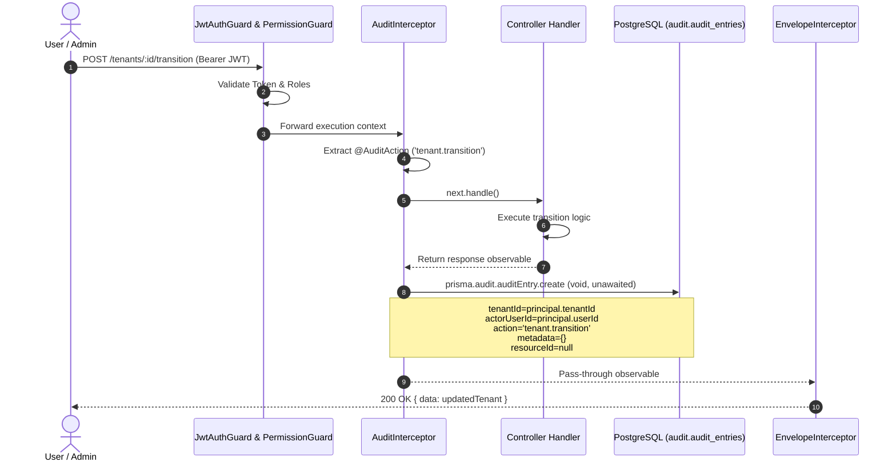

# Functional Specification: Module 15 — Audit Logging

**Standard:** [`FUNCTIONAL-SPECIFICATION-STANDARD.md`](../../FUNCTIONAL-SPECIFICATION-STANDARD.md) (`DEZ-STD-FS-001`)  
**Domain:** Compliance, Security Auditing & Administrative Activity Tracking  
**Status:** `RECONSTRUCTED FROM SOURCE FORENSICS`  
**Classification:** `PARTIALLY IMPLEMENTED / DEFECTIVE WIRE CONTRACT`

---

## Section A: Executive Summary & System Mission

Module 15 governs the immutable activity logging, compliance monitoring, and administrative forensics infrastructure for the Dezolver platform. Its core mission is to guarantee non-repudiation, tenant-scoped operational transparency, and administrative accountability across all multi-tenant boundaries.

Forensic examination of the legacy implementation reveals a subsystem designed with a sound database schema (`audit.audit_entries`) and comprehensive controller annotation coverage (89 distinct controller endpoints decorated with `@AuditAction`), but rendered dysfunctional in production by two crippling architecture flaws:
1. **Interceptor Context Loss:** The global `AuditInterceptor` (`src/shared/interceptors/audit.interceptor.ts:33-43`) discards all resource identifiers and execution parameters, storing `resourceType: null`, `resourceId: null`, and `metadata: {}` for 100% of intercepted actions.
2. **Wire Envelope Incompatibility:** The query controller `AuditController.list` (`src/audit/controllers/audit.controller.ts:65`) returns `{ items: page, nextCursor }`. Because it fails to return a key named `pagination`, the global `EnvelopeInterceptor` (`src/shared/interceptors/envelope.interceptor.ts:30-33`) wraps the payload into `{ data: { items: [...], nextCursor: "..." } }`. The frontend service `auditService.list` (`frontend/src/services/api/audit.service.ts:11-15`) expects an array at `res.data.data`, resulting in fatal runtime exceptions (`TypeError: items.map is not a function`) on all audit dashboard screens.

---

## Section B: Architecture & Execution Topology

Audit logging in Dezolver operates via two ingestion paths (an automated HTTP interceptor and manual service-level creation) and a single query ingress path.

```mermaid
flowchart TD
    subgraph Client["Frontend / API Consumer"]
        UI["AuditLogsPage.tsx / PlatformDashboardPage.tsx"]
        Svc["auditService.list()"]
        HTTP["HTTP Client (Axios)"]
    end

    subgraph Ingress["NestJS HTTP Ingress"]
        Auth["JwtAuthGuard (req.principal)"]
        Perm["PermissionGuard ('read:audit')"]
        AuditInt["AuditInterceptor (reads @AuditAction)"]
        Ctrl["AuditController.list()"]
    end

    subgraph Controllers["Annotated Controllers (89 Endpoints)"]
        Tenants["TenantsController (@AuditAction)"]
        Courses["CoursesController (@AuditAction)"]
        Events["EventsController (@AuditAction)"]
        Credentials["CredentialsController (@AuditAction)"]
        Submissions["SubmissionsController (@AuditAction)"]
    end

    subgraph IdentityService["Identity Domain"]
        AuthSvc["AuthService.ts (Manual Audit Ingestion)"]
    end

    subgraph Storage["PostgreSQL (audit schema)"]
        DB[(audit.audit_entries)]
    end

    UI --> Svc --> HTTP --> Auth --> Perm --> Ctrl
    Ctrl -->|findMany| DB

    HTTP --> Auth --> Perm --> AuditInt --> Controllers
    Controllers -->|Success tap| AuditInt
    AuditInt -.->|async void create: metadata={}| DB

    AuthSvc -->|explicit create: user.login.success| DB
    AuthSvc -->|explicit create: user.impersonate.start| DB
```

### Component Inventory

1. **`AuditInterceptor` (`src/shared/interceptors/audit.interceptor.ts:14-50`):** Global interceptor registered in `src/main.ts:58`. Inspects handler and class metadata for `AUDIT_ACTION_KEY`. Emits an unawaited asynchronous insert to `prisma.audit.auditEntry`.
2. **`AuditController` (`src/audit/controllers/audit.controller.ts:12-67`):** Exposes `GET /audit/entries`. Implements tenant isolation and cursor-based pagination.
3. **`AuditModule` (`src/audit/audit.module.ts:1-7`):** Encapsulating NestJS module, imported into root `AppModule` (`src/app.module.ts:63`).
4. **`AuthService` (`src/identity/services/auth.service.ts:269, 332`):** Direct database caller writing `user.impersonate.start` and `user.login.success` records.
5. **`AdminSecurityController` (`src/platform/controllers/admin-security.controller.ts:36, 48, 59`):** Audits token revocations and exposes parallel MFA security event queries.
6. **`auditService` (`frontend/src/services/api/audit.service.ts:5-17`):** Frontend HTTP client interface.
7. **`AuditLogsPage` (`frontend/src/pages/platform/audit/AuditLogsPage.tsx:272-348`):** React dashboard featuring search, timeline view, and category tabs.

---

## Section C: Database Schema & Entity Relationships

The entire persistence layer for Module 15 is defined in `prisma/audit/schema.prisma` under the dedicated PostgreSQL schema `audit`.

### Schema Definition (`prisma/audit/schema.prisma:15-32`)

```prisma
model AuditEntry {
  id           String   @id @default(dbgenerated("gen_random_uuid()")) @db.Uuid
  tenantId     String?  @map("tenant_id") @db.Uuid
  actorUserId  String?  @map("actor_user_id") @db.Uuid
  action       String   @db.VarChar(128)
  resourceType String?  @map("resource_type") @db.VarChar(64)
  resourceId   String?  @map("resource_id") @db.Uuid
  ipAddress    String?  @map("ip_address") @db.VarChar(50)
  userAgent    String?  @map("user_agent") @db.VarChar(500)
  metadata     Json     @default("{}")
  occurredAt   DateTime @default(now()) @map("occurred_at") @db.Timestamptz

  @@index([tenantId, action])
  @@index([actorUserId])
  @@index([occurredAt])
  @@map("audit_entries")
  @@schema("audit")
}
```

### Forensic Column Specification

| Column | PostgreSQL Type | Nullable | Default | Description | Forensic Finding |
|---|---|:---:|---|---|---|
| `id` | `uuid` | No | `gen_random_uuid()` | Primary Key | Standard v4 UUID. |
| `tenant_id` | `uuid` | Yes | `NULL` | Tenant Scope | `NULL` for platform-level actions (e.g. system flag updates, platform admin actions). Populated from `req.principal.tenantId`. |
| `actor_user_id` | `uuid` | Yes | `NULL` | Executing User | Foreign user UUID from `identity.users`. `NULL` for unauthenticated or system-triggered actions. |
| `action` | `varchar(128)` | No | — | Action Identifier | Dot-delimited action tag (e.g. `tenant.transition`, `course.create`). |
| `resource_type` | `varchar(64)` | Yes | `NULL` | Target Entity Type | Intended for target entity name (e.g. `Tenant`, `Assessment`). **100% NULL for interceptor events.** |
| `resource_id` | `uuid` | Yes | `NULL` | Target Entity ID | UUID of target resource. **100% NULL for interceptor events.** |
| `ip_address` | `varchar(50)` | Yes | `NULL` | Client IP Address | Extracted from `req.ip`. Supports IPv4 and IPv6 strings up to 50 characters. |
| `user_agent` | `varchar(500)` | Yes | `NULL` | Browser User-Agent | Extracted from `req.headers['user-agent']`. Truncated implicitly if over 500 chars. |
| `metadata` | `jsonb` | No | `'{}'::jsonb` | Context Payload | JSONB dictionary. **Hardcoded to `{}` in `AuditInterceptor`.** |
| `occurred_at` | `timestamptz` | No | `now()` | Event Timestamp | PostgreSQL timestamp with timezone. Primary sorting key. |

### Indexes & Performance Topology

1. `@@index([tenantId, action])` (`audit_entries_tenant_id_action_idx`): Optimizes tenant-scoped action filtering (`WHERE tenant_id = ? AND action LIKE ?`).
2. `@@index([actorUserId])` (`audit_entries_actor_user_id_idx`): Optimizes actor investigation queries (`WHERE actor_user_id = ?`).
3. `@@index([occurredAt])` (`audit_entries_occurred_at_idx`): Optimizes descending chronological scans (`ORDER BY occurred_at DESC`).
4. **Missing Composite Index:** No index exists on `[tenant_id, occurred_at]`. For institutional audits filtered by date range, PostgreSQL must execute a bitmap index intersection or filter across all tenant records.

---

## Section D: Endpoints & Wire Formats

Module 15 exposes a single query endpoint in `src/audit/controllers/audit.controller.ts`.

### 1. `GET /audit/entries`

- **Controller File:** [`src/audit/controllers/audit.controller.ts:15-66`](file:///e:/Dezolver%20project/dezlovers-main/Final%20product/dezlovers-main(cuurent%20update)/src/audit/controllers/audit.controller.ts#L15-L66)
- **Authentication:** Mandatory `@RequireAuth()` (Bearer JWT).
- **Authorization:** Mandatory `@RequirePermission('read:audit')`.
- **Query Parameters:**
  - `action` (optional string): Case-sensitive substring filter (`{ action: { contains: action } }`).
  - `actorUserId` (optional UUID string): Exact match on actor ID.
  - `from` (optional ISO 8601 string): Lower bound timestamp (`occurredAt >= new Date(from)`).
  - `to` (optional ISO 8601 string): Upper bound timestamp (`occurredAt <= new Date(to)`).
  - `limit` (optional integer string, defaults to `50`): Page size limit.
  - `cursor` (optional base64url string): Encoded cursor object `{ id: string }`.

#### Raw Controller Return Value (`audit.controller.ts:65`)

```typescript
return { items: page, nextCursor };
```

#### Actual Wire Response Transmitted Over HTTP

Because `EnvelopeInterceptor` (`src/shared/interceptors/envelope.interceptor.ts:28-34`) checks `isPaginatedResult` requiring both `'items'` and `'pagination'`, the controller response is treated as generic data:

```json
{
  "data": {
    "items": [
      {
        "id": "c1f71df8-3d12-4217-a068-152e987f2890",
        "tenantId": "e2a3c75d-59d0-4d43-8f55-7d43f0556ce2",
        "actorUserId": "3c87f9d5-7634-4b47-bc85-c6bf2334f590",
        "action": "assessment.create",
        "resourceType": null,
        "resourceId": null,
        "ipAddress": "127.0.0.1",
        "userAgent": "Mozilla/5.0 (Windows NT 10.0; Win64; x64)",
        "metadata": {},
        "occurredAt": "2026-11-05T09:12:44.120Z"
      }
    ],
    "nextCursor": "eyJpZCI6ImMxZjcxZGY4LTNkMTItNDIxNy1hMDY4LTE1MmU5ODdmMjg5MCJ9"
  }
}
```

#### HTTP Response Status Codes

- `200 OK`: Successful retrieval of audit records.
- `400 Bad Request`: Invalid cursor format (`{ code: 'invalid_cursor' }`).
- `401 Unauthorized`: Missing, invalid, or expired Bearer token.
- `403 Forbidden`: Authenticated user lacks `read:audit` permission.

---

## Section E: Workflows, Triggers & Lifecycle State Machines

Audit records represent immutable historical facts and have no mutable lifecycle or state transitions. Once created, records cannot be updated, transitioned, or deleted through application interfaces.



### Ingestion Triggers

1. **HTTP Ingress Interception:** Triggered on any incoming HTTP request terminating at a controller method annotated with `@AuditAction(...)`.
2. **Programmatic Ingestion:** Explicitly called by internal application services for actions occurring outside or prior to normal authenticated route handlers:
   - `auth.service.ts:332`: Invoked inside `buildLoginResponse` after password/MFA verification to record `user.login.success`.
   - `auth.service.ts:269`: Invoked inside `issueImpersonationTokens` to record `user.impersonate.start`.

---

## Section F: Business Rules & Algorithmic Logic

### 1. Exhaustive Forensic Action Catalog (All 89 Annotated Endpoints)

Every controller method decorated with `@AuditAction` across the entire legacy repository is cataloged below:

| # | Action Name | Source Controller | Line | HTTP Method & Route | Domain |
|:---:|---|---|:---:|---|---|
| 1 | `account.deletion.requested` | `src/identity/controllers/data-subject.controller.ts` | 73 | `POST /me/data-subject/delete-account` | Identity & Privacy |
| 2 | `admin.session.revoke` | `src/platform/controllers/admin-security.controller.ts` | 36 | `DELETE /admin/v1/security/sessions/:id` | Security Admin |
| 3 | `admin.sessions.revoke_all_for_tenant` | `src/platform/controllers/admin-security.controller.ts` | 48 | `POST /admin/v1/security/tenants/:tenantId/revoke-all-sessions` | Security Admin |
| 4 | `assessment.create` | `src/assessment/controllers/assessments.controller.ts` | 48 | `POST /assessments` | Assessments |
| 5 | `assessment.update` | `src/assessment/controllers/assessments.controller.ts` | 60 | `PATCH /assessments/:id` | Assessments |
| 6 | `billing.payout.initiate` | `src/billing/controllers/admin-billing.controller.ts` | 62 | `POST /admin/billing/payouts` | Billing Admin |
| 7 | `billing.refund.issue` | `src/billing/controllers/admin-billing.controller.ts` | 24 | `POST /admin/billing/refunds` | Billing Admin |
| 8 | `certificate.issue` | `src/credentials/controllers/credentials.controller.ts` | 201 | `POST /credentials/certificates/issue` | Credentials |
| 9 | `certificate.manual_issue` | `src/credentials/controllers/credentials.controller.ts` | 216 | `POST /credentials/certificates/manual-issue` | Credentials |
| 10 | `certificate.reissue` | `src/credentials/controllers/credentials.controller.ts` | 230 | `POST /credentials/certificates/:id/reissue` | Credentials |
| 11 | `certificate.revoke` | `src/credentials/controllers/credentials.controller.ts` | 248 | `POST /credentials/certificates/:id/revoke` | Credentials |
| 12 | `certificate_template.create` | `src/credentials/controllers/credentials.controller.ts` | 121 | `POST /credentials/templates` | Credentials |
| 13 | `certificate_template.publish` | `src/credentials/controllers/credentials.controller.ts` | 149 | `POST /credentials/templates/:id/publish` | Credentials |
| 14 | `cohort.create` | `src/tenancy/controllers/tenants.controller.ts` | 187 | `POST /tenants/:id/cohorts` | Tenancy & Cohorts |
| 15 | `course.create` | `src/content/controllers/courses.controller.ts` | 51 | `POST /courses` | Content & Courses |
| 16 | `course.room.add` | `src/content/controllers/courses.controller.ts` | 66 | `POST /courses/:id/rooms` | Content & Courses |
| 17 | `course.room.remove` | `src/content/controllers/courses.controller.ts` | 82 | `DELETE /courses/:id/rooms/:roomId` | Content & Courses |
| 18 | `curriculum.node.add` | `src/curriculum/controllers/curriculum.controller.ts` | 87 | `POST /curriculum/:id/nodes` | Curriculum |
| 19 | `curriculum.node.delete` | `src/curriculum/controllers/curriculum.controller.ts` | 117 | `DELETE /curriculum/nodes/:nodeId` | Curriculum |
| 20 | `curriculum.node.update` | `src/curriculum/controllers/curriculum.controller.ts` | 104 | `PATCH /curriculum/nodes/:nodeId` | Curriculum |
| 21 | `data-export.requested` | `src/identity/controllers/data-subject.controller.ts` | 42 | `POST /me/data-subject/export` | Identity & Privacy |
| 22 | `event.cancel` | `src/events/controllers/events.controller.ts` | 118 | `POST /events/:id/cancel` | Contests & Events |
| 23 | `event.create` | `src/events/controllers/events.controller.ts` | 60 | `POST /events` | Contests & Events |
| 24 | `event.extend` | `src/events/controllers/events.controller.ts` | 132 | `POST /events/:id/extend` | Contests & Events |
| 25 | `event.publish` | `src/events/controllers/events.controller.ts` | 73 | `POST /events/:id/publish` | Contests & Events |
| 26 | `event.record_result` | `src/events/controllers/events.controller.ts` | 203 | `POST /events/:id/results` | Contests & Events |
| 27 | `event.register` | `src/events/controllers/events.controller.ts` | 86 | `POST /events/:id/register` | Contests & Events |
| 28 | `event.submit` | `src/events/controllers/events.controller.ts` | 170 | `POST /events/:id/submissions` | Contests & Events |
| 29 | `event.unregister` | `src/events/controllers/events.controller.ts` | 157 | `POST /events/:id/unregister` | Contests & Events |
| 30 | `event.update` | `src/events/controllers/events.controller.ts` | 104 | `PATCH /events/:id` | Contests & Events |
| 31 | `event_order.create` | `src/billing/controllers/event-orders.controller.ts` | 29 | `POST /billing/event-orders` | Billing |
| 32 | `invitation.create` | `src/tenancy/controllers/tenants.controller.ts` | 207 | `POST /tenants/:id/invitations` | Tenancy & Members |
| 33 | `invitation.revoke` | `src/tenancy/controllers/tenants.controller.ts` | 240 | `DELETE /tenants/:id/invitations/:invitationId` | Tenancy & Members |
| 34 | `issuance_rule.create` | `src/credentials/controllers/credentials.controller.ts` | 174 | `POST /credentials/rules` | Credentials |
| 35 | `issuance_rule.delete` | `src/credentials/controllers/credentials.controller.ts` | 188 | `DELETE /credentials/rules/:id` | Credentials |
| 36 | `launch.advance_phase` | `src/launch/launch.controller.ts` | 26 | `POST /launch/advance` | System Launch |
| 37 | `media.upload.complete` | `src/content/controllers/media.controller.ts` | 35 | `POST /media/complete` | Content & Media |
| 38 | `media.upload.initiate` | `src/content/controllers/media.controller.ts` | 22 | `POST /media/initiate` | Content & Media |
| 39 | `overlay.activate` | `src/curriculum/controllers/overlays.controller.ts` | 154 | `POST /curriculum/overlays/:id/activate` | Curriculum Overlays |
| 40 | `overlay.append_operation` | `src/curriculum/controllers/overlays.controller.ts` | 99 | `POST /curriculum/overlays/:id/operations` | Curriculum Overlays |
| 41 | `overlay.remove_operation` | `src/curriculum/controllers/overlays.controller.ts` | 128 | `DELETE /curriculum/overlays/:id/operations/:opIndex` | Curriculum Overlays |
| 42 | `overlay.upgrade` | `src/curriculum/controllers/overlays.controller.ts` | 188 | `POST /curriculum/overlays/:id/upgrade` | Curriculum Overlays |
| 43 | `overlay.upsert` | `src/curriculum/controllers/overlays.controller.ts` | 74 | `PUT /curriculum/overlays` | Curriculum Overlays |
| 44 | `path.archive` | `src/paths/controllers/paths.controller.ts` | 138 | `POST /paths/:id/archive` | Learning Paths |
| 45 | `path.create` | `src/paths/controllers/paths.controller.ts` | 94 | `POST /paths` | Learning Paths |
| 46 | `path.fork` | `src/paths/controllers/paths.controller.ts` | 208 | `POST /paths/:id/fork` | Learning Paths |
| 47 | `path.publish` | `src/paths/controllers/paths.controller.ts` | 124 | `POST /paths/:id/publish` | Learning Paths |
| 48 | `path.step.add` | `src/paths/controllers/paths.controller.ts` | 152 | `POST /paths/:id/steps` | Learning Paths |
| 49 | `path.step.delete` | `src/paths/controllers/paths.controller.ts` | 179 | `DELETE /paths/:id/steps/:stepId` | Learning Paths |
| 50 | `path.step.update` | `src/paths/controllers/paths.controller.ts` | 165 | `PATCH /paths/:id/steps/:stepId` | Learning Paths |
| 51 | `path.steps.reorder` | `src/paths/controllers/paths.controller.ts` | 193 | `POST /paths/:id/steps/reorder` | Learning Paths |
| 52 | `path.update` | `src/paths/controllers/paths.controller.ts` | 109 | `PATCH /paths/:id` | Learning Paths |
| 53 | `platform.flag.set` | `src/platform/controllers/feature-flags.controller.ts` | 33 | `PUT /platform/flags/:key` | Platform Flags |
| 54 | `problem.create` | `src/content/controllers/problems.controller.ts` | 54 | `POST /problems` | Problem Management |
| 55 | `problem.publish` | `src/content/controllers/problems.controller.ts` | 89 | `POST /problems/:id/publish` | Problem Management |
| 56 | `problem.test_case.add` | `src/content/controllers/problems.controller.ts` | 69 | `POST /problems/:id/test-cases` | Problem Management |
| 57 | `room.approve` | `src/content/controllers/rooms.controller.ts` | 100 | `POST /rooms/:id/approve` | Content Rooms |
| 58 | `room.archive` | `src/content/controllers/rooms.controller.ts` | 143 | `POST /rooms/:id/archive` | Content Rooms |
| 59 | `room.create` | `src/content/controllers/rooms.controller.ts` | 55 | `POST /rooms` | Content Rooms |
| 60 | `room.rollback` | `src/content/controllers/rooms.controller.ts` | 128 | `POST /rooms/:id/rollback` | Content Rooms |
| 61 | `room.submit_review` | `src/content/controllers/rooms.controller.ts` | 85 | `POST /rooms/:id/review` | Content Rooms |
| 62 | `room.update` | `src/content/controllers/rooms.controller.ts` | 69 | `PATCH /rooms/:id` | Content Rooms |
| 63 | `room_progress.complete` | `src/paths/controllers/me-paths.controller.ts` | 134 | `POST /me/paths/:id/rooms/:roomId/complete` | Student Progress |
| 64 | `room_progress.skip` | `src/paths/controllers/me-paths.controller.ts` | 103 | `POST /me/paths/:id/rooms/:roomId/skip` | Student Progress |
| 65 | `room_progress.start` | `src/paths/controllers/me-paths.controller.ts` | 72 | `POST /me/paths/:id/rooms/:roomId/start` | Student Progress |
| 66 | `roster.import` | `src/tenancy/controllers/tenants.controller.ts` | 271 | `POST /tenants/:id/roster-import` | Tenancy Roster |
| 67 | `submission.create` | `src/assessment/controllers/submissions.controller.ts` | 28 | `POST /submissions` | Submissions |
| 68 | `submission.flag_review` | `src/assessment/controllers/submissions.controller.ts` | 111 | `POST /submissions/:id/flag` | Submissions |
| 69 | `submission.rerun` | `src/assessment/controllers/submissions.controller.ts` | 78 | `POST /submissions/:id/rerun` | Submissions |
| 70 | `subscription.cancel` | `src/billing/controllers/subscriptions.controller.ts` | 94 | `POST /billing/subscriptions/:id/cancel` | Subscriptions |
| 71 | `subscription.create` | `src/billing/controllers/subscriptions.controller.ts` | 41 | `POST /billing/subscriptions` | Subscriptions |
| 72 | `subscription.retry_payment` | `src/billing/controllers/subscriptions.controller.ts` | 112 | `POST /billing/subscriptions/:id/retry` | Subscriptions |
| 73 | `subscription.upgrade` | `src/billing/controllers/subscriptions.controller.ts` | 76 | `POST /billing/subscriptions/:id/upgrade` | Subscriptions |
| 74 | `syllabus.archive` | `src/curriculum/controllers/curriculum.controller.ts` | 143 | `POST /curriculum/:id/archive` | Curriculum |
| 75 | `syllabus.create` | `src/curriculum/controllers/curriculum.controller.ts` | 70 | `POST /curriculum` | Curriculum |
| 76 | `syllabus.publish` | `src/curriculum/controllers/curriculum.controller.ts` | 130 | `POST /curriculum/:id/publish` | Curriculum |
| 77 | `tenant.config.update` | `src/tenancy/controllers/tenants.controller.ts` | 159 | `PATCH /tenants/:id/config` | Tenancy Config |
| 78 | `tenant.create` | `src/tenancy/controllers/tenants.controller.ts` | 49 | `POST /tenants` | Tenancy Lifecycle |
| 79 | `tenant.transition` | `src/tenancy/controllers/tenants.controller.ts` | 126 | `POST /tenants/:id/transition` | Tenancy Lifecycle |
| 80 | `tenant.update` | `src/tenancy/controllers/tenants.controller.ts` | 110 | `PATCH /tenants/:id` | Tenancy Lifecycle |
| 81 | `user.impersonate.exit` | `src/identity/controllers/users.controller.ts` | 218 | `POST /users/impersonate/exit` | Impersonation |
| 82 | `user.impersonate.start` | `src/identity/controllers/users.controller.ts` | 144 | `POST /users/:id/impersonate` | Impersonation |
| 83 | `user.logout` | `src/identity/controllers/auth.controller.ts` | 134 | `POST /auth/logout` | Authentication |
| 84 | `user.logout.all` | `src/identity/controllers/auth.controller.ts` | 151 | `POST /auth/logout-all` | Authentication |
| 85 | `user.mfa.confirm` | `src/identity/controllers/users.controller.ts` | 192 | `POST /users/mfa/confirm` | MFA Security |
| 86 | `user.mfa.disable` | `src/identity/controllers/users.controller.ts` | 205 | `POST /users/mfa/disable` | MFA Security |
| 87 | `user.mfa.enroll` | `src/identity/controllers/users.controller.ts` | 179 | `POST /users/mfa/enroll` | MFA Security |
| 88 | `user.switch_user` | `src/identity/controllers/users.controller.ts` | 63 | `POST /users/switch-context` | Multi-Account Switch |
| 89 | `user.switch_user` | `src/identity/controllers/users.controller.ts` | 88 | `POST /users/:id/switch` | Multi-Account Switch |

### 2. Algorithmic Ingestion Logic (`AuditInterceptor`)

When a request enters the application:
1. `AuditInterceptor.intercept` calls `reflector.getAllAndOverride<string>(AUDIT_ACTION_KEY, [handler, class])`.
2. If no action metadata is present, it passes immediately to `next.handle()`.
3. If action metadata exists, it extracts `principal = req.principal`.
4. It calls `next.handle().pipe(tap(...))` to execute the route handler.
5. In the `tap` observer (invoked only on response emission):
   - Asynchronously fires `prisma.audit.auditEntry.create(...)` with:
     - `tenantId: principal?.tenantId ?? null`
     - `actorUserId: principal?.userId ?? null`
     - `action: action`
     - `ipAddress: req.ip ?? null`
     - `userAgent: req.headers['user-agent'] ?? null`
     - `metadata: {}`
   - Attaches `.catch(() => {})` to drop errors silently.
   - The promise is completely unawaited (`void`), preventing database latency from adding to HTTP response time.

---

## Section G: Authorization, Multi-Tenancy & Access Control

### 1. RBAC Permissions Matrix (`src/shared/auth/permission.guard.ts:25-45`)

Permission `read:audit` controls access to audit logs:

| Role | Has `read:audit`? | Scope of Visibility | Access Mode |
|---|:---:|---|---|
| `student` | No | None (403 Forbidden) | Denied |
| `faculty` | No | None (403 Forbidden) | Denied |
| `coordinator` | No | None (403 Forbidden) | Denied |
| `content_manager` | No | None (403 Forbidden) | Denied |
| `college_admin` | **Yes** | **Tenant-Scoped Only** (`where.tenantId = principal.tenantId`) | Backend Only (Frontend Route Blocked) |
| `platform_moderator` | **Yes** | **Tenant-Scoped Only** (Evaluates `isPlatformAdmin = false`) | Full UI & API |
| `platform_admin` | **Yes** (Wildcard `*`) | **Global Cross-Tenant** (`tenantFilter = {}`) | Full UI & API |

### 2. Tenant Isolation Enforcement

In `AuditController.list` (`src/audit/controllers/audit.controller.ts:39-41`):

```typescript
const isPlatformAdmin = principal.roles.includes('platform_admin');
const tenantFilter = isPlatformAdmin ? {} : { tenantId: principal.tenantId };
```

- **Platform Admin Privilege:** Only users with the explicit string `'platform_admin'` in `principal.roles` bypass the tenant filter.
- **Tenant Confinement:** Any user lacking `'platform_admin'` (including `college_admin` and `platform_moderator`) is strictly restricted to records matching their own `principal.tenantId`. If a platform moderator has `tenantId = null`, the query filters `tenantId: null`, hiding all institutional tenant events.

---

## Section H: Background Tasks, Workers & Messaging

1. **Zero BullMQ Workers:** Module 15 possesses no dedicated BullMQ queues, consumers, or scheduled cron workers. Audit writes are performed in-process via Prisma.
2. **Asynchronous Non-Blocking Execution:** Audit creation inside `AuditInterceptor` uses unawaited promises (`void this.prisma.audit.auditEntry.create(...)`). It executes on the Node.js event loop independently of the HTTP response lifecycle.
3. **Outbox Decoupling:** Domain events stored in `platform.outbox_events` (such as `TenantStatusChanged`, `UserCreated`, `SubscriptionActivated`) are distinct from `audit.audit_entries`. Outbox events drive asynchronous BullMQ event consumers, whereas audit entries serve compliance query ingress.

---

## Section I: Integrations & External Dependencies

1. **PostgreSQL Database:** Dedicated PostgreSQL schema `audit` containing table `audit_entries`.
2. **Prisma ORM Client:** Generated at `node_modules/.prisma/audit` via `prisma/audit/schema.prisma`. Instantiated in `PrismaService` as `this.audit`.
3. **Express / Node.js Engine:** Relies on Express `req.ip` and `req.headers['user-agent']` for forensic network telemetry.
4. **No External SIEM / Syslog Forwarding:** Zero integrations exist with Datadog, AWS CloudWatch, Splunk, ElasticSearch, or external syslog endpoints. All logs reside exclusively in PostgreSQL.

---

## Section J: Observability, Metrics & Telemetry

1. **Structured Log Telemetry:** The legacy codebase generates **zero logger output** on audit creation.
2. **Silent Failure Posture:** In `src/shared/interceptors/audit.interceptor.ts:45-47`, database insertion errors are caught with an empty arrow function:
   ```typescript
   .catch(() => {
     // audit failures must not break the request
   });
   ```
   No `Logger.error`, Prometheus counter increment, or Datadog metric is emitted when an audit entry fails to persist.
3. **MFA Telemetry Auxiliary Stream:** `AdminSecurityController.listMfaEvents` (`src/platform/controllers/admin-security.controller.ts:59-72`) exposes a secondary audit telemetry stream querying `identity.mfa_factors` directly for enrollments and deletions over a configurable time window (`since`).

---

## Section K: Edge Cases & Failure Modes

| Edge Case / Scenario | Legacy Behavior | Forensic Consequence |
|---|---|---|
| **Database Unavailable / Connection Pool Exhausted** | `AuditInterceptor` catches rejection silently. Route handler completes normally. | HTTP request succeeds, but audit record is permanently lost without any trace. |
| **HTTP Request Fails (4xx / 5xx)** | Route handler throws exception. RxJS `tap` observer never fires. | Malicious attacks, unauthorized attempts (403), invalid payloads (400), and system errors (500) leave zero audit logs. |
| **Simultaneous Identical Timestamps** | Prisma executes `take: limit + 1`, `cursor: { id }`, `orderBy: { occurredAt: 'desc' }`. | Because `id` is omitted from `orderBy`, tie-breaking across records created within the same millisecond is non-deterministic, causing entries to be skipped or repeated across pages. |
| **User-Agent > 500 Characters** | Prisma attempts insert with `varchar(500)`. | PostgreSQL throws `value too long for type character varying(500)`. Insert fails and is swallowed silently by `.catch(() => {})`. |
| **Client IP Missing / Proxy Spoofing** | Express `req.ip` is `undefined`. Stored as `NULL`. | Audit record has `ip_address = null`. No reverse proxy parsing (`X-Forwarded-For`) validation is enforced. |
| **Platform Moderator Queries Logs** | `isPlatformAdmin` evaluates to `false`. Queries `{ tenantId: principal.tenantId }`. | If moderator has no institutional tenant ID (`null`), only records where `tenant_id IS NULL` are returned. |

---

## Section L: Security & Compliance Posture

1. **Data Immutability:** Immutability is enforced strictly by API design. `AuditController` contains only `@Get('entries')`. No update, patch, or delete endpoints exist in the application.
2. **Database Trigger Omission:** No PostgreSQL database triggers (e.g. `BEFORE UPDATE OR DELETE RAISE EXCEPTION`) exist in `scripts/bootstrap-schemas.sql`. A database administrator or compromised connection with DDL/DML privileges can modify or purge `audit.audit_entries`.
3. **Sensitive Data Exposure:** Because `AuditInterceptor` hardcodes `metadata: {}`, request bodies are not saved. However, because `@LogRedact` (`src/shared/auth/log-redact.decorator.ts`) is dead code, any future attempt to serialize request bodies without fixing the interceptor risks logging cleartext passwords, tokens, or PII.
4. **GDPR / DPDP Compliance Isolation:** When a user invokes `POST /me/data-subject/delete-account` (`data-subject.controller.ts:73`), an audit record `account.deletion.requested` is created. However, historical audit records containing `actorUserId` referencing the deleted user are retained, maintaining auditability without violating right-to-erasure compliance (audit logs are exempt under legal obligation).

---

## Section M: Frontend-to-Backend Contract

### Contract Breakage Matrix

The audit subsystem exhibits severe contract divergence between NestJS controllers and React frontend components:

| Data Field / Property | Backend Type & Source | Frontend Type (`platform.types.ts`) | Runtime Result Against Live API |
|---|---|---|---|
| **Response Wrapper** | `{ data: { items: [...], nextCursor: "..." } }` | Expects `{ items: res.data.data, pagination: res.data.pagination }` | **FATAL**: `items` is an object, not an array. `items.map(...)` crashes UI. |
| **Timestamp Field** | `occurredAt` (`DateTime`) | `createdAt` (`string`) | UI renders `Invalid Date` via `formatRelativeTime(entry.createdAt)`. |
| **Actor Identifier** | `actorUserId` (`UUID`) | `actorId` (`string`) | `entry.actorId` is `undefined`. `entry.actorId.slice(0, 8)` crashes UI. |
| **Actor Profile** | Not joined (omitted) | `actorEmail`, `actorRole` | Always `undefined`; UI falls back to actor ID slice (which crashes). |
| **Target Type** | `resourceType` (`string?`) | `targetType` (`string?`) | Always `null` in DB; query param ignored by backend. |
| **Target Identifier** | `resourceId` (`UUID?`) | `targetId` (`string?`) | Always `null` in DB; UI renders empty placeholder `—`. |
| **Cursor Property** | `nextCursor` at root | `pagination.nextCursor` | `getNextPageParam` is permanently `undefined`; infinite scroll broken. |

---

## Section N: Negative Specifications & Non-Capabilities

To eliminate ambiguity, the following capabilities are confirmed to be **100% NOT IMPLEMENTED** in the Dezolver codebase:

1. **NO Export Feature:** Zero endpoints or client actions exist to export audit logs to CSV, Excel, PDF, or JSON format.
2. **NO Failed Attempt Auditing:** Zero audit entries are created when an endpoint rejects a request due to authentication failures (401), missing permissions (403), validation errors (400), or server exceptions (500).
3. **NO Resource/Entity Capture in Interceptor:** Zero resource identifiers (`resourceType`, `resourceId`) are captured by `AuditInterceptor`. All 89 annotated endpoints produce records with null resources.
4. **NO Request Body / Metadata Capture:** `metadata` is never populated by `AuditInterceptor`. Operational justifications (e.g. reasons for tenant transitions or contest extensions) are completely discarded.
5. **NO External SIEM Streaming:** Zero mechanisms exist to stream audit events to external logging collectors (Splunk, Datadog, AWS CloudWatch, Elastic).
6. **NO Automated Log Archival / Retention Policy:** Zero database partitioning, automated pruning crons, or S3 archival mechanisms exist for aging audit logs.
7. **NO User Search by Name / Email:** `GET /audit/entries` does not support filtering by actor name or email; it only accepts an exact `actorUserId` UUID string.

---

## Section O: Critical Defects & Architectural Discrepancies

### DEF-15-01: Pagination Envelope Serialization Crash
- **Location:** `src/audit/controllers/audit.controller.ts:65` vs `src/shared/interceptors/envelope.interceptor.ts:30`
- **Forensic Evidence:** `AuditController.list` returns `{ items: page, nextCursor }`. `EnvelopeInterceptor.isPaginatedResult` requires `'items' in data && 'pagination' in data`. Because `pagination` is missing, the response is enclosed as `{ data: { items: [...], nextCursor: "..." } }`.
- **Blast Radius:** In `frontend/src/services/api/audit.service.ts:13`, `res.data.data` is assigned to `items`. In `AuditLogsPage.tsx:123` and `PlatformDashboardPage.tsx:118`, calling `flatMap` or `map` throws `TypeError: items.map is not a function`, crashing both pages completely on live environments.

### DEF-15-02: Universal Resource & Metadata Erasure in Interceptor
- **Location:** `src/shared/interceptors/audit.interceptor.ts:33-43`
- **Forensic Evidence:**
  ```typescript
  void this.prisma.audit.auditEntry.create({
    data: {
      tenantId: principal?.tenantId ?? null,
      actorUserId: principal?.userId ?? null,
      action,
      ipAddress: req.ip ?? null,
      userAgent: (req.headers['user-agent'] as string | undefined) ?? null,
      metadata: {},
    },
  });
  ```
- **Blast Radius:** `resourceType` and `resourceId` are never populated. `metadata` is permanently `{}`. Across all 89 audited operations (such as deleting curriculum nodes, changing tenant lifecycles, or issuing certificates), the audit log contains no record of which entity was affected.

### DEF-15-03: Entity Field Naming Incompatibility
- **Location:** `frontend/src/types/platform.types.ts:3-16` vs `prisma/audit/schema.prisma:15-26`
- **Forensic Evidence:** The frontend expects `createdAt`, `actorId`, `targetId`, and `targetType`. The database and backend return `occurredAt`, `actorUserId`, `resourceId`, and `resourceType`.
- **Blast Radius:** `formatRelativeTime(entry.createdAt)` renders `Invalid Date`. Line 83 of `AuditLogsPage.tsx` (`entry.actorId.slice(0, 8)`) crashes with a runtime `TypeError` whenever `entry.actorEmail` is missing.

### DEF-15-04: Security Events Tab Permanent Empty State
- **Location:** `frontend/src/pages/platform/audit/AuditLogsPage.tsx:285`
- **Forensic Evidence:** The "Security Events" tab queries `action: 'auth.'`. In the backend, all authentication actions are prefixed with `user.` (`user.login.success`, `user.logout`, `user.logout.all`, `user.mfa.enroll`, `user.impersonate.start`).
- **Blast Radius:** Zero records match the query filter `{ action: { contains: 'auth.' } }`. The Security Events tab displays an empty state in perpetuity.

### DEF-15-05: Absence of Security Failure Auditing
- **Location:** `src/shared/interceptors/audit.interceptor.ts:31`
- **Forensic Evidence:** The interceptor chains via RxJS `tap()`. Under RxJS architecture, `tap(next)` is bypassed whenever the stream throws an error.
- **Blast Radius:** Malicious activity (brute force attacks, unauthorized RBAC access, privilege escalation attempts) results in HTTP 4xx errors and is never logged, defeating the primary security purpose of an audit trail.

### DEF-15-06: Redundant Impersonation Audit Entries
- **Location:** `src/identity/controllers/users.controller.ts:144` vs `src/identity/services/auth.service.ts:269`
- **Forensic Evidence:** `UsersController.impersonate` is decorated with `@AuditAction('user.impersonate.start')`. Concurrently, `AuthService.issueImpersonationTokens` explicitly calls `prisma.audit.auditEntry.create({ action: 'user.impersonate.start', metadata: { targetUserId } })`.
- **Blast Radius:** Every user impersonation event creates two distinct audit records: one with empty metadata and null resource, and one with the target user ID in metadata.

---

## Section P: Target Recommendations & Remediation Plan

### 1. Fix Controller Pagination Envelope

Update `AuditController.list` (`src/audit/controllers/audit.controller.ts:65`) to conform to `EnvelopeInterceptor`:

```typescript
// Replace:
// return { items: page, nextCursor };

// With:
return {
  items: page,
  pagination: {
    nextCursor,
    hasMore,
  },
};
```

### 2. Capture Resource IDs and Dynamic Metadata in Interceptor

Refactor `AuditInterceptor` (`src/shared/interceptors/audit.interceptor.ts`) to extract params and metadata:

```typescript
const req = context.switchToHttp().getRequest<Request>();
const resourceId = req.params?.id ?? req.params?.nodeId ?? req.params?.roomId ?? null;
const resourceType = this.reflector.get<string>('auditResourceType', context.getHandler()) ?? null;

// Capture safe request parameters
const metadata: Record<string, unknown> = {};
if (req.body?.reason) metadata.reason = req.body.reason;
if (req.body?.to) metadata.to = req.body.to;
if (req.params) metadata.params = req.params;
```

### 3. Synchronize Frontend TypeScript Model

Update `frontend/src/types/platform.types.ts`:

```typescript
export interface AuditEntry {
  id: string;
  action: string;
  actorUserId?: string | null;
  actorId?: string | null; // Compatibility alias
  actorEmail?: string | null;
  actorRole?: string | null;
  resourceId?: string | null;
  targetId?: string | null; // Compatibility alias
  resourceType?: string | null;
  targetType?: string | null; // Compatibility alias
  tenantId?: string | null;
  metadata?: Record<string, unknown> | null;
  ipAddress?: string | null;
  userAgent?: string | null;
  occurredAt: string;
  createdAt?: string; // Compatibility alias
}
```

### 4. Implement Error Stream Auditing

Attach a secondary RxJS `catchError` observer in `AuditInterceptor` or instrument `GlobalErrorFilter` to audit security-critical failures (401, 403, and invalid state transitions).

---

## Section Q: Master Verification Traceability Matrix

| Requirement / Component | Forensic Source File & Line | Verified Status | Legacy Defect / Finding |
|---|---|:---:|---|
| **Audit Schema Definition** | `prisma/audit/schema.prisma:15-32` | `CONFIRMED` | Model `AuditEntry` maps to `audit.audit_entries`. Indexes present on tenant, actor, timestamp. |
| **Prisma Audit Client Binding** | `src/shared/prisma/prisma.service.ts:58, 70` | `CONFIRMED` | Client `this.audit` initialized and connected in `PrismaService`. |
| **Global Interceptor Registration** | `src/main.ts:58` | `CONFIRMED` | Injected into global pipeline: `new AuditInterceptor(reflector, prisma)`. |
| **Method Decorator Definition** | `src/shared/auth/decorators.ts:23-24` | `CONFIRMED` | `@AuditAction(action)` sets metadata key `auditAction`. |
| **PII Redaction Utility** | `src/shared/auth/log-redact.decorator.ts:1-25` | `DEFECTIVE` | `@LogRedact` defined and applied in `auth.controller.ts`, but completely ignored by interceptor. |
| **Query API Endpoint** | `src/audit/controllers/audit.controller.ts:15-66` | `DEFECTIVE` | `GET /audit/entries` implemented, but envelope serialization breaks frontend. |
| **RBAC Authorization Guard** | `src/shared/auth/permission.guard.ts:28, 35, 37` | `CONFIRMED` | Permission `read:audit` granted to `college_admin`, `platform_moderator`, `platform_admin`. |
| **Tenant Scoping Logic** | `src/audit/controllers/audit.controller.ts:39-41` | `CONFIRMED` | Scopes queries by `principal.tenantId` unless user holds `platform_admin`. |
| **Frontend API Service** | `frontend/src/services/api/audit.service.ts:5-17` | `DEFECTIVE` | `auditService.list` expects array at `res.data.data` and pagination at `res.data.pagination`. |
| **Infinite Query Hook** | `frontend/src/hooks/useAudit.ts:6-16` | `DEFECTIVE` | `useAuditEntries` unable to page forward due to missing `nextCursor` in envelope. |
| **Frontend Audit Dashboard** | `frontend/src/pages/platform/audit/AuditLogsPage.tsx:272-348` | `DEFECTIVE` | Renders tables and timelines, but crashes on live data due to field naming mismatches. |
| **Security Tab Filtering** | `frontend/src/pages/platform/audit/AuditLogsPage.tsx:285` | `DEFECTIVE` | Queries `action: 'auth.'`; backend auth actions use `user.*`. Tab displays 0 results. |
| **Dashboard Activity Widget** | `frontend/src/pages/platform/PlatformDashboardPage.tsx:110, 267` | `DEFECTIVE` | Widget maps `recentAudit`, crashing due to object envelope response. |
| **Impersonation Dual Audit** | `src/identity/controllers/users.controller.ts:144` vs `src/identity/services/auth.service.ts:269` | `DEFECTIVE` | Generates duplicate audit entries for each impersonation start. |
| **Login Success Logging** | `src/identity/services/auth.service.ts:332` | `CONFIRMED` | Logs `user.login.success` manually in `buildLoginResponse`. |
| **Login Failure Logging** | `src/identity/services/auth.service.ts:54` | `NOT IMPLEMENTED` | Throws `UnauthorizedException` without logging audit entry. |
| **Log Export Capabilities** | Codebase-wide (`src/`, `frontend/src/`) | `NOT IMPLEMENTED` | Zero CSV, Excel, or JSON export endpoints or UI triggers exist. |

