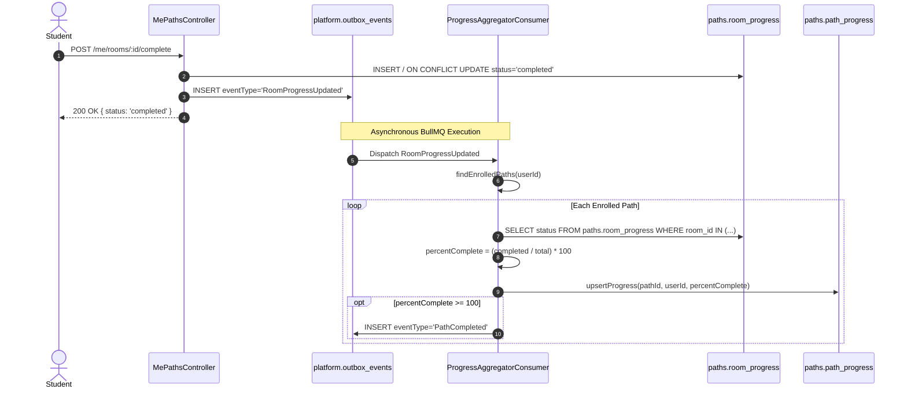

# Functional Specification: Module 16 — Student Analytics

**Standard:** [`FUNCTIONAL-SPECIFICATION-STANDARD.md`](../../FUNCTIONAL-SPECIFICATION-STANDARD.md) (`DEZ-STD-FS-001`)  
**Domain:** Learning Progress Tracking, Academic Performance & Competitive Metrics  
**Status:** `RECONSTRUCTED FROM SOURCE FORENSICS`  
**Classification:** `PARTIALLY IMPLEMENTED / NEGATIVE SPECIFICATION (BACKEND MISSING)`

---

## Section A: Executive Summary & System Mission

Module 16 establishes the functional requirements, operational mechanisms, and architectural specifications for the Student Analytics, Learning Progress Tracking, and Academic Performance subsystem of the Dezolver platform. Its core mission is to quantify student progression across curriculum milestones, calculate learning velocity, track topic mastery, evaluate problem-solving efficacy, and compute competitive platform standing.

A comprehensive forensic investigation of the legacy codebase demonstrates that **a dedicated backend analytics service is 100% NOT IMPLEMENTED**. The platform possesses:
1. **Zero Dedicated Analytics Database Schemas or Services:** There is no `analytics` schema in PostgreSQL (`prisma/` contains 0 analytics models), and no analytics controllers or services exist in `src/` (0 occurrences of `analytics` across the entire backend).
2. **Asymmetric Learning Path Progress Persistence:** The only persistent student progress tracking in the platform is managed through the `paths` schema (`prisma/paths/schema.prisma:50-67`), where `paths.path_progress` records total steps and percentage completion. Room-level states are tracked in an unmapped raw SQL table (`paths.room_progress`) via `$executeRaw` queries in `MePathsController`.
3. **Purely Ephemeral In-Memory Mock Dashboard Service:** The primary dashboard analytics interface (`frontend/src/services/api/dashboard.service.ts:127-145`) makes no API calls to the backend, returning hardcoded mock in-memory objects after an artificial 300ms delay.
4. **Client-Side Real-Time Math Reductions:** All analytics visualizations (average assessment scores, verdict distributions, event registration breakdowns, platform growth curves) are computed client-side in browser RAM by executing `useMemo` reductions over raw unaggregated entity lists. All four frontend analytics pages display explicit warning banners admitting the complete absence of backend aggregation APIs.
5. **Broken Global Competitive Standings:** While `PlatformRatingService` executes an ELO calculation engine on `EventCompleted`, public queries to `GET /leaderboard/global` return an empty list `[]` due to a broken repository query targeting a non-existent Prisma model.

---

## Section B: Architecture & Execution Topology

The student analytics subsystem consists of one operational backend asynchronous progress computation pipeline (`paths`), one broken leaderboard query controller, and a collection of client-side math aggregation reducers in the React frontend.

```mermaid
flowchart TD
    subgraph Client["Frontend Client (Browser RAM)"]
        DashUI["DashboardPage.tsx<br/>(Hardcoded Mock KPIs)"]
        MyProg["MyProgressPage.tsx<br/>(Personal Path Progress)"]
        AssessAna["AssessmentAnalyticsPage.tsx<br/>(Client useMemo Reducer)"]
        FacProg["FacultyProgressPage.tsx<br/>(Skeleton Limitation Banner)"]
        LeadUI["GlobalLeaderboardPage.tsx<br/>(Empty State)"]
    end

    subgraph BackendIngress["NestJS Controllers"]
        MePathsCtrl["MePathsController<br/>GET /me/paths<br/>POST /me/rooms/:id/complete"]
        LeadCtrl["LeaderboardController<br/>GET /leaderboard/global<br/>GET /persons/:id/standing"]
    end

    subgraph Storage["PostgreSQL Database"]
        PathProgDB[(paths.path_progress<br/>Prisma Model)]
        RoomProgDB[(paths.room_progress<br/>Raw SQL Table)]
        PersonDB[(identity.persons<br/>platformRating ELO)]
    end

    subgraph Workers["BullMQ / Outbox Workers"]
        AggConsumer["ProgressAggregatorConsumer<br/>paths.aggregate-progress"]
    end

    MyProg -->|GET /me/paths| MePathsCtrl
    MePathsCtrl -->|Prisma findMany| PathProgDB

    MyProg -->|POST /me/rooms/:id/complete| MePathsCtrl
    MePathsCtrl -->|raw executeRaw INSERT| RoomProgDB
    MePathsCtrl -->|Outbox RoomProgressUpdated| AggConsumer
    AggConsumer -->|raw SQL count query| RoomProgDB
    AggConsumer -->|Prisma upsert| PathProgDB

    AssessAna -.->|Client Math Over Raw Submissions| AssessAna
    DashUI -.->|Hardcoded Mock via setTimeout| DashUI

    LeadUI -->|GET /leaderboard/global| LeadCtrl
    LeadCtrl -.->|Broken Query: prisma.events.platformRating| LeadCtrl
    LeadCtrl -->>|Returns empty []| LeadUI
```

### Component Inventory

1. **`MePathsController` (`src/paths/controllers/me-paths.controller.ts:1-168`):** Handles personal learning path queries (`GET /me/paths`, `GET /me/paths/:id/progress`) and room progress state mutations (`POST /me/rooms/:roomId/*`).
2. **`ProgressAggregatorConsumer` (`src/paths/consumers/progress-aggregator.consumer.ts:1-71`):** BullMQ event consumer listening to `RoomProgressUpdated`. Calculates completed steps across enrolled paths using raw SQL and updates `paths.path_progress`.
3. **`LeaderboardController` (`src/events/controllers/leaderboard.controller.ts:1-34`):** Exposes `GET /leaderboard/global` and `GET /persons/:id/standing`.
4. **`EventsRepository` (`src/events/repositories/events.repository.ts:104-115`):** Defective repository containing broken queries referencing unmapped `prisma.events.platformRating`.
5. **`dashboardService` (`frontend/src/services/api/dashboard.service.ts:127-145`):** Synthetic mock service returning hardcoded KPI statistics.
6. **`progressService` (`frontend/src/services/api/progress.service.ts:5-54`):** HTTP client service for personal learning paths and room transitions.

---

## Section C: Database Schema & Entity Relationships

The platform lacks an `analytics` database schema. The only database models and tables directly involved in student progress and performance are distributed across the `paths`, `identity`, and `assessment` schemas.

### 1. Persistent Path Progress (`prisma/paths/schema.prisma:50-67`)

```prisma
model PathProgress {
  id               String    @id @default(dbgenerated("gen_random_uuid()")) @db.Uuid
  pathId           String    @map("path_id") @db.Uuid
  userId           String    @map("user_id") @db.Uuid
  tenantId         String    @map("tenant_id") @db.Uuid
  stepsCompleted   Int       @default(0) @map("steps_completed")
  stepsTotal       Int       @map("steps_total")
  percentComplete  Float     @default(0) @map("percent_complete")
  lastActivityAt   DateTime  @map("last_activity_at") @db.Timestamptz
  completedAt      DateTime? @map("completed_at") @db.Timestamptz

  path Path @relation(fields: [pathId], references: [id])

  @@unique([pathId, userId], map: "pathId_userId")
  @@index([tenantId, userId])
  @@map("path_progress")
  @@schema("paths")
}
```

### 2. Unmapped Room Progress Table (`paths.room_progress`)

This table is not defined in `prisma/paths/schema.prisma`. It is manipulated purely via raw SQL in `MePathsController.ts`:

| Column | PostgreSQL Type | Nullable | Description |
|---|---|:---:|---|
| `id` | `uuid` | No | Primary Key (`gen_random_uuid()`). |
| `room_id` | `uuid` | No | UUID of the room in `content.rooms`. |
| `user_id` | `uuid` | No | UUID of the student in `identity.users`. |
| `tenant_id` | `uuid` | No | UUID of the tenant in `tenancy.tenants`. |
| `status` | `varchar` | No | State string: `'in_progress'`, `'skipped'`, or `'completed'`. |
| `started_at` | `timestamptz` | Yes | Timestamp when student started the room. |
| `skipped_at` | `timestamptz` | Yes | Timestamp when student skipped the room. |
| `completed_at` | `timestamptz` | Yes | Timestamp when student completed the room. |
| `created_at` | `timestamptz` | No | Row creation timestamp. |
| `updated_at` | `timestamptz` | No | Row last update timestamp. |

- **Unique Constraint:** `UNIQUE (room_id, user_id)` (inferred from `ON CONFLICT (room_id, user_id)` in raw SQL).

### 3. Competitive Standing Entity (`prisma/identity/schema.prisma:80-97`)

```prisma
model Person {
  id             String   @id @default(dbgenerated("gen_random_uuid()")) @db.Uuid
  primaryEmail   String   @unique @map("primary_email") @db.Citext
  displayName    String   @map("display_name") @db.VarChar(100)
  platformRating Int      @default(1200) @map("platform_rating")
  createdAt      DateTime @default(now()) @map("created_at") @db.Timestamptz
  updatedAt      DateTime @updatedAt @map("updated_at") @db.Timestamptz

  @@map("persons")
  @@schema("identity")
}
```

---

## Section D: Endpoints & Wire Formats

### 1. `GET /me/paths`

- **Controller File:** [`src/paths/controllers/me-paths.controller.ts:21-28`](file:///e:/Dezolver%20project/dezlovers-main/Final%20product/dezlovers-main(cuurent%20update)/src/paths/controllers/me-paths.controller.ts#L21-L28)
- **Authentication:** Mandatory `@RequireAuth()`.
- **Authorization:** `@RequirePermission('read:cohort')`.
- **Description:** Returns all learning paths where the student has an active `PathProgress` record, including denormalized step counts and percentage complete.

#### Wire Response (`200 OK`)

```json
{
  "data": [
    {
      "id": "7f8b9c1d-2e3a-4b5c-6d7e-8f9a0b1c2d3e",
      "pathId": "4a1b2c3d-e4f5-6a7b-8c9d-0e1f2a3b4c5d",
      "userId": "3c87f9d5-7634-4b47-bc85-c6bf2334f590",
      "tenantId": "e2a3c75d-59d0-4d43-8f55-7d43f0556ce2",
      "stepsCompleted": 3,
      "stepsTotal": 10,
      "percentComplete": 30.0,
      "lastActivityAt": "2026-11-04T12:30:00.000Z",
      "completedAt": null,
      "path": {
        "id": "4a1b2c3d-e4f5-6a7b-8c9d-0e1f2a3b4c5d",
        "title": "Full-Stack Web Development",
        "slug": "full-stack-web-dev",
        "description": "Comprehensive journey from HTML to microservices.",
        "steps": [
          { "id": "1", "position": 0, "title": "Intro to HTML", "kind": "room", "contentRef": "room-001" },
          { "id": "2", "position": 1, "title": "CSS Layouts", "kind": "room", "contentRef": "room-002" }
        ]
      }
    }
  ]
}
```

### 2. `GET /me/paths/:id/progress`

- **Controller File:** [`src/paths/controllers/me-paths.controller.ts:42-49`](file:///e:/Dezolver%20project/dezlovers-main/Final%20product/dezlovers-main(cuurent%20update)/src/paths/controllers/me-paths.controller.ts#L42-L49)
- **Description:** Returns the single `PathProgress` record for the authenticated user and path.

#### Wire Response (`200 OK`)

```json
{
  "data": {
    "id": "7f8b9c1d-2e3a-4b5c-6d7e-8f9a0b1c2d3e",
    "pathId": "4a1b2c3d-e4f5-6a7b-8c9d-0e1f2a3b4c5d",
    "userId": "3c87f9d5-7634-4b47-bc85-c6bf2334f590",
    "tenantId": "e2a3c75d-59d0-4d43-8f55-7d43f0556ce2",
    "stepsCompleted": 3,
    "stepsTotal": 10,
    "percentComplete": 30.0,
    "lastActivityAt": "2026-11-04T12:30:00.000Z",
    "completedAt": null
  }
}
```

### 3. `GET /me/paths/:id/next-step`

- **Controller File:** [`src/paths/controllers/me-paths.controller.ts:30-40`](file:///e:/Dezolver%20project/dezlovers-main/Final%20product/dezlovers-main(cuurent%20update)/src/paths/controllers/me-paths.controller.ts#L30-L40)
- **Description:** Resolves the next incomplete step in the path based on `stepsCompleted` index.
- **Wire Response (`200 OK`):**
  ```json
  {
    "data": {
      "id": "step-004",
      "pathId": "4a1b2c3d-e4f5-6a7b-8c9d-0e1f2a3b4c5d",
      "position": 3,
      "title": "Asynchronous JavaScript & Promises",
      "kind": "room",
      "contentRef": "room-uuid-004",
      "estimatedMinutes": 45,
      "isRequired": true
    }
  }
  ```
- **Error Status:** `404 Not Found` (`{ code: 'no_next_step' }`) if all steps are complete or path does not exist.

### 4. `GET /leaderboard/global` (Defective Endpoint)

- **Controller File:** [`src/events/controllers/leaderboard.controller.ts:13-23`](file:///e:/Dezolver%20project/dezlovers-main/Final%20product/dezlovers-main(cuurent%20update)/src/events/controllers/leaderboard.controller.ts#L13-L23)
- **Description:** Intended to return top-N global platform ratings.
- **Forensic Failure:** `EventsRepository.findGlobalLeaderboard` executes `(this.prisma.events as any).platformRating?.findMany(...) ?? []`.
- **Actual Wire Response Transmitted:**
  ```json
  {
    "data": []
  }
  ```

---

## Section E: Workflows, Triggers & Lifecycle State Machines

Student progress progresses through room-level and path-level state transitions.

### 1. Room Progress State Machine

```
              ┌──────────────┐
              │ NOT STARTED  │
              └──────┬───────┘
                     │ POST /me/rooms/:id/start
                     ▼
              ┌──────────────┐
     ┌───────>│ IN_PROGRESS  │<───────┐
     │        └──────┬───────┘        │
     │               │                │
     │ POST /start   │ POST /complete │ POST /complete
     │ (re-open)     │                │ (re-open)
     │               ▼                │
┌────┴─────┐  ┌──────────────┐   ┌────┴─────┐
│ SKIPPED  │  │  COMPLETED   │   │ SKIPPED  │
└──────────┘  └──────────────┘   └──────────┘
```

- **Transitions:**
  - `startRoom`: Sets `status = 'in_progress'`, updates `started_at = now()`.
  - `skipRoom`: Sets `status = 'skipped'`, updates `skipped_at = now()`.
  - `completeRoom`: Sets `status = 'completed'`, updates `completed_at = now()`.
- **Asynchronous Aggregation:** Completing or skipping a room emits Outbox event `RoomProgressUpdated`, triggering `ProgressAggregatorConsumer`.

### 2. Path Progress Aggregation Workflow



---

## Section F: Business Rules & Algorithmic Logic

### 1. Path Completion Percentage Formula

In `src/paths/consumers/progress-aggregator.consumer.ts:42-46`:

$$\text{percentComplete} = \begin{cases} 0 & \text{if } \text{totalSteps} = 0 \\ \left(\frac{\text{completedSteps}}{\text{totalSteps}}\right) \times 100 & \text{if } \text{totalSteps} > 0 \end{cases}$$

- **Non-Room Step Handling:** Non-room steps (`step.kind !== 'room' && step.kind !== 'content'`) are unconditionally marked as completed (`completed++`).
- **Skipped Step Handling:** Steps marked with `status === 'skipped'` are counted toward completion (`if (rp[0]?.status === 'completed' || rp[0]?.status === 'skipped') completed++`).
- **Completion Trigger:** If $\text{percentComplete} \ge 100$, `isComplete = true` and `completedAt = now()`. If the enrollment was not previously completed, event `PathCompleted` is emitted to BullMQ.

### 2. ELO Rating Calculation Engine (`PlatformRatingService`)

In `src/events/services/platform-rating.service.ts`:
- **Initial Rating:** Default platform rating for new persons is $R_0 = 1200$.
- **Rating Floor:** Absolute floor is $R_{\text{min}} = 100$.
- **K-Factor:** Fixed $K = 32$.
- **Pairwise Update Formula:** For each pair of participants $(A, B)$ ranked in an event:
  $$E_A = \frac{1}{1 + 10^{(R_B - R_A)/400}}$$
  $$S_A = \begin{cases} 1 & \text{if } \text{rank}_A < \text{rank}_B \\ 0.5 & \text{if } \text{rank}_A = \text{rank}_B \\ 0 & \text{if } \text{rank}_A > \text{rank}_B \end{cases}$$
  $$\Delta R_A = \frac{K}{N-1} \sum_{B \ne A} (S_A - E_A)$$
- **Scope Restriction:** Platform rating adjustments are computed only for events with `scope: 'platform'` or external participants in `tenant_open` events.

---

## Section G: Authorization, Multi-Tenancy & Access Control

1. **Personal Scoping:** Endpoints under `/me/*` (`MePathsController`, `SubmissionsController`) extract `userId` directly from `req.principal.userId`. A student can never inspect another student's progress via these routes.
2. **Path Room Access Verification:** In `MePathsController.assertRoomAccess` (`src/paths/controllers/me-paths.controller.ts:53-67`):
   - Verifies the room exists within the caller's tenant (`content.room.findFirst({ where: { id: roomId, tenantId } })`).
   - Verifies the user is enrolled in at least one path step that references the target room (`contentRef === roomId`).
   - If unverified, throws `403 Forbidden ({ code: 'room_not_in_enrolled_path' })`. This prevents malicious students from forging arbitrary room completions to trigger automated certificates.
3. **Faculty / Cohort Progress Gap:** Faculty members have no backend endpoint to query the aggregated progress of students within their assigned cohorts. `FacultyProgressPage.tsx` explicitly warns that cohort-level progress analytics are missing.

---

## Section H: Background Tasks, Workers & Messaging

1. **`ProgressAggregatorConsumer` (`src/paths/consumers/progress-aggregator.consumer.ts`):**
   - **Queue / Trigger:** Outbox event `RoomProgressUpdated`.
   - **Consumer ID:** `paths.aggregate-progress`.
   - **Idempotency:** Safe for re-execution via database upsert (`paths.path_progress`).
2. **`PlatformRatingConsumer` (Module 11):**
   - **Queue / Trigger:** Outbox event `EventCompleted`.
   - **Behavior:** Executes pairwise ELO rating recalculation for all ranked participants, writes updated ratings to `identity.persons.platformRating`, and updates Redis ZSET `leaderboard:platform:global`.

---

## Section I: Integrations & External Dependencies

1. **PostgreSQL Multi-Schema DB:** Relies on tables in `paths`, `identity`, and `assessment`.
2. **Redis In-Memory Cache:**
   - `leaderboard:platform:global` (Redis Sorted Set): Stores person ELO ratings.
   - `leaderboard:event:${eventId}` (Redis Sorted Set): Stores live event scores.
3. **No External Learning Analytics Tools (LRS / xAPI / Caliper):** Zero integrations exist with external Learning Record Stores (Learning Locker, Watershed) or xAPI/TinCan statement emitters.

---

## Section J: Observability, Metrics & Telemetry

1. **No Analytics Prometheus Metrics:** Zero application-level metrics exist for tracking student drop-off rates, average path completion duration, problem abandonment rates, or room retry counts.
2. **Database Logging Omission:** `MePathsController` raw SQL statements use `.catch(() => null)`, swallowing SQL syntax or constraint errors during room progress updates without logging to `Logger.error`.

---

## Section K: Edge Cases & Failure Modes

| Edge Case / Scenario | Legacy Behavior | Forensic Consequence |
|---|---|---|
| **Path Step Count is Zero** | `ProgressAggregatorConsumer` evaluates `total === 0` and calls `continue`. | Path progress record is never updated; completion remains at 0%. |
| **All Steps Are Skipped** | Consumer evaluates `rp[0]?.status === 'skipped'` as completed. | Student reaches 100% completion by skipping all rooms, triggering automated certificate issuance without doing any work. |
| **Room Not in Enrolled Path** | `assertRoomAccess` checks `hasStep`. | Request rejected with `403 Forbidden ({ code: 'room_not_in_enrolled_path' })`. |
| **Global Leaderboard Queried** | `EventsRepository.findGlobalLeaderboard` executes broken Prisma query. | Returns empty list `[]` to frontend. |
| **Person Has No Platform Rating** | `findPersonStanding` queries broken Prisma model. | Returns `null`; controller throws `404 NotFoundException`. |
| **Database Disconnect During Progress Upsert** | Raw `$executeRaw` catches rejection silently. | Room completion is lost; outbox event is not created; progress is not updated. |

---

## Section L: Security & Compliance Posture

1. **Room Injection Prevention:** `assertRoomAccess` prevents students from completing arbitrary room IDs outside their enrolled paths.
2. **Skip-to-Certificate Exploit:** Because skipped rooms are counted toward `percentComplete` in `ProgressAggregatorConsumer:42`, a student can invoke `POST /me/rooms/:id/skip` for every room in a path to achieve 100% completion and fraudulently claim a certificate.
3. **Data Protection / FERPA / DPDP:** No sensitive academic grades or PII are exposed through unauthenticated endpoints. All `/me/*` routes are strictly authenticated.

---

## Section M: Frontend-to-Backend Contract

### Contract Reality vs Frontend Expectations

| Capability / Feature | Frontend Implementation | Backend Implementation | Live Integration Status |
|---|---|---|---|
| **Dashboard KPIs** | `dashboardService.getStats(role)` | **DOES NOT EXIST** | Pure mock in browser memory (`setTimeout(300)`). |
| **Recent Activity Feed** | `dashboardService.getActivity(role)` | **DOES NOT EXIST** | Pure mock in browser memory (`setTimeout(200)`). |
| **Enrolled Paths & Progress**| `useMyPaths() -> GET /me/paths` | `MePathsController.listMyPaths` | **CONFIRMED WORKING** (returns `PathProgress` array). |
| **Next Step Resolver** | `useNextStep(id) -> GET /me/paths/:id/next-step` | `MePathsController.getNextStep` | **CONFIRMED WORKING** (returns next step or 404). |
| **Room State Mutations** | `POST /me/rooms/:id/{start,skip,complete}` | `MePathsController` | **CONFIRMED WORKING** (raw SQL insert). |
| **Assessment Analytics** | `AssessmentAnalyticsPage.tsx` | **DOES NOT EXIST** | Derived in React RAM from `GET /me/submissions`. |
| **Event Analytics** | `EventAnalyticsPage.tsx` | **DOES NOT EXIST** | Derived in React RAM from `GET /events/:id/registrations`. |
| **Cohort Progress Analytics**| `FacultyProgressPage.tsx` | **DOES NOT EXIST** | Displays backend skeleton limitation banner. |
| **Platform Growth Analytics**| `PlatformAnalyticsPage.tsx` | **DOES NOT EXIST** | Derived in React RAM from `GET /tenants`. |
| **Global Leaderboard** | `GlobalLeaderboardPage.tsx` | `GET /leaderboard/global` | **DEFECTIVE**: Returns empty array `[]`. |
| **Person Rank & Standing** | `useMyStanding() -> GET /persons/:id/standing` | `LeaderboardController.personStanding`| **DEFECTIVE**: Always throws 404 Not Found. |

---

## Section N: Negative Specifications & Non-Capabilities

The following capabilities are confirmed to be **100% NOT IMPLEMENTED** across backend and database layers:

1. **NO Analytics Service or Controller:** Zero backend modules, services, or controllers dedicated to analytics exist.
2. **NO Daily Study Streak Tracking:** Zero models or counters exist to track daily active learning streaks.
3. **NO Activity Heatmap:** Zero commit/activity calendar data structures exist.
4. **NO Time-Spent / Workspace Duration Metrics:** Student time spent reading rooms or writing code in Monaco workspace is untracked.
5. **NO Topic / Concept Mastery Scoring:** The system does not classify student performance by concept tags (e.g. Recursion, Graphs, DP).
6. **NO Cohort-Wide Gradebook or Comparative Analytics:** Faculty cannot view class-wide completion matrices or gradebooks.
7. **NO Export Analytics Feature:** Zero backend endpoints exist to export student performance data to CSV or Excel.

---

## Section O: Critical Defects & Architectural Discrepancies

### DEF-16-01: Non-Existent Analytics Backend Subsystem
- **Location:** Codebase-wide (`src/`, `prisma/`)
- **Forensic Evidence:** Zero occurrences of `analytics` across backend source code and schemas. All frontend analytics pages (`AssessmentAnalyticsPage`, `EventAnalyticsPage`, `PlatformAnalyticsPage`, `FacultyProgressPage`, `DashboardPage`) display explicit limitation notices or return synthetic mock data.
- **Blast Radius:** Platform has no server-side analytical capabilities; frontend is forced to download raw unaggregated entity lists and compute metrics client-side, creating severe performance bottlenecks on large cohorts.

### DEF-16-02: Broken Global Leaderboard Prisma Query
- **Location:** `src/events/repositories/events.repository.ts:104-110`
- **Forensic Evidence:**
  ```typescript
  async findGlobalLeaderboard(limit: number, cursor?: string) {
    return (this.prisma.events as any).platformRating?.findMany({
      take: limit + 1,
      ...(cursor ? { cursor: { id: cursor }, skip: 1 } : {}),
      orderBy: { rating: 'desc' },
    }) ?? [];
  }
  ```
- **Blast Radius:** Model `platformRating` does not exist in `prisma.events`. The expression evaluates to `undefined` and returns an empty list `[]`. The global competitive leaderboard displays "No ratings yet" in perpetuity.

### DEF-16-03: Broken Person Standing Query (Permanent 404)
- **Location:** `src/events/repositories/events.repository.ts:112-114`
- **Forensic Evidence:**
  ```typescript
  async findPersonStanding(personId: string) {
    return (this.prisma.events as any).platformRating?.findUnique({ where: { personId } }) ?? null;
  }
  ```
- **Blast Radius:** Returns `null`. `LeaderboardController.personStanding` throws `NotFoundException({ code: 'person_has_no_rating' })`, preventing users from viewing their personal rank.

### DEF-16-04: Unmapped Raw SQL Room Progress Table
- **Location:** `src/paths/controllers/me-paths.controller.ts:83, 114, 145`
- **Forensic Evidence:** Table `paths.room_progress` is accessed via raw SQL `$executeRaw` without Prisma model representation or migration history.
- **Blast Radius:** Schema synchronization, automated migrations, type safety, and foreign key cascades are completely unmanaged by Prisma ORM.

### DEF-16-05: Skip-to-Certificate Fraud Vulnerability
- **Location:** `src/paths/consumers/progress-aggregator.consumer.ts:42`
- **Forensic Evidence:**
  ```typescript
  if (rp[0]?.status === 'completed' || rp[0]?.status === 'skipped') completed++;
  ```
- **Blast Radius:** Skipped rooms increment `completed`. A student can skip 100% of rooms in a path via `POST /me/rooms/:id/skip` and automatically receive a verified certificate.

---

## Section P: Target Recommendations & Remediation Plan

### 1. Implement Real Aggregation Endpoints for Dashboard KPIs

Create a dedicated `AnalyticsController` in a new module (`src/analytics/`) exposing:
- `GET /me/analytics/dashboard`: Aggregates active paths, solved problems count, upcoming events, and earned certificates in a single query.
- `GET /cohorts/:id/analytics`: Provides faculty with cohort-level completion matrices.

### 2. Remediate Global Leaderboard Query

Refactor `EventsRepository.findGlobalLeaderboard` to query the actual model `identity.person`:

```typescript
async findGlobalLeaderboard(limit: number, cursor?: string) {
  return this.prisma.identity.person.findMany({
    where: { platformRating: { gt: 100 } },
    take: limit,
    orderBy: { platformRating: 'desc' },
    select: { id: true, displayName: true, platformRating: true },
  });
}
```

### 3. Add `RoomProgress` to Prisma Schema

Define `RoomProgress` in `prisma/paths/schema.prisma` and replace `$executeRaw` queries with type-safe Prisma Client methods.

### 4. Patch Skip-to-Certificate Vulnerability

Separate required rooms from optional rooms, or exclude skipped rooms from certificate eligibility:

```typescript
// Count only completed rooms toward certificate issuance
if (rp[0]?.status === 'completed') completed++;
```

---

## Section Q: Master Verification Traceability Matrix

| Requirement / Component | Forensic Source File & Line | Verified Status | Legacy Defect / Finding |
|---|---|:---:|---|
| **Analytics Backend Service** | Codebase-wide (`src/`, `prisma/`) | `NOT IMPLEMENTED` | 0 models, 0 controllers, 0 services exist for analytics. |
| **Path Progress Persistence** | `prisma/paths/schema.prisma:50-67` | `CONFIRMED` | Model `PathProgress` (`paths.path_progress`) stores path metrics. |
| **Room Progress Storage** | `src/paths/controllers/me-paths.controller.ts:83` | `DEFECTIVE` | Table `paths.room_progress` unmapped in Prisma; managed via raw SQL. |
| **Path Progress Aggregator** | `src/paths/consumers/progress-aggregator.consumer.ts:7-71` | `CONFIRMED` | Recomputes percentage completion on `RoomProgressUpdated`. |
| **Enrolled Paths API** | `src/paths/controllers/me-paths.controller.ts:21-28` | `CONFIRMED` | `GET /me/paths` returns active enrolled paths with progress. |
| **Next Step API** | `src/paths/controllers/me-paths.controller.ts:30-40` | `CONFIRMED` | `GET /me/paths/:id/next-step` resolves next incomplete step. |
| **Room State Mutations** | `src/paths/controllers/me-paths.controller.ts:69-168` | `CONFIRMED` | Start, skip, and complete endpoints implemented. |
| **Dashboard KPI Service** | `frontend/src/services/api/dashboard.service.ts:127-145` | `DEFECTIVE` | Pure mock service returning static data via `setTimeout`. |
| **Assessment Analytics Page**| `frontend/src/pages/assessments/AssessmentAnalyticsPage.tsx:61` | `DEFECTIVE` | Derived client-side in React RAM; displays backend limitation banner. |
| **Event Analytics Page** | `frontend/src/pages/events/EventAnalyticsPage.tsx:92` | `DEFECTIVE` | Derived client-side in React RAM; displays backend limitation banner. |
| **Faculty Analytics Page** | `frontend/src/pages/paths/FacultyProgressPage.tsx:46` | `DEFECTIVE` | Cohort-level progress missing; displays skeleton limitation banner. |
| **Platform Analytics Page** | `frontend/src/pages/platform/analytics/PlatformAnalyticsPage.tsx:174`| `DEFECTIVE` | Derived client-side in React RAM; displays backend limitation banner. |
| **Global Leaderboard API** | `src/events/controllers/leaderboard.controller.ts:13` | `DEFECTIVE` | Queries non-existent `prisma.events.platformRating`; returns empty `[]`. |
| **Person Standing API** | `src/events/controllers/leaderboard.controller.ts:25` | `DEFECTIVE` | Queries non-existent `prisma.events.platformRating`; throws 404. |
| **ELO Rating Engine** | `src/events/services/platform-rating.service.ts` | `CONFIRMED` | Calculates pairwise ELO ratings on `EventCompleted`. |
| **Daily Streak Tracking** | Codebase-wide (`src/`, `frontend/src/`) | `NOT IMPLEMENTED` | 0 streak counters or daily tracking models exist. |
| **Activity Heatmap** | Codebase-wide (`src/`, `frontend/src/`) | `NOT IMPLEMENTED` | 0 commit/activity heatmap data structures exist. |
| **Topic / Concept Mastery** | Codebase-wide (`src/`, `frontend/src/`) | `NOT IMPLEMENTED` | 0 topic mastery or taxonomy models exist. |
| **Gradebook Export** | Codebase-wide (`src/`, `frontend/src/`) | `NOT IMPLEMENTED` | 0 gradebook or CSV performance export endpoints exist. |

