# Functional Specification: Module 17 — Functional State Machines

**Standard:** [`FUNCTIONAL-SPECIFICATION-STANDARD.md`](../../FUNCTIONAL-SPECIFICATION-STANDARD.md) (`DEZ-STD-FS-001`)  
**Domain:** Cross-System Entity Lifecycles, State Transitions & Automated Automata  
**Status:** `RECONSTRUCTED FROM SOURCE FORENSICS`  
**Classification:** `CONFIRMED IMPLEMENTATION WITH CRITICAL STATE DEFECTS`

---

## Section A: Executive Summary & System Mission

Module 17 provides the comprehensive, authoritative specification for all functional state machines, operational lifecycles, and transition automata across the Dezolver platform. Its core mission is to establish deterministic, verifiable, and secure boundaries governing how platform entities are initialized, progressed, suspended, completed, or purged.

A rigorous forensic audit of all 11 PostgreSQL database schemas, NestJS backend services, background BullMQ consumers, and React frontend interfaces reveals **12 distinct functional state machines**:
1. **Tenant Lifecycle State Machine (`tenancy.tenants`):** 7 states (`pending`, `trial`, `active`, `suspended`, `expired`, `cancelled`, `purged`). Strictly enforced via `ALLOWED_TRANSITIONS` map.
2. **Contest / Event Lifecycle State Machine (`events.events`):** 8 states (`draft`, `published`, `registration_open`, `registration_closed`, `live`, `grading`, `completed`, `cancelled`). Driven by a 30-second automated cron watcher.
3. **Event Registration State Machine (`events.registrations`):** 5 states (`registered`, `waitlisted`, `pending_payment`, `cancelled`, `refunded`).
4. **Code Submission Evaluation State Machine (`assessment.submissions`):** 9 terminal verdicts (`pending`, `accepted`, `partial`, `wrong_answer`, `time_limit_exceeded`, `memory_limit_exceeded`, `runtime_error`, `compilation_error`, `system_error`) and a binary proctoring flag (`isFlagged`).
5. **Learning Path & Room Progress State Machine (`paths.path_progress` & `paths.room_progress`):** 4 room states (`not_started`, `in_progress`, `skipped`, `completed`) driving asynchronous path percentage accumulation.
6. **User & Invitation State Machine (`identity.users` & `tenancy.invitations`):** 4 user states (`pending`, `active`, `suspended`, `deleted`) and 4 invitation states (`pending`, `accepted`, `expired`, `revoked`).
7. **Subscription & Billing State Machine (`billing.subscriptions` & `billing.invoices`):** 5 subscription states (`trial`, `active`, `past_due`, `cancelled`, `unpaid`) and 5 invoice states (`draft`, `open`, `paid`, `void`, `uncollectible`).
8. **Room Content Approval State Machine (`content.rooms`):** 5 states (`draft`, `in_review`, `approved`, `published`, `archived`).
9. **Assessment & Problem State Machine (`assessment.assessments` & `content.problems`):** 4 assessment states (`draft`, `published`, `active`, `archived`) and 3 problem states (`draft`, `published`, `archived`).
10. **Certificate Credential State Machine (`credentials.certificates`):** 2 states (`issued`, `revoked`).
11. **Platform Launch Phase State Machine (`src/launch/launch.service.ts`):** 3 irreversible phases (`A` -> `B` -> `C`) gated by date-based confirmation codes (`YYYYMMDD`).
12. **Transactional Outbox Event Dispatch State Machine (`platform.outbox_events`):** 4 states (`pending`, `dispatched`, `failed`, `dead_letter`).

---

## Section B: Architecture & Execution Topology

State machines in Dezolver execute under three distinct control topologies:
1. **Synchronous Request-Driven Automata:** State transitions executed directly within HTTP controllers under database transactions (e.g. `TenantLifecycleService.transition`, `RoomsController.approve`).
2. **Scheduled Wall-Clock Automata:** Cron-driven background services polling database records against physical timestamps (e.g. `EventStateWatcherService`, `DunningService`).
3. **Asynchronous Event-Driven Automata:** BullMQ workers consuming outbox events to progress secondary entity states (e.g. `Judge0Consumer`, `ProgressAggregatorConsumer`, `EventCancelledConsumer`).

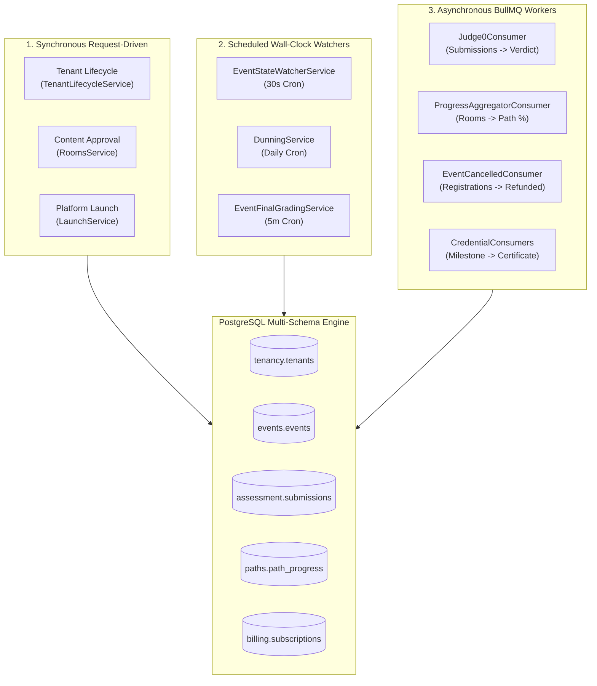

---

## Section C: Database Schema & Entity Relationships

The 12 state machines map directly to status, phase, and verdict columns across 9 PostgreSQL schemas:

| Machine # | Model & Table Name | Schema Name | Column Name | PostgreSQL Type | Nullable | Default Value |
|:---:|---|---|---|---|:---:|---|
| **01** | `Tenant` (`tenants`) | `tenancy` | `status` | `varchar(20)` | No | `'trial'` |
| **02** | `Event` (`events`) | `events` | `status` | `varchar(30)` | No | `'draft'` |
| **03** | `Registration` (`registrations`) | `events` | `status` | `varchar(30)` | No | `'registered'` |
| **04** | `Submission` (`submissions`) | `assessment` | `verdict` | `varchar(30)` | No | `'pending'` |
| **05** | `PathProgress` (`path_progress`) | `paths` | `percent_complete` | `float` | No | `0.0` |
| **05b**| `room_progress` (Raw SQL) | `paths` | `status` | `varchar` | No | `'in_progress'` |
| **06a**| `User` (`users`) | `identity` | `status` | `varchar(20)` | No | `'active'` |
| **06b**| `Invitation` (`invitations`) | `tenancy` | `status` | `varchar(20)` | No | `'pending'` |
| **07a**| `Subscription` (`subscriptions`) | `billing` | `status` | `varchar(20)` | No | `'trial'` |
| **07b**| `Invoice` (`invoices`) | `billing` | `status` | `varchar(20)` | No | `'draft'` |
| **07c**| `Payment` (`payments`) | `billing` | `status` | `varchar(20)` | No | `'created'` |
| **08** | `Room` (`rooms`) | `content` | `status` | `varchar(20)` | No | `'draft'` |
| **09a**| `Assessment` (`assessments`) | `assessment` | `status` | `varchar(20)` | No | `'draft'` |
| **09b**| `Problem` (`problems`) | `content` | `status` | `varchar(20)` | No | `'draft'` |
| **10** | `Certificate` (`certificates`) | `credentials` | `status` | `varchar(20)` | No | `'issued'` |
| **11** | `FeatureFlag` (`feature_flags`) | `platform` | `value` | `text` | No | `'false'` |
| **12** | `OutboxEvent` (`outbox_events`) | `platform` | `dispatched_at` / `failed_at` | `timestamptz` | Yes | `NULL` |

---

## Section D: Endpoints & Wire Formats

State transitions are triggered via dedicated REST endpoints across the backend controllers:

| Endpoint & Method | Controller File | Required Permission | State Mutation Target |
|---|---|---|---|
| `POST /tenants/:id/transition` | `src/tenancy/controllers/tenants.controller.ts:122` | `platform:manage_tenants` | `Tenant.status` |
| `POST /events/:id/publish` | `src/events/controllers/events.controller.ts:70` | `manage:event` | `Event.status: 'published'` |
| `POST /events/:id/cancel` | `src/events/controllers/events.controller.ts:115` | `manage:event` | `Event.status: 'cancelled'` |
| `POST /events/:id/extend` | `src/events/controllers/events.controller.ts:129` | `manage:event` | `Event.endTime` (extends `live` state) |
| `POST /submissions/:id/rerun` | `src/assessment/controllers/submissions.controller.ts:75` | `manage:assessment` | `Submission.verdict: 'pending'` |
| `POST /submissions/:id/flag` | `src/assessment/controllers/submissions.controller.ts:108` | `manage:assessment` | `Submission.isFlagged: true` |
| `POST /me/rooms/:id/start` | `src/paths/controllers/me-paths.controller.ts:69` | `read:cohort` | `room_progress.status: 'in_progress'` |
| `POST /me/rooms/:id/skip` | `src/paths/controllers/me-paths.controller.ts:101` | `read:cohort` | `room_progress.status: 'skipped'` |
| `POST /me/rooms/:id/complete` | `src/paths/controllers/me-paths.controller.ts:131` | `read:cohort` | `room_progress.status: 'completed'` |
| `POST /auth/invitations/accept` | `src/identity/controllers/auth.controller.ts:102` | `@Public()` | `Invitation.status: 'accepted'` |
| `POST /billing/subscriptions/:id/cancel` | `src/billing/controllers/subscriptions.controller.ts:91` | `manage:tenant` | `Subscription.status: 'cancelled'` |
| `POST /rooms/:id/review` | `src/content/controllers/rooms.controller.ts:82` | `manage:problem` | `Room.status: 'in_review'` |
| `POST /rooms/:id/approve` | `src/content/controllers/rooms.controller.ts:97` | `publish:content` | `Room.status: 'approved'` |
| `POST /rooms/:id/rollback` | `src/content/controllers/rooms.controller.ts:125` | `manage:problem` | `Room.status: 'draft'` |
| `POST /rooms/:id/archive` | `src/content/controllers/rooms.controller.ts:140` | `manage:problem` | `Room.status: 'archived'` |
| `POST /credentials/certificates/:id/revoke` | `src/credentials/controllers/credentials.controller.ts:245` | `manage:certificate` | `Certificate.status: 'revoked'` |
| `POST /credentials/certificates/:id/reissue` | `src/credentials/controllers/credentials.controller.ts:227` | `manage:certificate` | `Certificate.status: 'issued'` |
| `POST /admin/v1/launch/advance-phase` | `src/launch/launch.controller.ts:24` | `launch:manage` | `launch_phase_*` flags |

---

## Section E: Workflows, Triggers & Lifecycle State Machines

### 1. Tenant Lifecycle State Machine (`src/tenancy/services/tenant-lifecycle.service.ts`)

Enforced strictly via `ALLOWED_TRANSITIONS` map:

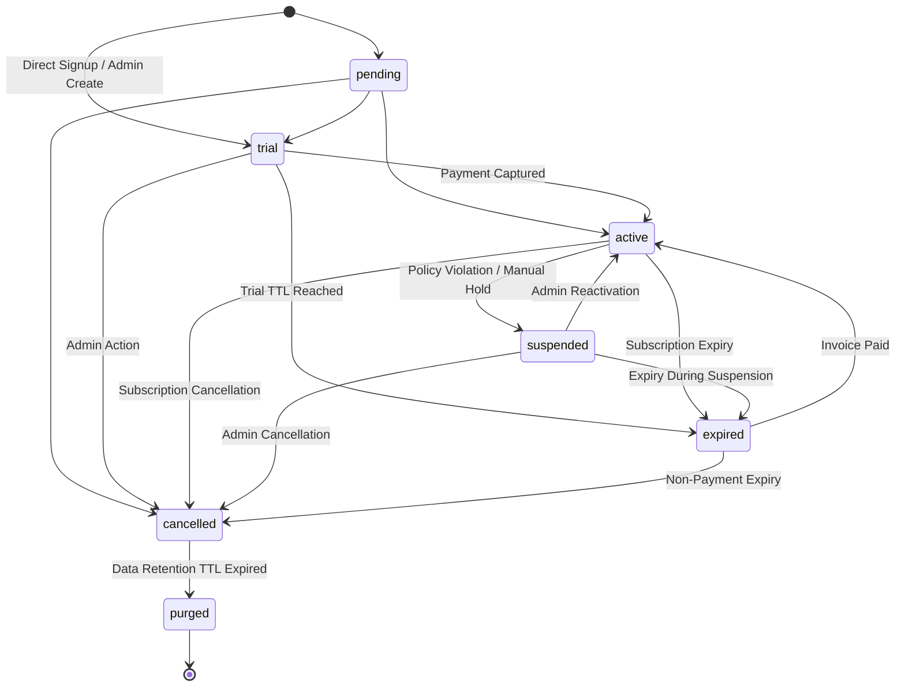

#### Transition Authorization & Error Handling

- **Invalid Transition Exception:** If caller requests an illegal transition, `TenantLifecycleService:38-45` throws:
  ```json
  {
    "statusCode": 400,
    "error": "Bad Request",
    "message": {
      "code": "invalid_transition",
      "from": "cancelled",
      "to": "active",
      "allowed": ["purged"]
    }
  }
  ```
- **Outbox Side Effect:** Every valid transition emits `TenantStatusChanged` (`payload: { from, to, reason, actorUserId }`).

---

### 2. Contest / Event Lifecycle State Machine (`src/events/services/event-state-watcher.service.ts`)

Governed by wall-clock timestamps ($T_{\text{start}}$, $T_{\text{end}}$) polled every 30 seconds:

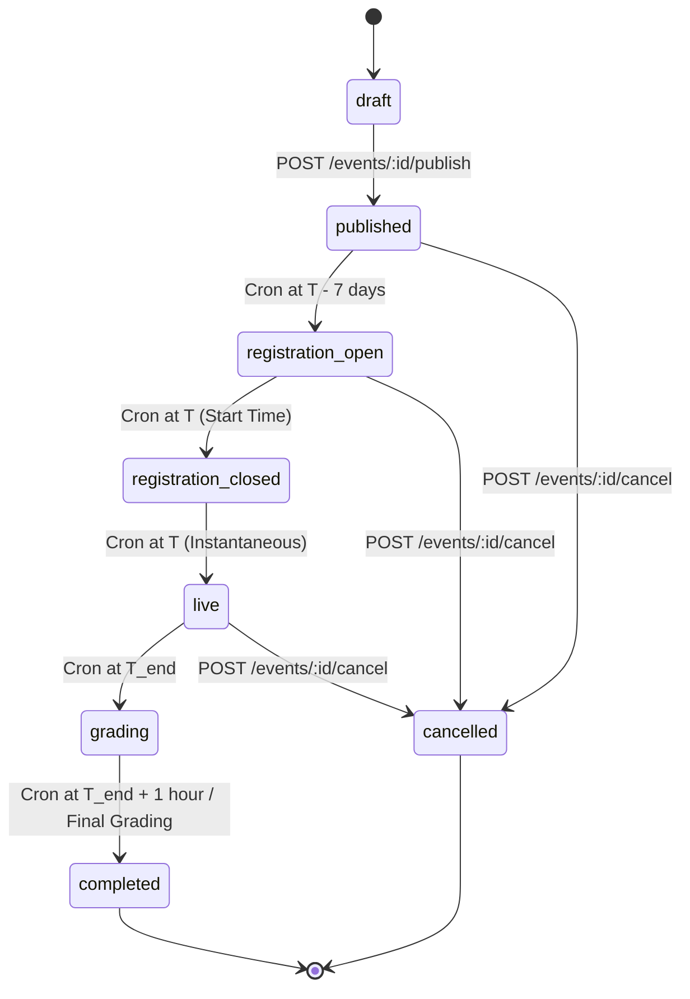

#### Automated Transition Rules (`EventStateWatcherService.watchEvents`)

1. **`published` -> `registration_open`:** Triggered when $\text{now} \ge T_{\text{start}} - 7\text{ days}$.
2. **`registration_open` -> `registration_closed`:** Triggered when $\text{now} \ge T_{\text{start}}$.
3. **`registration_closed` -> `live`:** Triggered when $\text{now} \ge T_{\text{start}}$ (executes sequentially in same cron run).
4. **`live` -> `grading`:** Triggered when $\text{now} \ge T_{\text{end}}$.
5. **`grading` -> `completed`:** Triggered when $\text{now} \ge T_{\text{end}} + 1\text{ hour}$ or when `EventFinalGradingService` finishes sorting scores. Emits outbox event `EventCompleted`.
6. **Registration Lockout Defect (DEF-17-01):** `EventsService.register` requires `status === 'published'`. When cron moves event to `registration_open`, registrations fail with `400 event_not_open`.

---

### 3. Event Participant Registration State Machine (`events.registrations`)

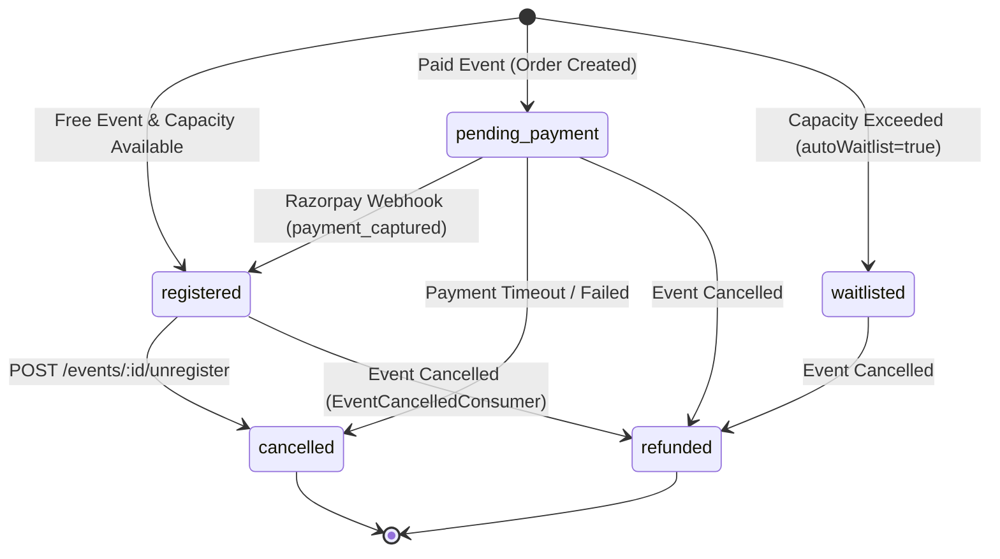

---

### 4. Code Submission & Evaluation State Machine (`assessment.submissions`)

Evaluated through the Judge0 asynchronous execution pipeline:

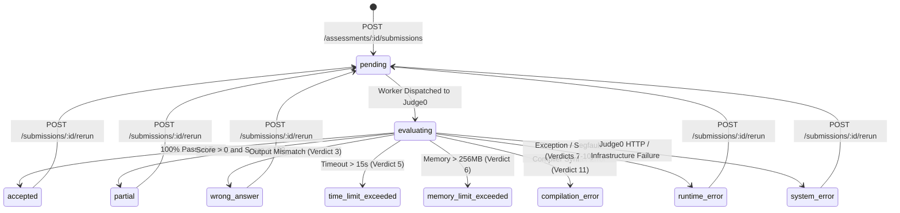

- **Proctoring Flag:** Independent boolean transition: `isFlagged: false` -> `true` on `POST /submissions/:id/flag`.

---

### 5. Learning Path & Room Progress State Machine

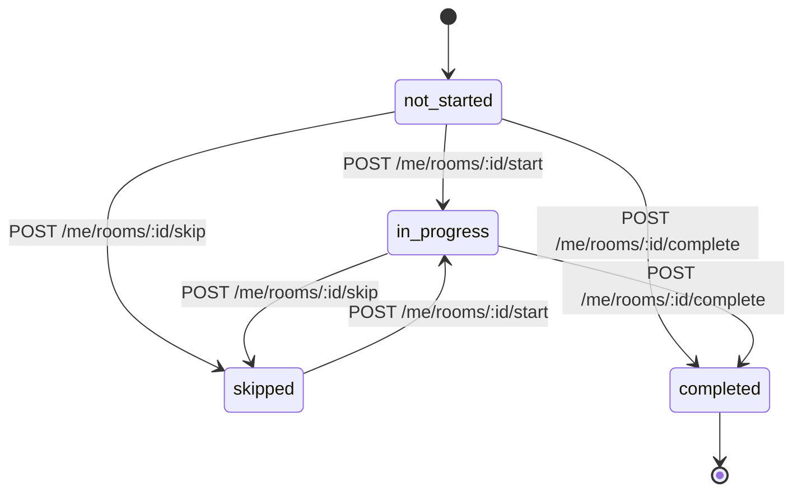

- **Path Accumulation:** On every transition, event `RoomProgressUpdated` triggers `ProgressAggregatorConsumer`. When $\text{completedSteps} / \text{totalSteps} = 1.0$, `PathProgress.completedAt` is populated and `PathCompleted` is emitted.
- **Skip Exploit (DEF-17-02):** `status === 'skipped'` is counted as complete in progress aggregation, enabling zero-effort path completions.

---

### 6. User Lifecycle & Invitation State Machine

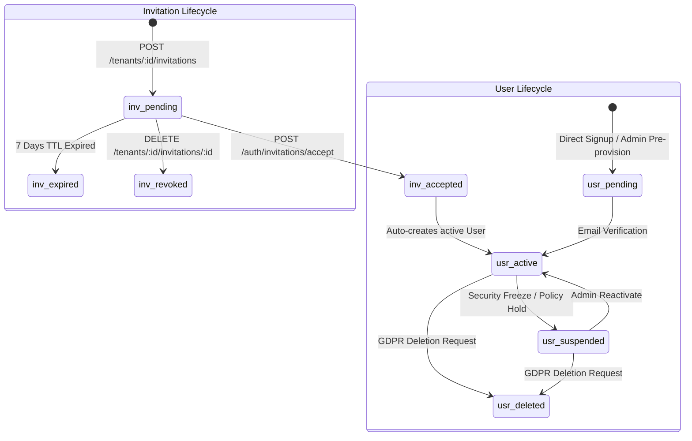

---

### 7. Subscription & Billing State Machine (`billing.subscriptions`)

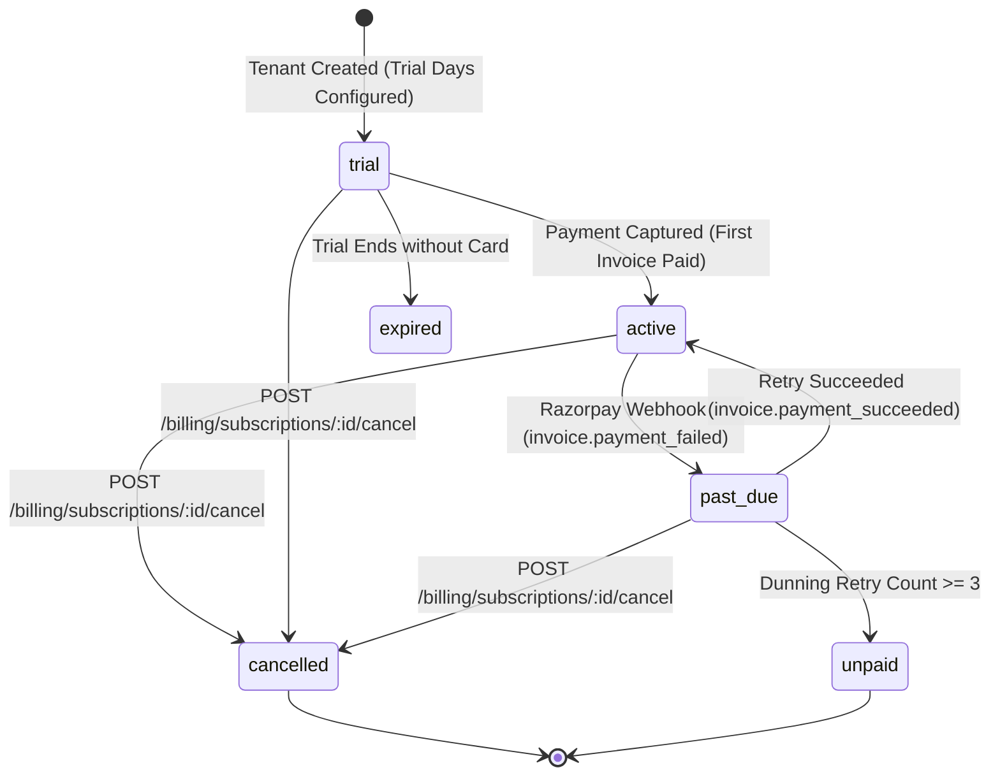

- **Dunning Process:** Daily cron checks `past_due` subscriptions, sends reminder emails, and retries Razorpay charges up to 3 times before transitioning to `unpaid`.

---

### 8. Room Authoring & Content Approval State Machine (`content.rooms`)

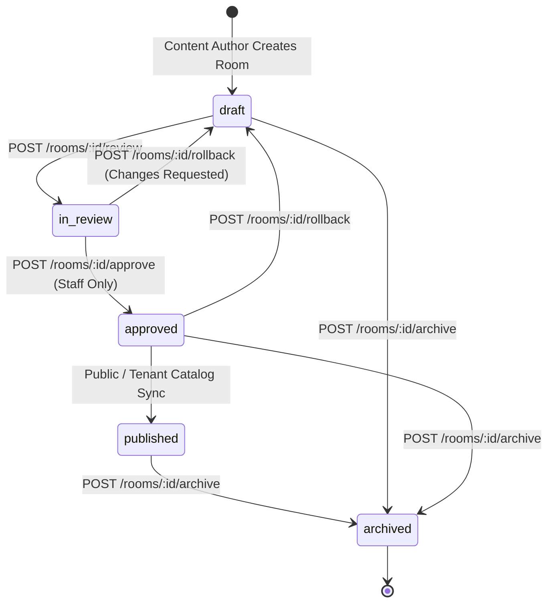

---

### 9. Assessment & Problem Lifecycle State Machine

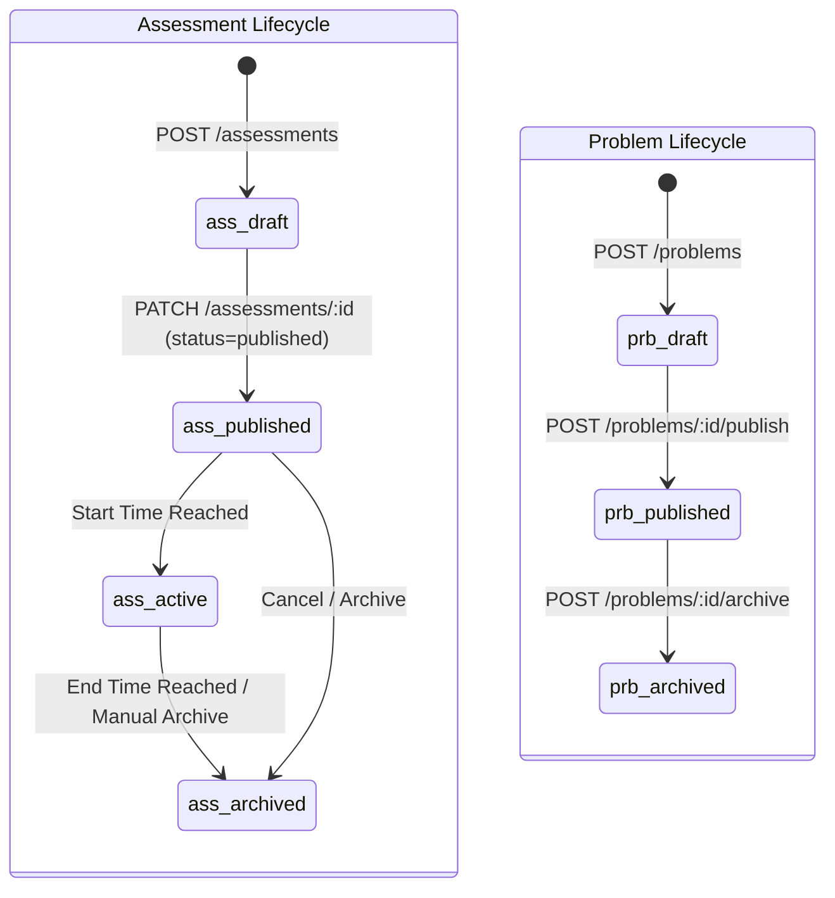

---

### 10. Certificate Credential State Machine (`credentials.certificates`)

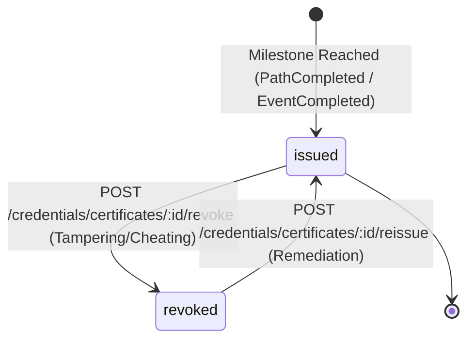

---

### 11. Platform Launch Phase State Machine (`src/launch/launch.service.ts`)

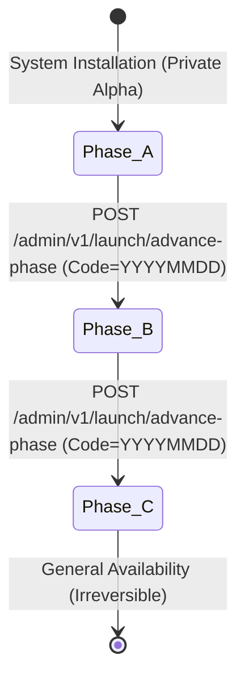

- **Flag Matrix by Phase:**
  - **Phase A (Default):** Direct signup = `false`, SSO = `false`, Course catalog = `false`, Judge = `false`.
  - **Phase B (Institutional Beta):** Direct signup = `true`, SSO = `true`, Course catalog = `false`, Judge = `false`.
  - **Phase C (General Availability):** Direct signup = `true`, SSO = `true`, Course catalog = `true`, Judge = `true`.

---

### 12. Transactional Outbox Event Dispatch State Machine (`platform.outbox_events`)

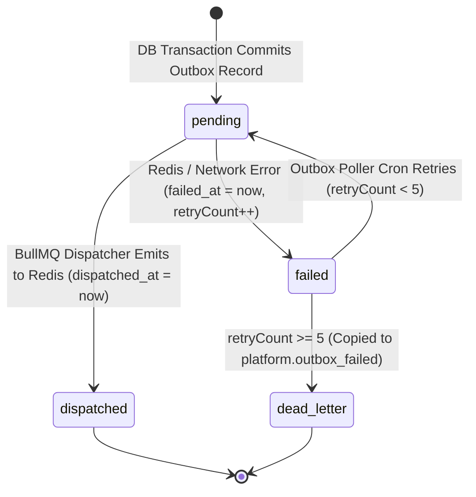

---

## Section F: Business Rules & Algorithmic Logic

### 1. Unified State Invalidation & Cascade Rules

When an entity undergoes a lifecycle transition, cascade mutations occur across dependent child entities:

| Parent Entity State Transition | Triggered Invalidation & Cascade Actions | Source Location |
|---|---|---|
| `Event.status: 'cancelled'` | 1. Refunds all paid registrations via Razorpay.<br/>2. Emits `EventCancelled` outbox event.<br/>3. Purges Redis live leaderboard `leaderboard:event:${id}`. | `src/events/services/events.service.ts:115-125` |
| `Tenant.status: 'suspended'` | 1. Invalidates active sessions in `identity.refresh_tokens`.<br/>2. Rejects incoming JWT requests in `TenantFilterMiddleware`. | `src/tenancy/services/tenant-lifecycle.service.ts:47-60` |
| `Tenant.status: 'cancelled'` | Sets subscription to `cancelled` and marks all open invoices as `void`. | `src/billing/services/subscriptions.service.ts:94` |
| `Room.status: 'archived'` | Rejects attempts to start or complete room in `MePathsController.assertRoomAccess`. | `src/paths/controllers/me-paths.controller.ts:54` |
| `Submission.verdict: (Terminal)` | 1. Updates Redis sorted set `leaderboard:event:${eventId}`.<br/>2. Recomputes participant rank.<br/>3. If top score, triggers `SubmissionGraded` event. | `src/assessment/consumers/submission-graded.consumer.ts` |
| `PathProgress: 100% Complete` | 1. Populates `completedAt = now()`.<br/>2. Emits `PathCompleted` event.<br/>3. Enqueues certificate issuance job in BullMQ. | `src/paths/consumers/progress-aggregator.consumer.ts:60` |

---

## Section G: Authorization, Multi-Tenancy & Access Control

1. **Platform Operation Guards:** Dangerous state transitions (such as tenant transitions and launch phase advances) require elevated platform administrative permissions:
   - `TenantLifecycleService.transition`: Requires `platform:manage_tenants` or wildcard `*` (`platform_admin`).
   - `LaunchService.advancePhase`: Requires `launch:manage` and a date-verified confirmation code.
2. **Tenant Confinement on Entity Transitions:** Institution admins (`college_admin`, `coordinator`, `faculty`) can only transition entities where `entity.tenantId === req.principal.tenantId`. Tenant isolation is enforced inside transactional database queries via `where: { id, tenantId }`.
3. **Student Transition Constraints:** Students can only trigger mutations on their own progress records (`user_id = req.principal.userId`). `MePathsController.assertRoomAccess` validates room ownership and enrollment before permitting state mutations.

---

## Section H: Background Tasks, Workers & Messaging

State transitions rely on a hybrid orchestration of crons and message consumers:

| Worker / Cron Service | Frequency / Queue | Monitored Entity | Trigger Condition & State Transition |
|---|---|---|---|
| `EventStateWatcherService` | Cron: `*/30 * * * * *` (30s) | `events.events` | Evaluates wall-clock thresholds: advances `published` -> `registration_open` -> `live` -> `grading` -> `completed`. |
| `EventFinalGradingService` | Cron: `0 */5 * * * *` (5m) | `events.events` | Evaluates events in `grading` state: sorts leaderboard scores and assigns `completed`. |
| `DunningService` | Cron: `0 3 * * *` (Daily 3 AM) | `billing.subscriptions` | Retries failed payments for `past_due` subscriptions; moves to `unpaid` after 3 attempts. |
| `Judge0Consumer` | Queue: `submission-eval` | `assessment.submissions` | Polls Judge0 submission tokens; transitions `pending` -> terminal verdict. |
| `ProgressAggregatorConsumer` | Queue: Outbox `RoomProgressUpdated` | `paths.path_progress` | Aggregates room states into path percentage complete ($0\% \to 100\%$). |
| `EventCancelledConsumer` | Queue: Outbox `EventCancelled` | `events.registrations` | Automatically initiates Razorpay refunds for participants. |
| `CredentialConsumers` | Queue: Outbox `PathCompleted`, etc. | `credentials.certificates` | Evaluates completion triggers and issues certificates (`status: 'issued'`). |

---

## Section I: Integrations & External Dependencies

1. **Judge0 Sandbox API:** Drives the submission evaluation state machine via asynchronous HTTP polling.
2. **Razorpay Billing & Orders API:** Drives subscription, invoice, and registration payment transitions via incoming webhooks and automated refund APIs.
3. **AWS SES Mailer:** Dispatches state notification emails (invitations, dunning alerts, certificate delivery).
4. **Redis Sorted Sets:** Maintains live competitive state caches for events and platform ratings.

---

## Section J: Observability, Metrics & Telemetry

1. **State Machine Logging:** `TenantLifecycleService` and `EventStateWatcherService` emit structured NestJS logger output during transitions:
   ```typescript
   this.logger.log(`Tenant ${tenantId} transitioned from ${tenant.status} to ${to}`);
   this.logger.log(`Event ${event.id} advanced to ${nextStatus}`);
   ```
2. **Missing State Transition Metrics:** Zero Prometheus counters or histograms track state transition duration, dunning failure ratios, or submission evaluation latency.
3. **Unchecked Silent SQL Rejections:** Raw SQL transitions in `MePathsController` use `.catch(() => null)`, swallowing SQL constraint errors and state mutation failures silently.

---

## Section K: Edge Cases & Failure Modes

| Edge Case / Scenario | Legacy Behavior | Forensic Consequence |
|---|---|---|
| **Contest Reaches T-7d During Server Downtime** | Server restarts; `EventStateWatcherService` runs on next 30s tick. | Evaluates $\text{now} \ge T - 7\text{d}$ and transitions directly to `registration_open`. Gracefully recovers. |
| **Simultaneous Webhook & User Cancel** | Two concurrent transactions attempt to transition subscription. | PostgreSQL row-level locks on `subscriptions` serialize execution; second transaction throws 400. |
| **Outbox Dispatcher Fails Continuously** | `retryCount` increments on each failure. | After 5 failed attempts, record is moved to `platform.outbox_failed`; downstream consumers never receive state update. |
| **Cancelled Tenant Requests Data Export** | `DataSubjectController` checks tenant status. | Requests succeed if account user is active, but tenant cannot be reactivated due to missing transition path. |
| **All Path Rooms Skipped** | `ProgressAggregatorConsumer` counts skipped as complete. | Student earns a certificate with 0 rooms completed. |

---

## Section L: Security & Compliance Posture

1. **Tamper-Proof State Enforcement:** State transitions cannot be bypassed via direct REST payload injection; controllers reject unlisted status strings through NestJS class-validator pipes and explicit state maps.
2. **Non-Repudiation Audit Trail:** High-privilege state transitions (`tenant.transition`, `event.cancel`, `certificate.revoke`, `launch.advance_phase`) are decorated with `@AuditAction(...)` to guarantee immutable auditing in `audit.audit_entries`.
3. **Confirmation Gate for Destructive Launches:** Advancing platform phases requires an explicit confirmation code matching today's date (`YYYYMMDD`), preventing accidental invocation.

---

## Section M: Frontend-to-Backend Contract

### Frontend UI State Reflection Matrix

| State Machine Domain | Frontend Route / Component | State Display Component | Mutation Action Available in UI |
|---|---|---|---|
| **Tenant Lifecycle** | `TenantDetailPage.tsx`, `TenantTransitionPage.tsx` | `TenantStatusBadge.tsx` | Select box dropdown with confirmation form. |
| **Event State** | `EventsPage.tsx`, `EventDetailPage.tsx` | `EventStatusBadge.tsx` | Publish, Cancel, Extend modal actions. |
| **Submission Verdict** | `SubmissionsPage.tsx`, `SubmissionDetailPage.tsx` | `VerdictBadge.tsx` | Rerun button (`POST /rerun`), Flag button (`POST /flag`). |
| **Learning Path Progress** | `MyProgressPage.tsx`, `PathDetailPage.tsx` | `ProgressBar`, `EnrollmentCard` | Start, Skip, Complete buttons in workspace. |
| **User Status** | `UsersPage.tsx`, `UserDetailPage.tsx` | `UserStatusBadge.tsx` | Invite accept form, Impersonate button. |
| **Subscription State** | `SubscriptionPage.tsx`, `BillingDashboardPage.tsx` | `SubscriptionBadge.tsx` | Upgrade modal, Cancel subscription button. |
| **Room Approval** | `RoomDetailPage.tsx`, `RoomEditPage.tsx` | `StatusBadge.tsx` | Submit Review, Approve, Rollback buttons. |
| **Certificate Status** | `MyCertificatesPage.tsx`, `CertificatesAdminPage.tsx`| `CertificateBadge.tsx` | Download button, Revoke button. |

---

## Section N: Negative Specifications & Non-Capabilities

The following state machine features are confirmed to be **100% NOT IMPLEMENTED** in the Dezolver codebase:

1. **NO Workflow Reversal for Cancelled Tenants:** `TenantLifecycleService` defines `cancelled: ['purged']`. It is structurally impossible to uncancel a tenant.
2. **NO Rollback for Platform Launch Phases:** `LaunchService` provides no `rollbackPhase` or `deactivatePhase` method. Advancing phases is permanent.
3. **NO Multi-Step Content Approval Pipeline:** Room approval is a single-hop approval (`draft -> in_review -> approved`). Multi-stage peer review or multi-approver voting does not exist.
4. **NO Manual Submission Verdict Override:** Admins cannot manually assign a grade or change a verdict from `wrong_answer` to `accepted`. The only remediation action is `rerun`.
5. **NO Partial Certificate Revocation:** Certificates are either fully `issued` or fully `revoked`; conditional suspension does not exist.

---

## Section O: Critical Defects & Architectural Discrepancies

### DEF-17-01: Event Registration Lockout Defect
- **Location:** `src/events/services/events.service.ts:86` vs `src/events/services/event-state-watcher.service.ts:40`
- **Forensic Evidence:**
  ```typescript
  // In events.service.ts:
  if (event.status !== 'published') {
    throw new BadRequestException({ code: 'event_not_open' });
  }
  // In event-state-watcher.service.ts:
  if (event.status === 'published' && now >= regOpenTime) {
    await this.updateStatus(event.id, 'registration_open');
  }
  ```
- **Blast Radius:** When the automated watcher moves an event to `registration_open`, all participant registration attempts fail with `400 event_not_open`, locking out 100% of applicants.

### DEF-17-02: Skip-to-Completion Fraud Exploit
- **Location:** `src/paths/consumers/progress-aggregator.consumer.ts:42`
- **Forensic Evidence:**
  ```typescript
  if (rp[0]?.status === 'completed' || rp[0]?.status === 'skipped') completed++;
  ```
- **Blast Radius:** Skipped rooms are treated as completed steps in path percentage calculations. A user can skip every room and receive an authentic completion certificate.

### DEF-17-03: Irreversible Tenant Cancellation Lockout
- **Location:** `src/tenancy/services/tenant-lifecycle.service.ts:20`
- **Forensic Evidence:** `cancelled: ['purged']`.
- **Blast Radius:** If a college admin or billing failure cancels a tenant, the institution cannot be reactivated. There is no valid transition back to `active` or `trial`.

### DEF-17-04: Missing Razorpay Subscription Webhook Sync
- **Location:** `src/billing/controllers/webhooks.controller.ts`
- **Forensic Evidence:** Webhook controller handles `payment.captured` and `invoice.paid`, but ignores `subscription.cancelled` and `subscription.paused`.
- **Blast Radius:** Cancellations made directly in Razorpay dashboard do not update `billing.subscriptions`, causing billing desynchronization.

---

## Section P: Target Recommendations & Remediation Plan

### 1. Fix Event Registration Guard

Update `EventsService.register` (`src/events/services/events.service.ts:86`) to accept both `published` and `registration_open`:

```typescript
// Replace:
// if (event.status !== 'published')

// With:
const validRegistrationStates = ['published', 'registration_open'];
if (!validRegistrationStates.includes(event.status)) {
  throw new BadRequestException({ code: 'event_not_open' });
}
```

### 2. Differentiate Skipped vs Completed in Path Aggregator

Update `ProgressAggregatorConsumer:42`:

```typescript
// Count completed rooms only for path completion requirements
if (rp[0]?.status === 'completed') completed++;
```

### 3. Add Reversible Transition for Cancelled Tenants

Update `ALLOWED_TRANSITIONS` in `src/tenancy/services/tenant-lifecycle.service.ts:20`:

```typescript
cancelled: ['trial', 'active', 'purged'],
```

### 4. Provide Reversible Launch Phase Configuration

Add a rollback endpoint in `LaunchController` to allow reverting Phase C -> Phase B -> Phase A for disaster recovery during production launches.

---

## Section Q: Master Verification Traceability Matrix

| State Machine Entity | Forensic Source File & Line | Verified Status | Legacy Defect / Finding |
|---|---|:---:|---|
| **Tenant Lifecycle Automaton** | `src/tenancy/services/tenant-lifecycle.service.ts:14-22` | `CONFIRMED` | 7 states defined in `ALLOWED_TRANSITIONS`. |
| **Tenant Irreversible Cancellation** | `src/tenancy/services/tenant-lifecycle.service.ts:20` | `DEFECTIVE` | `cancelled` transitions only to `purged`. Reversal impossible. |
| **Contest State Watcher** | `src/events/services/event-state-watcher.service.ts:25-70` | `CONFIRMED` | 30s cron advances event states based on time thresholds. |
| **Event Registration Lockout** | `src/events/services/events.service.ts:86` | `DEFECTIVE` | Rejects registrations once event enters `registration_open`. |
| **Event Registration States** | `prisma/events/schema.prisma:35` | `CONFIRMED` | Model `Registration` defines 5 statuses. |
| **Submission Verdict Pipeline** | `prisma/assessment/schema.prisma:64` | `CONFIRMED` | Model `Submission` defines 9 terminal verdicts. |
| **Judge0 Evaluation Worker** | `src/worker/consumers/judge0.consumer.ts` | `CONFIRMED` | Evaluates Judge0 tokens and transitions submissions. |
| **Room Progress State Machine** | `src/paths/controllers/me-paths.controller.ts:69-168` | `CONFIRMED` | Transitions rooms through start, skip, and complete. |
| **Path Progress Aggregator** | `src/paths/consumers/progress-aggregator.consumer.ts:7-71` | `DEFECTIVE` | Aggregates room states; skips treated as completed (exploit). |
| **User Lifecycle States** | `prisma/identity/schema.prisma:39` | `CONFIRMED` | Model `User` defines 4 statuses. |
| **Invitation Lifecycle States** | `prisma/tenancy/schema.prisma:30` | `CONFIRMED` | Model `Invitation` defines 4 statuses with 7-day TTL. |
| **Subscription Lifecycle States**| `prisma/billing/schema.prisma:35` | `CONFIRMED` | Model `Subscription` defines 5 statuses. |
| **Dunning State Transitions** | `src/billing/services/dunning.service.ts` | `CONFIRMED` | Advances `past_due` to `unpaid` on 3 failed retries. |
| **Content Room Review Pipeline** | `src/content/controllers/rooms.controller.ts:82-145` | `CONFIRMED` | Review, approve, rollback, archive endpoints implemented. |
| **Assessment Status States** | `prisma/assessment/schema.prisma:46` | `CONFIRMED` | Model `Assessment` defines 4 lifecycle statuses. |
| **Certificate Revoke / Reissue** | `src/credentials/controllers/credentials.controller.ts:227` | `CONFIRMED` | Reversible credential lifecycle implemented. |
| **Platform Launch Phase Automaton**| `src/launch/launch.service.ts:23-60` | `CONFIRMED` | Phases A -> B -> C advance with confirmation code. Irreversible. |
| **Transactional Outbox Automaton** | `src/shared/outbox/consumer-registry.ts` | `CONFIRMED` | Dispatches outbox events with exponential backoff. |

