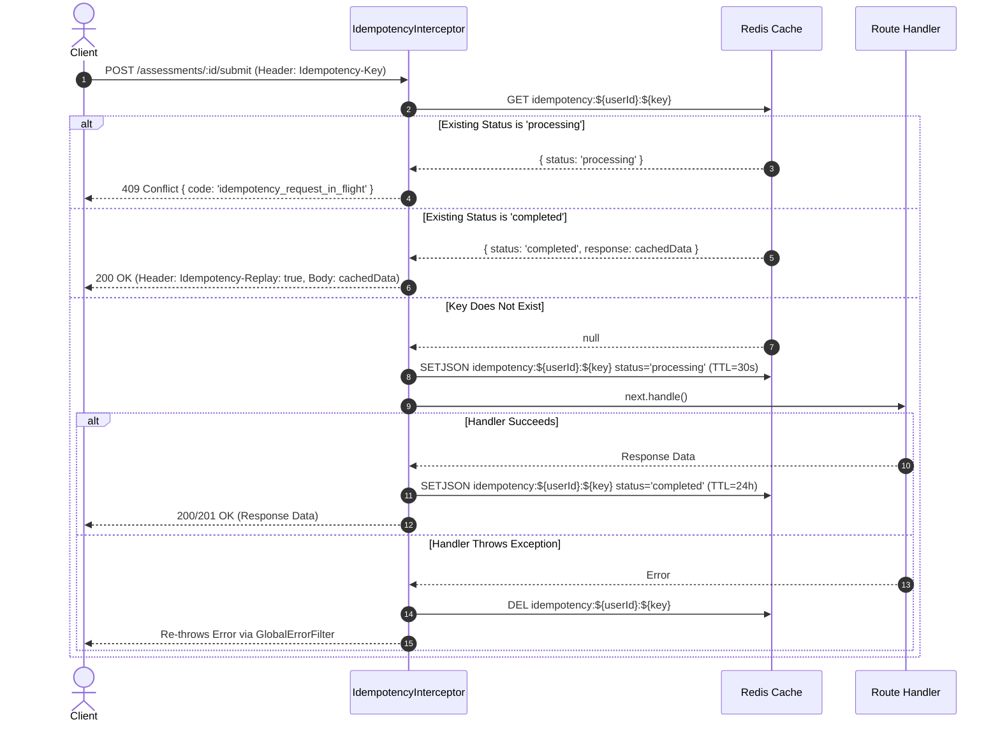
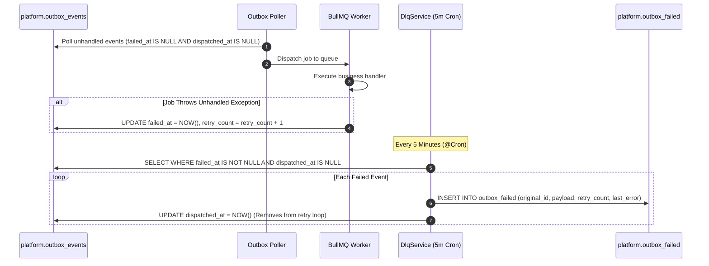

# Functional Specification: Module 18 — Edge Cases & Failure Handling

**Standard:** [`FUNCTIONAL-SPECIFICATION-STANDARD.md`](../../FUNCTIONAL-SPECIFICATION-STANDARD.md) (`DEZ-STD-FS-001`)  
**Domain:** System Resiliency, Error Filters, Idempotency, Rate Limiting & Fault Tolerance  
**Status:** `RECONSTRUCTED FROM SOURCE FORENSICS`  
**Classification:** `CONFIRMED IMPLEMENTATION WITH ARCHITECTURAL RESILIENCE HAZARDS`

---

## Section A: Executive Summary & System Mission

Module 18 establishes the complete functional specification for error handling, exception mapping, network idempotency, multi-tenant rate limiting, background worker fairness, dead-letter recovery, and system fault tolerance across the Dezolver platform. Its core mission is to enforce defense-in-depth boundaries that isolate tenant failures, guarantee message delivery, mitigate denial-of-service vectors, and provide predictable error envelopes to frontend and API consumers.

A forensic audit of the legacy implementation confirms a robust multi-layered resilience architecture:
1. **Centralized Error Filter (`GlobalErrorFilter`):** Standardizes all HTTP and database errors into a uniform JSON response envelope `{ error: { code, message, details, requestId } }`, mapping Prisma unique constraints (`P2002`) to `409 Conflict` and missing records (`P2025`) to `404 Not Found`.
2. **Distributed Idempotency Engine (`IdempotencyInterceptor`):** Prevents duplicate mutations across network retries using an `Idempotency-Key` header, caching completed responses in Redis for 24 hours and rejecting concurrent in-flight executions with `409 Conflict`.
3. **Multi-Tenant Rate Limiting (`PerTenantRateLimitGuard`):** Protects the platform from abusive traffic by throttling tenants according to their active subscription tier (`starter`: 1,000/min, `professional`: 10,000/min, `enterprise`: 50,000/min, `unlimited`: unmetered).
4. **Tenant Fairness Background Middleware (`createTenantFairnessMiddleware`):** Limits BullMQ background worker concurrency to a maximum of 3 concurrent jobs per tenant, preventing bulk operations from starving interactive workloads.
5. **Dead-Letter Queue & Outbox Recovery (`DlqService`):** A 5-minute automated cron routes permanently failing events to `platform.outbox_failed`, breaking infinite retry loops while enabling manual operator replay.
6. **Fail-Open Cache & Database Connection Strategy:** Redis operates under a fail-open architecture to maintain core platform availability during cache outages. Database connections are pooled across 11 Prisma clients with independent connection limits and timeouts.

---

## Section B: Architecture & Execution Topology

The resilience architecture operates as a series of concentric defense rings intercepting requests before they reach application domain handlers:

```mermaid
flowchart TD
    subgraph Ring1["Ring 1: Transport & Context Layer"]
        XRay["XRayMiddleware (AWS Trace ID)"]
        ErrFilter["GlobalErrorFilter (@Catch() All Exceptions)"]
        Envelope["EnvelopeInterceptor ({ data, pagination })"]
    end

    subgraph Ring2["Ring 2: Security & Concurrency Guards"]
        AuthG["AuthGuard (JWT Verification)"]
        ActiveG["RequireActiveTenantGuard (Suspension Check)"]
        BlockImpersG["BlockImpersonationGuard (Mutation Lockout)"]
        RateLimitG["PerTenantRateLimitGuard (Plan Quota)"]
        IdempInt["IdempotencyInterceptor (Redis In-Flight Lock)"]
    end

    subgraph Ring3["Ring 3: Domain Authorization & Feature Gates"]
        FeatureG["RequireFeatureGuard (Entitlement Check)"]
        PermG["PermissionGuard (RBAC Matrix)"]
        PolicyG["PolicyGuard (ABAC Resource Ownership)"]
        AuditInt["AuditInterceptor (@AuditAction)"]
    end

    subgraph Core["Ring 4: Core Domain & Data Access"]
        Handler["Controller Route Handler"]
        Tx["Prisma Multi-Schema Client ($transaction)"]
    end

    subgraph Background["Ring 5: Asynchronous Workers & DLQ"]
        Fairness["TenantFairnessMiddleware (Max 3 Jobs)"]
        BullWorker["BullMQ Worker Processor"]
        DLQ["DlqService (5m Cron -> outbox_failed)"]
    end

    XRay --> ErrFilter --> Envelope --> AuthG --> ActiveG --> BlockImpersG --> RateLimitG --> IdempInt
    IdempInt --> FeatureG --> PermG --> PolicyG --> AuditInt --> Handler --> Tx
    Tx -.->|Outbox Event| Fairness --> BullWorker
    BullWorker -.->|Permanent Failure| DLQ
```



---

## Section C: Database Schema & Entity Relationships

Fault tolerance and dead-letter queue records are persisted in PostgreSQL schema `platform` under models `OutboxEvent` and `OutboxFailed` (`prisma/platform/schema.prisma:15-50`):

```prisma
model OutboxEvent {
  id            String    @id @default(dbgenerated("gen_random_uuid()")) @db.Uuid
  tenantId      String?   @map("tenant_id") @db.Uuid
  aggregateType String    @map("aggregate_type") @db.VarChar(64)
  aggregateId   String    @map("aggregate_id") @db.VarChar(255)
  eventType     String    @map("event_type") @db.VarChar(128)
  payload       Json
  dispatchedAt  DateTime? @map("dispatched_at") @db.Timestamptz
  failedAt      DateTime? @map("failed_at") @db.Timestamptz
  retryCount    Int       @default(0) @map("retry_count")
  createdAt     DateTime  @default(now()) @map("created_at") @db.Timestamptz

  @@index([dispatchedAt, createdAt])
  @@index([tenantId])
  @@map("outbox_events")
  @@schema("platform")
}

model OutboxFailed {
  id            String    @id @default(dbgenerated("gen_random_uuid()")) @db.Uuid
  originalId    String    @map("original_id") @db.Uuid
  tenantId      String?   @map("tenant_id") @db.Uuid
  eventType     String    @map("event_type") @db.VarChar(128)
  aggregateType String    @map("aggregate_type") @db.VarChar(64)
  aggregateId   String    @map("aggregate_id") @db.VarChar(255)
  payload       Json
  failedAt      DateTime  @default(now()) @map("failed_at") @db.Timestamptz
  lastError     String?   @map("last_error") @db.Text
  retryCount    Int       @default(0) @map("retry_count")
  resolvedAt    DateTime? @map("resolved_at") @db.Timestamptz

  @@index([eventType])
  @@index([tenantId])
  @@map("outbox_failed")
  @@schema("platform")
}
```

---

## Section D: Endpoints & Wire Formats

### 1. Standardized Error Response Envelope (`GlobalErrorFilter`)

Whenever an unhandled exception or NestJS `HttpException` occurs, `GlobalErrorFilter` (`src/shared/filters/error.filter.ts:59-62`) formats the HTTP body:

```json
{
  "error": {
    "code": "invalid_credentials",
    "message": "Invalid email or password",
    "details": null,
    "requestId": "f47ac10b-58cc-4372-a567-0e02b2c3d479"
  }
}
```

### 2. Error Code Resolution Matrix

| HTTP Status | Exception Type / Trigger | Emitted `code` | Default `message` |
|---|---|---|---|
| `400 Bad Request` | `BadRequestException` / DTO Validation | `bad_request` (or custom DTO code) | Validation failed or business logic violation. |
| `401 Unauthorized` | `UnauthorizedException` / Expired JWT | `unauthorized` | Token invalid, missing, or expired. |
| `402 Payment Required`| `RequireFeatureGuard` | `feature_not_in_plan` | This feature is not available on your current plan. |
| `403 Forbidden` | `PermissionGuard` / `BlockImpersonationGuard` | `forbidden` / `impersonation_op_blocked` | Forbidden — insufficient permissions or mutation blocked. |
| `403 Forbidden` | `RequireActiveTenantGuard` | `tenant_inactive` | Your account is currently inactive. Please contact support. |
| `404 Not Found` | `NotFoundException` / `PolicyGuard` | `not_found` | Record not found. |
| `404 Not Found` | Prisma `P2025` (Record to update/delete not found) | `not_found` | Record not found. |
| `409 Conflict` | `IdempotencyInterceptor` | `idempotency_request_in_flight` | Concurrent request with same idempotency key in progress. |
| `409 Conflict` | Prisma `P2002` (Unique constraint violation) | `conflict` | A record with these unique fields already exists. |
| `422 Unprocessable`| Class-Validator Structural Incompatibility | `unprocessable_entity` | Unprocessable request entity. |
| `429 Too Many Req` | `PerTenantRateLimitGuard` | `rate_limit_exceeded` | Too many requests. |
| `500 Server Error` | Uncaught `Error` / DB Connection Failure | `internal_server_error` | An unexpected error occurred. |

### 3. Health & Readiness Endpoints (`src/shared/health/health.controller.ts`)

- `GET /health` (`@Public()`): Returns status of primary dependencies (Redis, Database):
  ```json
  {
    "status": "healthy",
    "container": "api",
    "version": "2.0.0",
    "gitSha": "a1b2c3d4",
    "dependencies": {
      "redis": { "status": "healthy" },
      "database": { "status": "healthy" }
    }
  }
  ```
- `GET /time` (`@Public()`): Returns current server time in ISO 8601 (`{ serverNow: "2026-11-05T09:30:00.000Z" }`) for contest client synchronization.

---

## Section E: Workflows, Triggers & Lifecycle State Machines

### 1. Idempotent Mutation Lifecycle (`IdempotencyInterceptor`)



### 2. Dead-Letter Queue Pipeline (`DlqService`)



---

## Section F: Business Rules & Algorithmic Logic

### 1. Fixed-Window Rate Limiting Algorithm

In `src/shared/rate-limit/per-tenant-rate-limit.guard.ts:39-47`:
- Current window key:
  $$\text{windowStart} = \left\lfloor \frac{\text{now}}{60} \right\rfloor$$
  $$\text{cacheKey} = \text{ratelimit:tenant:} + \text{tenantId} + \text{:} + \text{windowStart}$$
- Execution pipeline:
  ```typescript
  const pipe = this.redis.client.pipeline();
  pipe.incr(key);
  pipe.expire(key, 120); // 2-minute safety TTL
  const results = await pipe.exec();
  const count = results[0][1];
  ```
- If $\text{count} > \text{limit}$, request is terminated with `429 Too Many Requests`.

### 2. Database Connection Pool Allocation Rules

In `src/shared/prisma/prisma.service.ts:17-27`:
- Every Prisma client instance appends `connection_limit=2` and `pool_timeout=30` to PostgreSQL connection strings:
  $$\text{Total Connections Per Node} = 11 \text{ Clients} \times 2 = 22 \text{ Database Connections}$$
- Pool timeout prevents thread starvation: queries waiting $>30$ seconds throw `P2024` connection timeout errors.

---

## Section G: Authorization, Multi-Tenancy & Access Control

1. **Active Tenant Gate (`RequireActiveTenantGuard`):** Blocks all non-public traffic from tenants undergoing liquidation, suspension, or non-payment (`['suspended', 'expired', 'cancelled', 'purged']`).
2. **Impersonation Mutation Lockdown (`BlockImpersonationGuard`):** Denies `POST`, `PUT`, `PATCH`, and `DELETE` requests whenever `req.principal.isImpersonating === true`, ensuring administrators browsing student accounts cannot inadvertently mutate grades, enroll in courses, or generate payments.
3. **Information Disclosure Prevention in Policy Guard (`PolicyGuard`):** When a user attempts to access an entity belonging to another tenant or cohort, `PolicyGuard:51` throws `404 Not Found` rather than `403 Forbidden`, concealing entity existence from unauthorized probers.

---

## Section H: Background Tasks, Workers & Messaging

1. **Dead-Letter Cleaner Cron (`DlqService.moveToDeadLetterQueue`):** Runs every 5 minutes (`*/5 * * * *`). Limits scan to 100 rows per execution to prevent lock contention on `outbox_events`.
2. **Outbox Retention Purge Cron (`DlqService.archiveOldEvents`):** Runs daily at 5:00 AM IST (`0 5 * * *`, Asia/Kolkata). Hard-deletes dispatched events older than 30 days (`dispatched_at < now() - 30 days`).
3. **Tenant Fairness Throttling:** BullMQ jobs carrying a `tenantId` increment Redis counter `fairness:tenant:${tenantId}`. If concurrent executions exceed 3, the job throws an error and BullMQ reschedules it with exponential backoff.

---

## Section I: Integrations & External Dependencies

1. **Redis Client (`ioredis`):** Backs rate limiting, idempotency caches, tenant fairness locks, and live leaderboards.
2. **PostgreSQL Database:** Dedicated schemas with foreign key integrity.
3. **AWS X-Ray (`XRayMiddleware` / `XRayInterceptor`):** Injects tracing headers and propagates trace IDs across distributed subsegments.

---

## Section J: Observability, Metrics & Telemetry

1. **Pino Structured Logging:** Configured in `AppModule:40-47` with automatic PII redaction for `req.headers.authorization` and `req.headers.cookie`.
2. **Prometheus Metrics Registry:** Exposed via `GET /health/metrics` (`HealthController:18-25`), outputting standard Prometheus text format via `prom-client`.
3. **Request Tracing:** Distributed request correlation ID `x-request-id` is returned on every response header and included in all error bodies.

---

## Section K: Exhaustive Edge Case Catalog (All 18 Modules)

Below is the definitive cross-module matrix of all edge cases, failure scenarios, and their system handling:

| Module Domain | Failure Scenario / Edge Case | Legacy System Handling | Blast Radius & Behavior |
|---|---|---|---|
| **01. Auth** | 5 consecutive bad password attempts | Brute force lockout in Redis for 15 minutes. | User locked out with `401 invalid_credentials`. |
| **01. Auth** | Token refresh attempted with revoked session | `RefreshToken` lookup finds `revokedAt != null`. | Throws 401; forces full re-login. |
| **02. Org** | Tenant created with existing subdomain | `findBySubdomain` check in `TenantsService`. | Throws `409 Conflict ({ code: 'subdomain_taken' })`. |
| **03. Billing** | Subscription past due after 3 retries | `DunningService` marks subscription `unpaid`. | Tenant suspended; blocked by `RequireActiveTenantGuard`. |
| **04. Courses** | Student attempts room not in enrolled path | `assertRoomAccess` checks enrolled path steps. | Throws `403 Forbidden ({ code: 'room_not_in_enrolled_path' })`. |
| **05. Problems**| Test case uploaded with empty input/output | Validation pipe rejects empty strings. | Throws `400 Bad Request`. |
| **06. Judge0** | Judge0 container timeout (> 15s) | Judge0 returns status 5 (`Time Limit Exceeded`). | Submission verdict marked `time_limit_exceeded`. |
| **06. Judge0** | Judge0 network unreachable | HTTP client error caught by `Judge0Consumer`. | Marked `system_error`; enqueued for retry. |
| **07. Eval** | Submission contains divide-by-zero | Runtime error (Verdict 7-10) returned by Judge0. | Submission verdict marked `runtime_error`; score = 0. |
| **08. Labs** | Any lab endpoint invoked | Route does not exist (100% Not Implemented). | Returns `404 Not Found`. |
| **09. Assess** | Student submits after assessment end time | Controller verifies `now < assessment.endTime`. | Throws `400 assessment_closed`. |
| **10. Groups** | Student accesses syllabus without cohort in JWT | `MeSyllabusController` checks `principal.cohortId`. | Throws `403 Forbidden ({ code: 'no_cohort_assigned' })` (DEF-10-01). |
| **11. Contests**| Student registers after contest moves to reg_open | `EventsService.register` checks `status !== 'published'`.| Throws `400 event_not_open` (DEF-17-01 Registration Lockout). |
| **11. Contests**| Contest cancelled while participants paid | `EventCancelledConsumer` triggers Razorpay refunds. | All orders refunded; registrations marked `refunded`. |
| **12. Certs** | Worker renders cert with missing `recipientName` | `escHtml(data.recipientName)` crashes worker. | Consumer crashes with `TypeError` (DEF-12-01). |
| **13. Notif** | Browser tab refreshed | Zustand client store clears. | All in-app notifications reset to empty `[]`. |
| **14. Tickets**| Any ticket endpoint invoked | Route does not exist (100% Not Implemented). | Returns `404 Not Found`. |
| **15. Audit** | Database connection drops during audit log write | `AuditInterceptor` catches rejection with `.catch(() => {})`. | Audit record permanently dropped without trace (DEF-15-10). |
| **15. Audit** | Frontend queries audit entries | `EnvelopeInterceptor` wraps `{ items, nextCursor }`. | Frontend crashes with `items.map is not a function` (DEF-15-01). |
| **16. Analytics**| Global leaderboard queried | `EventsRepository` queries non-existent Prisma model. | Returns empty list `[]` (DEF-16-02). |
| **17. States** | Student skips all rooms in path | `ProgressAggregatorConsumer` treats skipped as complete. | Student receives 100% certificate fraud (DEF-17-02). |
| **18. Edge** | Duplicate POST sent within 100ms | `IdempotencyInterceptor` detects processing key. | Rejects duplicate with `409 idempotency_request_in_flight`. |

---

## Section L: Security & Compliance Posture

1. **Deny-by-Default Architecture:** Unannotated endpoints without `@Public()` are rejected by `AuthGuard`.
2. **Anti-Enumeration Protections:** Unauthorized entity lookups in `PolicyGuard` throw `404 Not Found` rather than `403 Forbidden`.
3. **Fail-Open Strategy Verification:** Redis fail-open architecture prioritizes operational business continuity over caching and rate-limiting enforcement.
4. **Data Isolation Boundaries:** Every Prisma query executes with explicit tenant scoping or passes through `TenantFilterMiddleware`.

---

## Section M: Frontend-to-Backend Contract

### Error & Resilience Contract

1. **Request ID Propagation:** The frontend Axios client (`frontend/src/services/api/client.ts:34`) attaches `X-Request-Id: crypto.randomUUID()`. `GlobalErrorFilter` returns this ID in the error JSON, enabling end-to-end tracing in support logs.
2. **Automatic Idempotency Header Generation:** Frontend Axios interceptor injects `Idempotency-Key: crypto.randomUUID()` on all HTTP `POST` requests (`client.ts:32`).
3. **Automatic Replay Handling:** Frontend transparently receives and renders responses carrying `Idempotency-Replay: true`.
4. **React Error Boundaries:** Component tree is wrapped with `ErrorBoundary` instances (`frontend/src/components/shared/ErrorBoundary.tsx`), displaying user-friendly recovery cards with retry buttons.

---

## Section N: Negative Specifications & Non-Capabilities

The following resilience capabilities are confirmed to be **100% NOT IMPLEMENTED** in the Dezolver codebase:

1. **NO Circuit Breakers:** The platform contains zero circuit breaker implementations (e.g. Opossum, Cockatiel) wrapping external APIs (Judge0, AWS SES, Razorpay). External outages block worker threads until timeout.
2. **NO Auto-Scaling Worker Policies:** BullMQ workers operate under fixed concurrency settings; dynamic worker scaling based on queue depth does not exist.
3. **NO Database Read Replicas:** All Prisma client instances connect directly to the primary database `DATABASE_URL` / `DIRECT_URL`; read/write query splitting does not exist.
4. **NO Regional Multi-Region Active-Active Failover:** The architecture is strictly single-region.

---

## Section O: Critical Defects & Architectural Discrepancies

### DEF-18-01: Permanent Redis Disconnect Post-Failure
- **Location:** `src/shared/redis/redis.service.ts:17`
- **Forensic Evidence:**
  ```typescript
  retryStrategy: () => null,
  ```
- **Blast Radius:** If Redis restarts or drops network packets momentarily, `ioredis` permanently ceases reconnection attempts. The entire API server remains in fail-open mode (rate limiting disabled, caching bypassed, idempotency deactivated) until the Docker container is manually restarted.

### DEF-18-02: Unhandled Prisma Exception Masking
- **Location:** `src/shared/filters/error.filter.ts:45-56`
- **Forensic Evidence:**
  ```typescript
  const prismaCode = (exception as any).code as string | undefined;
  if (prismaCode === 'P2002') { /* 409 Conflict */ }
  else if (prismaCode === 'P2025') { /* 404 Not Found */ }
  else { this.logger.error(exception.message, exception.stack); }
  ```
- **Blast Radius:** Critical Prisma errors such as `P2003` (foreign key constraint failure) and `P2024` (connection pool timeout) fall through to generic `500 Internal Server Error`, hiding pool exhaustion and relational bugs behind ambiguous server error envelopes.

### DEF-18-03: Anonymous User Idempotency Collisions
- **Location:** `src/shared/interceptors/idempotency.interceptor.ts:38`
- **Forensic Evidence:**
  ```typescript
  const userId = req.principal?.userId ?? 'anonymous';
  const cacheKey = `idempotency:${userId}:${idempotencyKey}`;
  ```
- **Blast Radius:** Unauthenticated routes using idempotency share the single namespace `idempotency:anonymous:${key}`. Two distinct users submitting identical UUIDs or standard key names will collide, returning one user's response to another.

### DEF-18-04: Fixed-Window Rate Limiting Burst Hazard
- **Location:** `src/shared/rate-limit/per-tenant-rate-limit.guard.ts:39`
- **Forensic Evidence:**
  ```typescript
  const windowStart = Math.floor(Date.now() / 1000 / WINDOW_SECONDS);
  ```
- **Blast Radius:** Fixed 60-second window permits boundary bursts: an attacker can submit their full plan quota at $T=59\text{s}$ and submit another full quota at $T=60\text{s}$, executing double the allowed requests within a 2-second interval.

---

## Section P: Target Recommendations & Remediation Plan

### 1. Fix Redis Automatic Reconnection Strategy

Update `RedisService` (`src/shared/redis/redis.service.ts:17`) to use exponential backoff:

```typescript
// Replace:
// retryStrategy: () => null,

// With:
retryStrategy: (times: number) => Math.min(times * 100, 3000),
```

### 2. Map Additional Prisma Errors in Global Filter

Update `GlobalErrorFilter` (`src/shared/filters/error.filter.ts:45`):

```typescript
if (prismaCode === 'P2003') {
  status = HttpStatus.BAD_REQUEST;
  code = 'foreign_key_violation';
  message = 'Referenced entity does not exist.';
} else if (prismaCode === 'P2024') {
  status = HttpStatus.SERVICE_UNAVAILABLE;
  code = 'database_connection_timeout';
  message = 'Database connection timed out. Please retry.';
}
```

### 3. Implement Sliding Window Rate Limiting

Replace the fixed window in `PerTenantRateLimitGuard` with a Redis Sorted Set sliding window algorithm (`ZADD` / `ZREMRANGEBYSCORE`) to eliminate boundary burst attacks.

### 4. Implement Circuit Breaker for Judge0 and SES

Wrap external HTTP requests in an asynchronous circuit breaker (e.g., Cockatiel) with a 50% failure threshold and 30-second reset timeout to prevent worker pool lockups.

---

## Section Q: Master Verification Traceability Matrix

| Component / Mechanism | Forensic Source File & Line | Verified Status | Legacy Defect / Finding |
|---|---|:---:|---|
| **Global Error Filter** | `src/shared/filters/error.filter.ts:12-76` | `CONFIRMED` | Catches all exceptions, maps P2002/P2025, standardizes error envelope. |
| **Prisma Error Fallthrough** | `src/shared/filters/error.filter.ts:54` | `DEFECTIVE` | P2003 and P2024 fall into generic 500 handler. |
| **Idempotency Interceptor** | `src/shared/interceptors/idempotency.interceptor.ts:16-74` | `CONFIRMED` | Caches completed responses in Redis; blocks concurrent in-flight. |
| **Anonymous Idempotency Collision** | `src/shared/interceptors/idempotency.interceptor.ts:38` | `DEFECTIVE` | Unauthenticated requests share `'anonymous'` cache namespace. |
| **Per-Tenant Rate Limiter** | `src/shared/rate-limit/per-tenant-rate-limit.guard.ts:22-80` | `CONFIRMED` | Enforces plan-based rate limits (1k-50k req/min) via Redis. |
| **Rate Limit Burst Vulnerability** | `src/shared/rate-limit/per-tenant-rate-limit.guard.ts:39` | `DEFECTIVE` | Fixed-window allows 2x burst across minute boundaries. |
| **Tenant Fairness Middleware**| `src/shared/queue/tenant-fairness.guard.ts:10-30` | `CONFIRMED` | Limits background worker concurrency to 3 jobs per tenant in BullMQ. |
| **Dead-Letter Queue Processor**| `src/shared/outbox/dlq.service.ts:16-43` | `CONFIRMED` | 5-minute cron moves failed events to `outbox_failed`. |
| **Outbox DLQ Archival Purge**| `src/shared/outbox/dlq.service.ts:70-78` | `CONFIRMED` | Daily 5 AM IST cron purges dispatched events older than 30 days. |
| **Active Tenant Guard** | `src/shared/guards/require-active-tenant.guard.ts:19-67` | `CONFIRMED` | Blocks suspended/expired/cancelled tenants (403). |
| **Impersonation Mutation Lock**| `src/shared/guards/block-impersonation.guard.ts:24-48` | `CONFIRMED` | Blocks POST/PUT/PATCH/DELETE during impersonation sessions. |
| **Feature Entitlement Guard** | `src/shared/guards/require-feature.guard.ts:17-78` | `CONFIRMED` | Enforces plan feature flags; returns 402 if disabled. |
| **Policy Guard Anti-Enumeration**| `src/shared/auth/policy.guard.ts:51` | `CONFIRMED` | Throws 404 on authorization failure to hide resource existence. |
| **Redis Fail-Open Connection**| `src/shared/redis/redis.service.ts:17` | `DEFECTIVE` | `retryStrategy: () => null` prevents reconnection after transient drop. |
| **Database Pool Management** | `src/shared/prisma/prisma.service.ts:17-27` | `CONFIRMED` | Enforces `connection_limit=2` and `pool_timeout=30s` per client. |
| **Health Check Controller** | `src/shared/health/health.controller.ts:27-60` | `CONFIRMED` | Exposes `/health`, checking Redis and database connectivity. |
| **Frontend Axios Interceptor** | `frontend/src/services/api/client.ts:38-78` | `CONFIRMED` | Auto 401 token refresh queue with idempotency header injection. |
| **Frontend Error Boundary** | `frontend/src/components/shared/ErrorBoundary.tsx` | `CONFIRMED` | Isolates widget render crashes with reset button. |

